# RT58x BLE SDK Application Guide

## Introduction

The RT58x family (RT581, RT582, RT583, RT584L, RT584H, RF1301) is built around an ARM
Cortex-M CPU capable of running multiple wireless protocols concurrently, including Bluetooth
LE, Bluetooth Mesh, Zigbee, 802.15.4, and 2.4GHz proprietary links.

This document covers the Bluetooth LE example applications under
[`examples/bluetooth-le/`](../../examples/bluetooth-le/): peripheral-role demos, central-role
demos, a combined central+peripheral demo, an iBeacon broadcaster, and an AT-command console
demo. For the BLE stack architecture, application flow, and command API reference these demos are
built against, see `RT58x_BLE_SDK_User_Guide.md`.

---

## Table of Contents

1. [Building and Running a Demo](#1-building-and-running-a-demo)
2. [BLE Peripheral Demo Applications](#2-ble-peripheral-demo-applications)
   1. [periph-hrs — Heart Rate Service](#21-periph-hrs--heart-rate-service)
   2. [periph-trsp — Transparent Service](#22-periph-trsp--transparent-service)
   3. [periph-hogp — HID over GATT](#23-periph-hogp--hid-over-gatt)
   4. [periph-data-rate — Throughput Test (Peripheral)](#24-periph-data-rate--throughput-test-peripheral)
   5. [periph-esl — Electronic Shelf Label](#25-periph-esl--electronic-shelf-label)
3. [BLE Central Demo Applications](#3-ble-central-demo-applications)
   1. [central-trsp — Transparent Service](#31-central-trsp--transparent-service)
   2. [central-data-rate — Throughput Test (Central)](#32-central-data-rate--throughput-test-central)
   3. [central-esl-ap — ESL Access Point](#33-central-esl-ap--esl-access-point)
4. [BLE Central + Peripheral Demo Application](#4-ble-central--peripheral-demo-application)
   1. [multi-1c1p](#41-multi-1c1p)
5. [Other Demo Applications](#5-other-demo-applications)
   1. [ibeacon](#51-ibeacon)
   2. [at-command](#52-at-command)

---

## 1. Building and Running a Demo

Every demo under `examples/bluetooth-le/` shares the same project skeleton:

```
<demo-name>/
├── CMakeLists.txt, Kconfig
├── default-<CHIP>-EVB.config     # one per supported chip/EVB (RT581/RT582/RT583/RT584H/RT584HA4/RT584L/RF1301)
├── ble-app-profile/
│   ├── include/ble_profile.h
│   └── src/ble_profile_app.c, ble_profile_def.c
├── <demo-name>/
│   ├── include/ble_app.h
│   └── src/main.c
└── rtos/                          # FreeRTOS config/CMakeLists for this project
```

Some demos add extra folders on top of this (a `control-cmd/` UART command console, a `cli/`
interactive command-line module, etc.) — called out per-demo below. Not every chip variant is
supported by every demo; check which `default-<CHIP>-EVB.config` files actually exist for the
demo you want (e.g. PAwR-based demos only ship configs for RF1301/RT584H/RT584HA4/RT584L, since
RT581/RT582/RT583 don't support Periodic Advertising with Responses).

To build and flash a demo, use the Rafael VS Code extension: select the example project, pick the
matching chip/board type, build, then download the image to the board over SWD (CMSIS-DAP or
J-Link). Full steps are in
[`docs/SDK_Setup/sdk_build_examples.md`](../SDK_Setup/sdk_build_examples.md).

**Power-saving note:** most demos leave `CONFIG_HOSAL_SOC_IDLE_SLEEP` enabled, so the board sleeps
when idle. If a demo doesn't respond to a UART command, send a short "Break" signal (~2ms) first
to wake it, then send the command —
[`tools/Uart_Break_Tool/Uart_Break_Tool.7z`](../../tools/Uart_Break_Tool/Uart_Break_Tool.7z)
contains `UART_BREAK_TOOL.exe`, which does this automatically before each command it sends over
UART0 (COM port and baud rate are set in its `config.ini`). `periph-data-rate` is an exception —
it explicitly disables idle sleep so throughput measurements aren't skewed by wake latency.

---

## 2. BLE Peripheral Demo Applications

Path: [`examples/bluetooth-le/peripheral/`](../../examples/bluetooth-le/peripheral/). Every demo
here is a single-link peripheral (`BLE_SUPPORT_NUM_CONN_MAX=1`, host id 0).

### 2.1 periph-hrs — Heart Rate Service

Path: `examples/bluetooth-le/peripheral/periph-hrs/`. Demonstrates transmitting heart-rate sensor
data over the standard BLE Heart Rate Service.

**BLE Services:** GAP, GATT, DIS (Device Information Service), HRS (Heart Rate Service) —
`att_service_comb00[]` in `ble_profile_def.c` = `ATT_GAPS_SERVICE, ATT_GATTS_SERVICE,
ATT_DIS_SERVICE, ATT_HRS_SERVICE`. `server_profile_init()` initializes them in that order, ending
with `ble_svcs_hrs_init(host_id, BLE_GATT_ROLE_SERVER, &svcs_info_hrs, ble_svcs_hrs_evt_handler)`.

**Sending heart-rate notifications:** a 1-second auto-reload FreeRTOS timer (`g_hrs_timer`) is
created in `app_init()`. `ble_svcs_hrs_evt_handler()` starts/stops this timer when the client
writes the Heart Rate Measurement CCCD. Each tick, if the link is connected, `hrs_timer_handler()`
posts `APP_REQUEST_HRS_NTF`; the handler toggles the "Sensor Contact Status" bit and sends the
measurement:

```c
case APP_REQUEST_HRS_NTF:
{
    ble_gatt_data_param_t gatt_param;
    if ((data.heart_rate_measurement[0] & BIT1) == 0)
        data.heart_rate_measurement[0] |= BIT1;
    else
        data.heart_rate_measurement[0] &= ~BIT1;

    gatt_param.host_id = host_id;
    gatt_param.handle_num = handles.hdl_heart_rate_measurement;
    gatt_param.length = sizeof(data.heart_rate_measurement);
    gatt_param.p_data = data.heart_rate_measurement;

    status = ble_svcs_data_send(TYPE_BLE_GATT_NOTIFICATION, &gatt_param);
    if (status == BLE_ERR_OK) {
        data.heart_rate_measurement[1]++;  // simulated +1 bpm each tick
        data.heart_rate_measurement[2]++;  // simulated RR-interval
    }
}
break;
```

A GATT read of Body Sensor Location is also implemented.

**Testing:** connect with a generic BLE scanner app (e.g. "BLE Scanner"); scan and select the
device advertising as **`HRS_DEMO`** (`DEVICE_NAME` in `main.c`) to connect, then open the Heart
Rate service, enable notifications on the measurement characteristic, and observe the value
incrementing roughly once per second.

### 2.2 periph-trsp — Transparent Service

Path: `examples/bluetooth-le/peripheral/periph-trsp/`. Bridges a UART serial link to a peer over
BLE using the proprietary Transparent Service (TRSPS) — a reference point for streaming or
AT-command style applications.

**BLE Services:** GAP, GATT, DIS, TRSPS (`ATT_GAPS_SERVICE, ATT_GATTS_SERVICE, ATT_DIS_SERVICE,
ATT_TRSPS_SERVICE`).

| TRSP Service / Characteristic | UUID | Description |
|---|---|---|
| Service | `0x00112233445566778899AABBCCDDEEFF` | Serial data transferred via BLE. |
| Read (UDATR01) | `0x101112131415161718191A1B1C1D1E1F` | Client reads static data from this characteristic. |
| Notify (UDATNI01) | `0x303132333435363738393A3B3C3D3E3F` | Peer sends data to the client via notify/indicate. |
| Read/Write (UDATRW01) | `0x505152535455565758595A5B5C5D5E5F` | Peer sends data to the client or receives data from the client. |

(Verified against `components/network/bluetooth/ble-host/ble-service/trsps/src/ble_service_trsps.c` — unchanged.)

**UART → BLE:** UART0 is reconfigured for line-buffered input. `uart_data_handler()` accumulates
bytes until the MTU limit or a `\n`/`\r`, then `trsp_data_send_from_isr()` queues
`APP_REQUEST_TRSPS_DATA_SEND`:

```c
static bool uart_data_handler(char ch)
{
    bool status = false;
    static uint8_t rx_buffer[DEFAULT_MTU];
    static uint8_t index = 0;

    rx_buffer[index++] = ch;

    if (index >= (g_trsp_mtu - 3)) // 3 bytes header
    {
        // send data via TRSP service
        trsp_data_send_from_isr(rx_buffer, index);

        // reset index
        index = 0;
    }
    else if ((ch == '\n') || (ch == '\r'))
    {
        // send data via TRSP service
        trsp_data_send_from_isr(rx_buffer, (index - 1)); // (-1) removed '\n' or '\r'

        // reset index
        index = 0;

        // set status to true indicates the system can enable sleep mode
        status = true;
    }
    return status;
}

static void trsp_data_send_from_isr(uint8_t *p_data, uint8_t length)
{
    // if there is data pending, still send old data and skip new data
    if (g_data_send_pending == false)
    {
        g_rx_buffer_length[g_uart_index] = length;
        memcpy(&g_rx_buffer[g_uart_index][0], p_data, length);

        g_uart_index++;
        if (g_uart_index == UART_BUFF_DEPTH)
        {
            g_uart_index = 0;
        }
        // send queue to task_bla_app
        if (ble_app_request_set(APP_TRSP_P_HOST_ID, APP_REQUEST_TRSPS_DATA_SEND, true) == false)
        {
            // No Application queue buffer. Error.
        }
    }
}
```

`trsp_data_send_from_isr()` runs from the UART RX ISR (`from_isr = true`) and just buffers the
data and posts the request; the actual send happens later on the application task, in the
`APP_REQUEST_TRSPS_DATA_SEND` handler, which sends via notification or indication depending on
which CCCD the client enabled:

```c
if (data.udatni01_cccd & BLEGATT_CCCD_NOTIFICATION)
    status = ble_svcs_trsps_server_send(host_id, BLEGATT_CCCD_NOTIFICATION, hdl_udatni01, buf, len);
else if (data.udatni01_cccd & BLEGATT_CCCD_INDICATION)
    status = ble_svcs_trsps_server_send(host_id, BLEGATT_CCCD_INDICATION, hdl_udatni01, buf, len);
```

On failure (e.g. host busy), it re-queues `APP_REQUEST_TRSPS_DATA_SEND` to retry.

**BLE → UART:** `ble_svcs_trsps_evt_handler()` is registered as the TRSPS
service callback and handles both a client write and a client read of `UDATRW01`:

```c
static void ble_svcs_trsps_evt_handler(ble_evt_att_param_t *p_param)
{
    if (p_param->gatt_role == BLE_GATT_ROLE_SERVER)
    {
        /* ----------------- Handle event from client ----------------- */
        switch (p_param->event)
        {
        case BLESERVICE_TRSPS_UDATRW01_WRITE_EVENT:
        case BLESERVICE_TRSPS_UDATRW01_WRITE_WITHOUT_RSP_EVENT:
        {
            uint8_t *p_data;

            p_data = pvPortMalloc(p_param->length + 1);
            if (p_data != NULL)
            {
                memcpy(p_data, p_param->data, p_param->length);
                *(p_data + p_param->length) = '\0';
                printf("%s\n", p_data);
                vPortFree(p_data);
            }
        }
        break;

        case BLESERVICE_TRSPS_UDATRW01_READ_EVENT:
        {
            ble_err_t status;
            const uint8_t readData[] = "UDATRW01 data";
            ble_gatt_data_param_t gatt_data_param;

            gatt_data_param.host_id = p_param->host_id;
            gatt_data_param.handle_num = p_param->handle_num;
            gatt_data_param.length = SIZE_STRING(readData);
            gatt_data_param.p_data = (uint8_t *)readData;

            status = ble_svcs_data_send(TYPE_BLE_GATT_READ_RSP, &gatt_data_param);
            if (status != BLE_ERR_OK)
            {
                printf("ble_gatt_read_rsp status: %d\n", status);
            }
        }
        break;

        default:
            break;
        }
    }
}
```

A write copies the payload into a malloc'd buffer, NUL-terminates it, and prints it to the console
(UART0 is repurposed for the app, so `printf` output goes out the same wire), then frees the
buffer. A read always replies with the fixed string `"UDATRW01 data"` via
`ble_svcs_data_send(TYPE_BLE_GATT_READ_RSP, ...)`.

**Testing:** connect with a BLE scanner app; scan and select the device advertising as
**`TRSP_DEMO`** (`DEVICE_NAME` in `main.c`) to connect, enable notify on the TRSP service, then
type into the board's UART and watch the data appear in the app; conversely, write from the app
and watch it print on the UART.

To drive the board's UART0 from a PC, use `UART_BREAK_TOOL.exe` (see
[1](#1-building-and-running-a-demo)); point its `config.ini` `[COM Port]` at the board's serial
port and set `[Baud Rate]` to match `CONFIG_UART_STDIO_BAUDRATE` (115200 by default).

### 2.3 periph-hogp — HID over GATT

Path: `examples/bluetooth-le/peripheral/periph-hogp/`. Implements a HID-over-GATT peripheral that
demonstrates mouse, keyboard, and consumer-control (volume) input reports.

**BLE Services:** GAP, GATT, DIS, HIDS — `att_service_comb00[]` = `ATT_GAPS_SERVICE,
ATT_GATTS_SERVICE, ATT_DIS_SERVICE, ATT_HIDS_SERVICE` (no separate Battery Service in this build).

**IO capability / pairing:** the pairing method is a compile-time choice in
`periph-hogp/include/ble_app.h`:

```c
#define IO_CAPABILITY_SETTING NOINPUT_NOOUTPUT
// options: DISPLAY_ONLY / DISPLAY_YESNO / KEYBOARD_ONLY / NOINPUT_NOOUTPUT / KEYBOARD_DISPLAY
```

applied via `ble_cmd_io_capability_set()` at the end of `ble_init()`. Depending on the setting,
`ble_evt_handler()` handles `BLE_SM_EVT_STK_GENERATION_METHOD` / `BLE_SM_EVT_PASSKEY_CONFIRM` /
`BLE_SM_EVT_NUMERIC_COMPARISON` / `BLE_SM_EVT_AUTH_STATUS`. For a display-capable setting, a fixed
demo passkey (`DEMO_HID_DISPLAY_PASSKEY = 654321`) is printed and submitted with
`ble_cmd_passkey_set()`; for a keyboard-capable setting, the user types the passkey shown on the
peer over UART. On successful auth, `ble_cmd_cccd_restore()` restores bonded CCCD state.

> Changing the pairing method requires editing `IO_CAPABILITY_SETTING` and rebuilding — it is not
> a Kconfig option. There is no separate "privacy" variant of this demo: LE Secure Connections
> init (`ble_cmd_lesc_init()`) and resolvable private address init
> (`ble_cmd_resolvable_address_init()`) are called unconditionally in `ble_init()`, so that
> behavior is always present rather than a separate build.

**Sending HID reports:** a 50ms auto-reload timer (`g_hids_timer`) starts once the client
subscribes to any HID input-report CCCD. The `APP_REQUEST_HIDS_NTF` handler is a counter-driven
state machine: most ticks move the mouse pointer in a square pattern
(`hdl_mouse_input_report`), one tick per cycle presses/releases a demo keyboard key
(`hdl_keyboard_input_report`), and one tick presses/releases a consumer-control key such as
volume/mute (`hdl_consumer_input_report`). Both boot-protocol and report-protocol characteristics
are implemented (protocol-mode switching itself is handled inside the HIDS service module).

```c
case APP_REQUEST_HIDS_NTF:
{
    ble_gatt_data_param_t gatt_param;

    if ((hid_report_count & 0x3F) != 0x3F)    // counter != 0x3F/0x7F/0xBF/0xFF -> move the mouse
    {
        if (hid_report_count < 0x80 && p_profile_info->svcs_info_hids.server_info.data.mouse_input_report_cccd != 0)
        {
            if (hid_report_count <= 0x1F)          // 0x00~0x1F: right-down
            {
                data.mouse_input_report[HDL_HIDS_REPORT_TAB_DIR_L_R_L] = 0x05;    // right
                data.mouse_input_report[HDL_HIDS_REPORT_TAB_DIR_U_D_L] = 0x05;    // down
            }
            // ... else if (hid_report_count <= 0x3F) left-down / <= 0x5F left-up / <= 0x7F right-up ...

            gatt_param.host_id = host_id;
            gatt_param.handle_num = handles.hdl_mouse_input_report;
            gatt_param.length = sizeof(data.mouse_input_report);
            gatt_param.p_data = data.mouse_input_report;

            status = ble_svcs_data_send(TYPE_BLE_GATT_NOTIFICATION, &gatt_param);
            if (status == BLE_ERR_OK) hid_report_count++;
        }
    }
    else    // counter == 0x3F/0x7F/0xBF/0xFF -> press or release keyboard/consumer key
    {
        if ((hid_report_count == 0x3F) || (hid_report_count == 0xBF))    // keyboard event
        {
            if ((hid_keyboard_report_state & STATE_HID_REPORT_KB_DATA_UPD) == 0)
            {
                data.keyboard_intput_report[HDL_HIDS_REPORT_TAB_KEY_DATA0] = hid_keyboard_report_count;    // 'a'..'z'..'1'..'9'
                // send notification (hdl_keyboard_input_report) -> on success, mark key "pressed"
            }
            else
            {
                data.keyboard_intput_report[HDL_HIDS_REPORT_TAB_KEY_DATA0] = 0x00;    // release key
                // send notification -> on success, mark key "released", hid_report_count++
            }
        }
        if ((hid_report_count == 0x7F) || (hid_report_count == 0xFF))    // consumer-control (volume) event
        {
            if ((hid_consumer_report_state & STATE_HID_REPORT_CS_DATA_UPD) == 0)
            {
                // hids_consumer_report_keycode_demo[0] = vol+, [2] = mute, alternating by hid_consumer_report_count
                // send notification (hdl_consumer_input_report) -> on success, mark key "pressed"
            }
            else
            {
                // release key (zero the report) -> send notification -> on success, hid_report_count++
            }
        }
    }
}
break;
```

Every branch that successfully sends a notification advances `hid_report_count` (0x00-0xFF,
wrapping), which is what steps the state machine through its cycle: many ticks of mouse movement,
then one keyboard press/release pair, then more mouse movement, then one consumer-control
press/release pair, then repeat.

**Testing:**

1. On the phone's Bluetooth settings, scan and select the device advertising as **`HOGP_DEMO`**
   (`DEVICE_NAME` in `main.c`).

   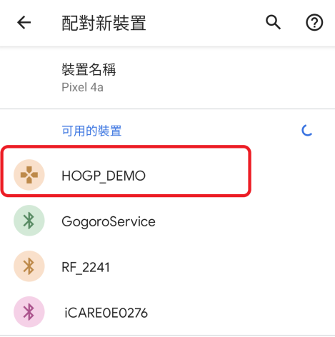

2. The pairing prompt depends on `IO_CAPABILITY_SETTING`:
   - **`DISPLAY_ONLY`** — the phone shows a fixed passkey to confirm (`654321`,
     `DEMO_HID_DISPLAY_PASSKEY`).
   - **`KEYBOARD_ONLY`** — the phone displays a random passkey; type that same value into the
     board's UART console when prompted (`Please enter passkey...`) to complete pairing.

   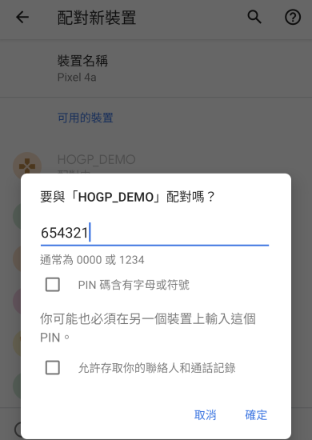 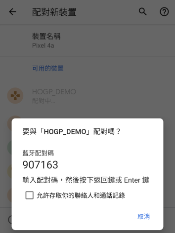 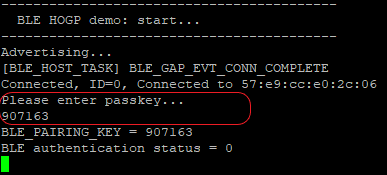

   Once paired, the phone lists `HOGP_DEMO` under its connected devices.

   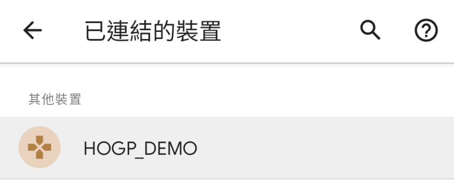

3. The mouse pointer should move in a slow diamond pattern, with the volume control activating
   each time it reaches the top; opening a text field (e.g. a search box) shows `HOGP_keyboard`
   repeating keys `a`–`z`, `1`–`9`.

   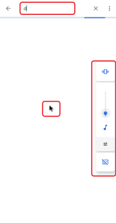 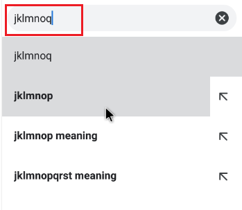

4. Turning the phone's Bluetooth off/on reconnects automatically — bonding is enabled, so the
   security key is stored in MCU flash.

### 2.4 periph-data-rate — Throughput Test (Peripheral)

Path: `examples/bluetooth-le/peripheral/periph-data-rate/`. Measures BLE throughput using the
TRSP service as a transport, either against the `central-data-rate` demo or a compatible mobile
app.

**BLE Services:** GAP, GATT, DIS, TRSPS (same combination as `periph-trsp`).

**Command protocol** — plain-text identifier strings written to the TRSPS `UDATRW01`
characteristic select the test mode:

| Identifier | Direction | Meaning |
|---|---|---|
| `set_param=<phy>,<packet_len>,<conn_int_min>,<conn_int_max>` | central → device | Set preferred PHY, packet data length, and connection interval range. |
| `get_param` | central → device | Request current parameters; device replies (read response) with a CSV string: `phy,packet_data_len,mtu_size,conn_interval,conn_latency,conn_supervision_timeout`. |
| `pRxtest<total_length>` | central → device | Start a peripheral-RX test: device measures how fast it receives `total_length` bytes. |
| `pTxtest<total_length>` | central → device | Start a peripheral-TX test: device streams `total_length` bytes to the central. |
| `canceltest` | central → device | Cancel the current test. |
| `connLatencytest0` | central → device | Force connection latency to 0 for the duration of the test. |

Each identifier is written to `UDATRW01` and routed by `ble_svcs_trsps_evt_handler()` to
`trsps_write_cmd_handler()`, which dispatches on the link's current test state:

```c
static void trsps_write_cmd_handler(uint8_t host_id, uint8_t length, uint8_t *data)
{
    uint32_t dataLen;

    if (CHECK_STR(data, CANCEL_TEST_STR))
    {
        // cancel the test
        ble_app_link_info[host_id].state = STATE_TEST_STANDBY;
        hosal_timer_stop(APP_HW_TIMER_ID);
        printf("Cancel Test.\n");
    }

    if (ble_app_link_info[host_id].state == STATE_TEST_STANDBY)
    {
        if (CHECK_STR(data, PRX_TEST_STR))
        {
            hosal_timer_tick_config_t tick_cfg;

            // start device RX test
            ble_app_link_info[host_id].state = STATE_TEST_RXING;
            g_time_ms = 0;
            g_curr_rx_length = 0;

            tick_cfg.timeload_ticks = APP_TIMER_MS_TO_TICK(1);
            tick_cfg.timeout_ticks = 0;
            hosal_timer_start(APP_HW_TIMER_ID, tick_cfg);

            // total test length follows the test string, e.g. "pRxtest1024"
            data[length] = 0;
            sscanf((char *)(data + strlen(PRX_TEST_STR)), "%d", &dataLen);
            g_test_length = dataLen;
        }
        else if (CHECK_STR(data, PTX_TEST_STR))
        {
            // start device TX test
            ble_app_link_info[host_id].state = STATE_TEST_TXING;
            g_curr_tx_lenght = 0;

            data[length] = 0;
            sscanf((char *)(data + strlen(PTX_TEST_STR)), "%d", &dataLen);
            g_test_length = dataLen;

            ble_app_request_set(host_id, APP_REQUEST_TX_TEST, false);
        }
        else if (CHECK_STR(data, SET_PARAM_STR))
        {
            // "set_param=<phy>,<packet_len>,<conn_int_min>,<conn_int_max>"
            data[length] = 0;
            sscanf((char *)data, "set_param=%u,%u,%u,%u", &g_temp_test_param.phy,
                   &g_temp_test_param.packet_data_len,
                   &g_temp_test_param.conn_interval_min,
                   &g_temp_test_param.conn_interval_max);
            ble_app_request_set(host_id, APP_REQUEST_TEST_PARAM_SET, false);
        }
        else if (CHECK_STR(data, GET_PARAM_STR))
        {
            ble_app_request_set(host_id, APP_REQUEST_TEST_PARAM_GET, false);
        }
        else if (CHECK_STR(data, SET_LATENCY_STR))
        {
            if (g_curr_test_param.conn_latency != 0)
                ble_app_request_set(host_id, APP_REQUEST_LATENCY_0_SET, false);
        }
    }
    else if (ble_app_link_info[host_id].state == STATE_TEST_RXING)
    {
        g_curr_rx_length += length;    // every subsequent write while RXing is just test payload

        if (g_curr_rx_length >= g_test_length)    // RX test done
        {
            double throughput;

            hosal_timer_stop(APP_HW_TIMER_ID);
            ble_app_link_info[host_id].state = STATE_TEST_STANDBY;
            throughput = (double)(g_test_length << 3) / (double)g_time_ms;

            printf("Stop RX\n");
            printf("Total Rx Received Time: %d ms\n", g_time_ms);
            printf("Total Rx Received %d Bytes\n", g_test_length);
            printf("Rx Through: %.3f bps\n", throughput * 1000);
        }
    }
}
```

While `STATE_TEST_STANDBY`, an incoming write is matched against the identifier strings above.
Once RXing, every subsequent write is instead treated as raw test payload and just counted — a
1ms hardware timer (`APP_HW_TIMER_ID`) tracks elapsed time (`g_time_ms`) until `g_curr_rx_length`
reaches `g_test_length`, at which point throughput is computed as `(bytes << 3) / ms` (bits per
ms) and printed as bps. The TX side streams `packet_data_len`-sized notifications from the
`APP_REQUEST_TX_TEST` handler until `g_test_length` bytes are sent.

**Testing:** the device advertises as **`DATA_RATE`** (`DEVICE_NAME` in `main.c`). Either pair this
demo with the `central-data-rate` example (see
[3.2](#32-central-data-rate--throughput-test-central)) and drive the test from its UART command
console, or use the "Rafael BLE" mobile app's Throughput test page:

1. Open the app, tap **START SCANNING**, find the device advertising as `DATA_RATE`, connect, then
   enter its application list and choose **RAFAEL TRSPX**.

   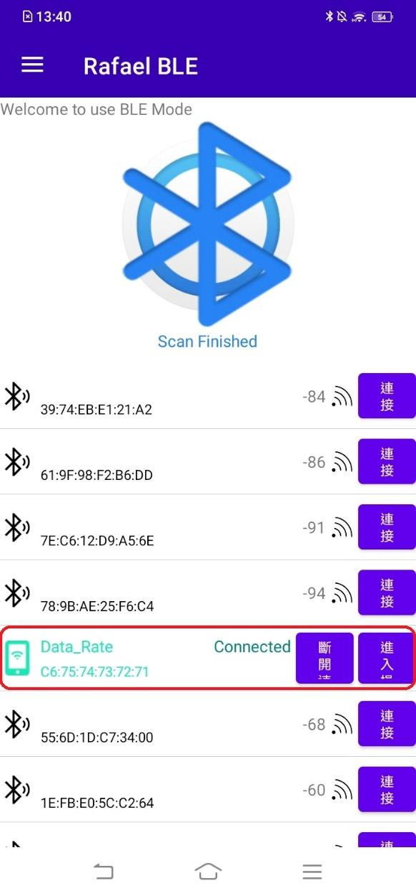 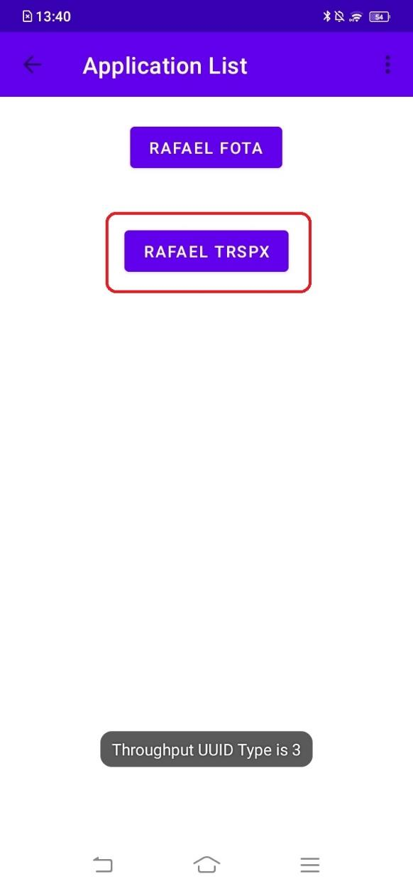

2. **General setting** — tap the "⋮" menu in the Throughput page's top-right corner, then **Set
   initial preferred PHY** (TX PHY must equal RX PHY) and **Set connection interval**
   (`CONNECTION_BALANCED` 30–50ms, `CONNECTION_HIGH` 11.25–15ms, `CONNECTION_LOW_POWER`
   100–125ms, or `Fastest` 7.5ms).

   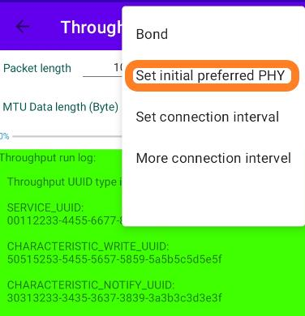 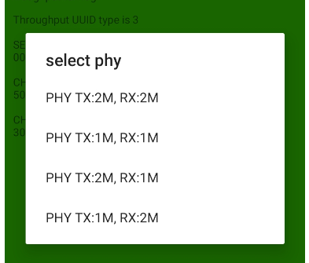 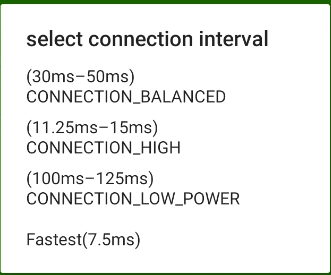

3. **Demo setting** — set **Packet length** (total bytes to transfer over the test, default
   1048712) and **MTU Data length (Byte)** (per-packet payload, 20–244, default 244; ATT MTU is
   set to this value + 3 bytes of header), then choose the direction with **pls sel**: `aT-dR`
   (App → Device) or `aR-dT` (Device → App).

   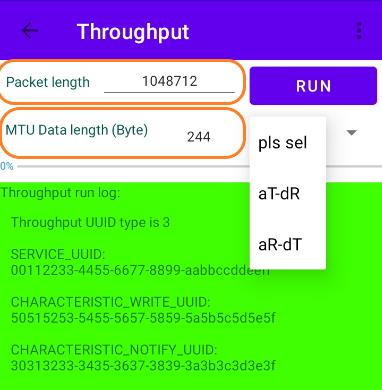 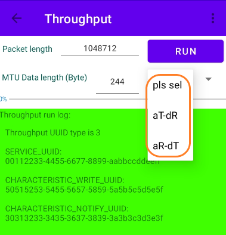

Tap **RUN** to start the test and watch the throughput log.

### 2.5 periph-esl — Electronic Shelf Label

Path: `examples/bluetooth-le/peripheral/periph-esl/`. Available chip variants: RF1301, RT584H,
RT584HA4, RT584L only (not RT581/RT582/RT583, which lack the PAwR/encrypted-advertising support
this demo needs). Drives a black/white/red (BWR) e-paper display; the panel driver lives in
`periph-esl/periph-esl/src/epd_driver.c`.

**BLE Services:** GAP, GATT, DIS, ESLS (Electronic Shelf Label Service), OTS (Object Transfer
Service, used for image blob downloads), FOTAS (proprietary firmware-over-the-air service) —
`ATT_GAPS_SERVICE, ATT_GATTS_SERVICE, ATT_DIS_SERVICE, ATT_ESLS_SERVICE, ATT_OTS_SERVICE,
ATT_FOTAS_SERVICE`.

**How ESL commands arrive — this is not a simple GATT write.** After initial provisioning by an
ESL Access Point (see [3.3](#33-central-esl-ap--esl-access-point)), the tag receives its periodic
advertising sync info over the connection (`BLE_PADV_EVT_PADV_SYNC_TRANSFER_RECEIVED_V2`), selects
its subevent (`ble_cmd_periodic_sync_subevent_set()`), enables periodic-adv reception
(`ble_cmd_periodic_adv_receive_enable()`), and **terminates the GATT connection** — from then on it
just listens to periodic advertising broadcasts. Each `BLE_PADV_EVT_PADV_REPORT_V2` is scanned for
an `GAP_AD_TYPE_ENCRYPTED_ADVERTISING_DATA` AD structure, decrypted with AES-CCM using the
provisioned sync key, and passed to `app_esl_cmd_parsing()`, which switches on the command opcode
(from `components/network/bluetooth/ble-host/ble-service/esls/include/ble_service_esls.h`):

```c
ESL_CMD_PING, ESL_CMD_UNASSOCIATE_FROM_AP, ESL_CMD_SERVICE_RESET, ESL_CMD_FACTORY_RESET,
ESL_CMD_UPDATE_COMPLETE, ESL_CMD_READ_SENSOR_DATA, ESL_CMD_REFRESH_DISPLAY,
ESL_CMD_DISPLAY_IMAGE, ESL_CMD_DISPLAY_TIMED_IMAGE, ESL_CMD_LED_CONTROL, ESL_CMD_LED_TIMED_CONTROL
```

LED commands drive a GPIO directly; display commands trigger `esl_epd_image_process()` against
image data staged in flash (received separately over OTS); sensor-read returns sample sensor
data; factory reset triggers a software reset. Any response is AES-CCM re-encrypted and scheduled
into the next periodic-adv response slot via `ble_cmd_periodic_adv_rsp_data_set()` — responses go
out over encrypted periodic advertising, not a GATT notification.

Firmware updates go through the FOTAS characteristics (`ble_fota_data()`/`ble_fota_cmd()`), driven
by a periodic FOTA timer.

**Testing:** this demo must be tested together with `central-esl-ap` — see
[3.3](#33-central-esl-ap--esl-access-point) for the full provisioning/testing flow. Before it is
provisioned, the tag advertises connectably as **`ESL_DEMO`** (`DEVICE_NAME` in `main.c`), which is
what `central-esl-ap` scans for when configuring unassociated tags onto the network.

---

## 3. BLE Central Demo Applications

Path: [`examples/bluetooth-le/central/`](../../examples/bluetooth-le/central/).

### 3.1 central-trsp — Transparent Service

Path: `examples/bluetooth-le/central/central-trsp/`. The central-role counterpart to
`periph-trsp`, bridging a UART link to a TRSP peripheral over BLE.

**GATT client services:** GAPS, GATTS, DIS, TRSPS (same set as the peripheral side).
`link0_svcs_handles_get()` fetches all four services' client handles on
`BLE_ATT_GATT_EVT_DB_PARSE_COMPLETE`.

**Scan and connect:** scanning filters advertisement reports for the local name `"TRSP_DEMO"`; on
a match it stops scanning and calls `ble_cmd_conn_create()`. After the GATT database is parsed,
`svcs_trspc_multi_cmd_handler()` runs a fixed post-connect sequence: MTU exchange → data-length
update → enable TRSPS notify CCCD → enable GATT "service changed" indicate CCCD → read DIS
manufacturer name → read DIS firmware revision.

**UART → BLE:** UART RX is buffered by `uart_data_handler()` exactly like `periph-trsp` — bytes
accumulate until the MTU limit or a `\n`/`\r`, then `trsp_data_send_from_isr()` queues
`APP_REQUEST_TRSPC_DATA_SEND`:

```c
static bool uart_data_handler(char ch)
{
    bool status = false;
    static uint8_t rx_buffer[DEFAULT_MTU];
    static uint8_t index = 0;

    rx_buffer[index++] = ch;

    if (index >= (g_trsp_mtu - 3)) // 3 bytes header
    {
        trsp_data_send_from_isr(rx_buffer, index);
        index = 0;
    }
    else if ((ch == '\n') || (ch == '\r'))
    {
        trsp_data_send_from_isr(rx_buffer, (index - 1)); // (-1) removed '\n' or '\r'
        index = 0;
        status = true;    // indicates the system can enable sleep mode
    }

    return status;
}

static void trsp_data_send_from_isr(uint8_t *p_data, uint8_t length)
{
    // if there is data pending, still send old data and skip new data
    if (g_data_send_pending == false)
    {
        g_rx_buffer_length[g_uart_index] = length;
        memcpy(&g_rx_buffer[g_uart_index][0], p_data, length);

        g_uart_index++;
        if (g_uart_index == UART_BUFF_DEPTH)
        {
            g_uart_index = 0;
        }
        // send queue to task_bla_app
        if (app_request_set(APP_TRSP_C_HOST_ID, APP_REQUEST_TRSPC_DATA_SEND, true) == false)
        {
            // No application queue buffer. Error.
        }
    }
}
```

The actual GATT write happens later on the application task, in the `APP_REQUEST_TRSPC_DATA_SEND`
handler:

```c
case APP_REQUEST_TRSPC_DATA_SEND:
    status = ble_svcs_trsps_client_send(host_id,
                                        BLE_TRSP_WRITE_TYPE,    // BLEGATT_WRITE_WITHOUT_RSP by default
                                        handles.hdl_udatrw01,
                                        &g_rx_buffer[g_uart_transmit_index][0],
                                        g_rx_buffer_length[g_uart_transmit_index]);

    if (status == BLE_ERR_OK)
    {
        g_data_send_pending = false;
        g_uart_transmit_index = (g_uart_transmit_index + 1) % UART_BUFF_DEPTH;
    }
    else
    {
        g_data_send_pending = true;
        app_request_set(host_id, APP_REQUEST_TRSPC_DATA_SEND, false);    // re-send
    }
    break;
```

**BLE → UART:** `ble_svcs_trsps_evt_handler()` handles TRSPS notify/indicate events from the
server and prints the payload straight to the console:

```c
static void ble_svcs_trsps_evt_handler(ble_evt_att_param_t *p_param)
{
    if (p_param->gatt_role == BLE_GATT_ROLE_CLIENT)
    {
        switch (p_param->event)
        {
        case BLESERVICE_TRSPS_UDATNI01_NOTIFY_EVENT:
        case BLESERVICE_TRSPS_UDATNI01_INDICATE_EVENT:
        {
            uint8_t *p_data;

            p_data = pvPortMalloc(p_param->length + 1);
            if (p_data != NULL)
            {
                memcpy(p_data, p_param->data, p_param->length);
                *(p_data + p_param->length) = '\0';
                printf("%s\n", p_data);
                vPortFree(p_data);
            }
        }
        break;

        default:
            break;
        }
    }
}
```

**Testing:** this demo has no advertising to select — it's the central, so it scans for and
auto-connects to a peer advertising as `"TRSP_DEMO"` (e.g. a `periph-trsp` board). Flash a
`periph-trsp` board and a `central-trsp` board and power both on; the central connects as soon as
it sees the peripheral's advertisement. Use `UART_BREAK_TOOL.exe` (see
[1](#1-building-and-running-a-demo)) on both boards' UART0 (115200 baud) — type on either board
and watch the data appear on the other.

### 3.2 central-data-rate — Throughput Test (Central)

Path: `examples/bluetooth-le/central/central-data-rate/`. Adds a `control-cmd/` UART text-console
module on top of the shared skeleton.

**GATT client services:** same GAPS/GATTS/DIS/TRSPS combination as `central-trsp`, with the same
`svcs_trspc_multi_cmd_handler()` post-connect sequence. The connection target address defaults to
a fixed value, overridable with the `tAddr` command below.

**UART command console** (table-driven in `control-cmd/include/ctrl_cmd.h`):

| Command | Description |
|---|---|
| `help` | List all supported commands. |
| `param` | Get the current data-rate test parameters (mac address, destination mac address, connection interval, PHY, packet size, test length, test mode). |
| `lAddr` | List the device's own MAC address. |
| `tAddr` | List/set the target MAC address. |
| `createCon` | Attempt to establish a connection with a data-rate peripheral. |
| `cancelCon` | Cancel an in-progress create-connection. |
| `disconnect` | Release the current connection. |
| `conEnc` | Enable BLE encryption for the test connection. |
| `conInt` | Set the connection interval. |
| `phy` | Set the PHY. |
| `dataLen` | Set the maximum packet data length for the test. |
| `testTxLen` | Set the total amount of data to transfer in the test. |
| `testMode` | Set test mode: transmit or receive. |
| `testStart` | Start the data-rate test. |
| `testStop` | Stop the data-rate test. |
| `channelmapSet` | Set the BLE channel classification. |
| `channelmapRead` | Read the BLE channel map. |

**Test protocol:** in TX mode, the central sends the peer a `pRxtest<len>` identifier, waits for
the peer's write-response ack, then streams fixed-size chunks with write-without-response until
`len` bytes are sent, printing progress every 5%. In RX mode, the central sends `pTxtest<len>` plus
a `set_param=...` string to sync PHY/data-length/interval, then counts incoming notifications with
a hardware-timer-based clock; once the target length is received it prints elapsed time, total
bytes, and computed throughput in bps.

**Testing:** power on a `periph-data-rate` board and a `central-data-rate` board, and connect to
the central's UART0 (115200 baud) with `UART_BREAK_TOOL.exe` (see
[1](#1-building-and-running-a-demo)). On boot, the central prints its role, local/target address,
and the full command list from the table above:

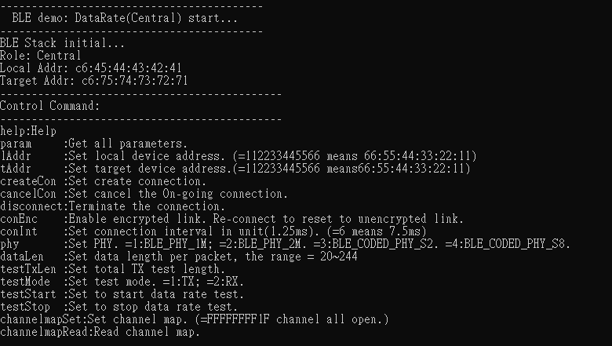

1. **Create connection:** confirm the target's MAC address (`tAddr` to change it), then
   `createCon`. The central performs MTU exchange, CCCD configuration, and reads the DIS
   manufacturer name/firmware revision:

   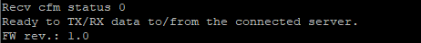

2. **Set test conditions:** use the parameter commands (`conInt`, `phy`, `dataLen`, `testTxLen`,
   `testMode`, ...) to configure the test.
3. **Start the test:** `testStart`. Once finished, the transmission rate is printed on the RX
   side:

   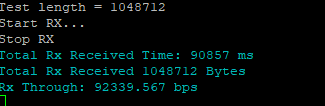

### 3.3 central-esl-ap — ESL Access Point

Path: `examples/bluetooth-le/central/central-esl-ap/`. Chip variants: RF1301, RT584H, RT584HA4,
RT584L only. Acts as the ESL network's Access Point: provisions ESL tags, transfers display images,
and issues LED/sensor commands over Periodic Advertising with Responses (PAwR).

**GATT client services:** GAPS, GATTS, DIS, ESLS, OTS, FOTAS.

**Two control surfaces**, both driving the same underlying helper functions in `main.c`:
1. A binary UART "gateway" protocol (`ble_esl_ap_cmd_handle.c` + `uart_handler.c`), framed as
   `Header(FF FC FC FF) | Length(2) | CommandID(1) | Parameters(N) | Checksum(1)` — meant for an
   external host/gateway tool.
2. An interactive text CLI (`cli/src/cli_cmd_ap.c`), enabled when the build defines
   `SUPPORT_DEBUG_CONSOLE_CLI=1`.

**Provisioning a new tag:** an unprovisioned tag advertises connectably with the ESL service UUID.
The AP scans, connects normally (CLI `connect`), and after GATT discovery runs a 15-step sequence:
MTU exchange, data-length update, ESLS/OTS/FOTAS CCCD subscriptions, reads of display/image/
sensor/LED capability handles, then opens an **L2CAP connection-oriented channel**
(`ble_cmd_l2cap_chan_connect()`, SPSM `0x0025`) used later for bulk image transfer. The CLI
`config [address]` command (or UART command `0x21`) then writes the tag's ESL address, an AP
sync key + nonce, an ESL response key + nonce, and the current absolute time — after which the
tag is "synchronized," starts listening on its assigned PAwR subevent, and normally stops
connectable advertising (see [2.5](#25-periph-esl--electronic-shelf-label)).

**Image storage assignment:** the CLI `updatei [idx] [bw/red]` command (or UART `0x22`/`0x23`)
selects the target image object over **OTS** (`OLCP_OPCODE_GO_TO`, then `OACP_OPCODE_WRITE` to
reserve the object length), then streams the actual image bytes over the L2CAP channel opened
during provisioning, with credit-based flow control.

**Enhanced create connection:** once a tag is synchronized (no longer normally connectable), the
AP reaches it through a *second* connection mechanism — CLI `padvconnect [addr] [esl_addr]` (or
UART `0x03`) calls `ble_cmd_extend_conn_create_v2()` with the tag's assigned PAwR `adv_handle` and
`subevent` (set to the tag's group id). This connects the AP to the tag through its PAwR subevent
rather than through normal scannable advertising; once connected this way, the same GATT/OTS/L2CAP
machinery from provisioning is reused for further image updates or FOTA.

**PAwR — LED control and sensor read:** starting the PAwR train (CLI `sync 1`) chains
`ble_cmd_extended_adv_parameter_set()` → `ble_cmd_adv_set_random_addr_set()` →
`ble_cmd_periodic_adv_parameter_set()` (interval, subevent count/interval, response-slot timing)
→ `ble_cmd_periodic_adv_enable_set()` → `ble_cmd_extended_adv_enable_set()`. LED control
(CLI `led [esl_addr] [on/off]`) and sensor-data read build an ESL Control Point command, AES-CCM
encrypt it, and schedule it into the correct subevent via
`ble_cmd_periodic_adv_subevent_data_set()`. Responses arrive as PAwR response-slot reports
(`BLE_PADV_EVT_PADV_RESPONSE_REPORT`), are decrypted, and dispatched by the same
`app_esl_rsp_data_parsing()` opcode switch used for connection-based responses (`ESL_RSP_ERROR`,
`ESL_RSP_LED_STATE`, `ESL_RSP_BASIC_STATE`, `ESL_RSP_DISPLAY_STATE`, `ESL_RSP_SENSOR_VALUE`, ...).
The CLI's group table lets you target one or multiple tags with a single LED or sensor-read
command.

**FOTA:** exposed only via the UART gateway protocol (no CLI command). The OTA control
sub-commands (query/start/erase/apply/...) are written to the FOTAS command characteristic; image
data is streamed to the FOTAS data characteristic. Because a synchronized tag is normally only
reachable through the PAwR-subevent connection, FOTA in practice runs over an enhanced connection.

**Testing:** flash `periph-esl` onto one or more tags and `central-esl-ap` onto the AP board. The
screenshots below use "ESL Tool" (a Windows GUI that drives the AP's UART binary gateway
protocol, connected to the AP's UART1) rather than the CLI, but the flow is the same either way.

**Preparation:** connect ESL Tool to the AP's UART1, then press **Start Ap** to enable PAwR.

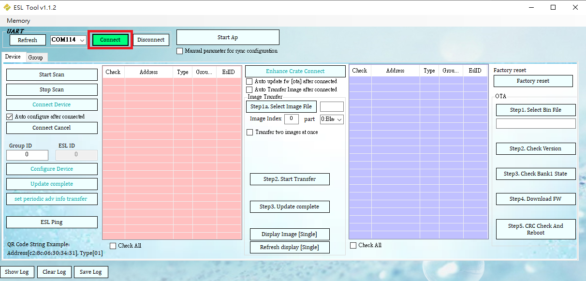

Once PAwR starts successfully, the AP's UART0 debug log (115200 baud) shows the periodic-adv
subevents going out:

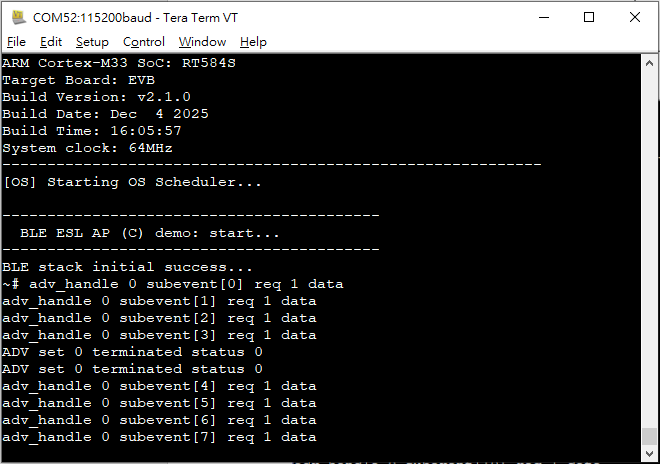

1. **Configure device:** scan to find un-synchronized tags and connect to configure them onto the
   network. Once joined, a tag moves to the joined list with an assigned Group/ESL ID:

   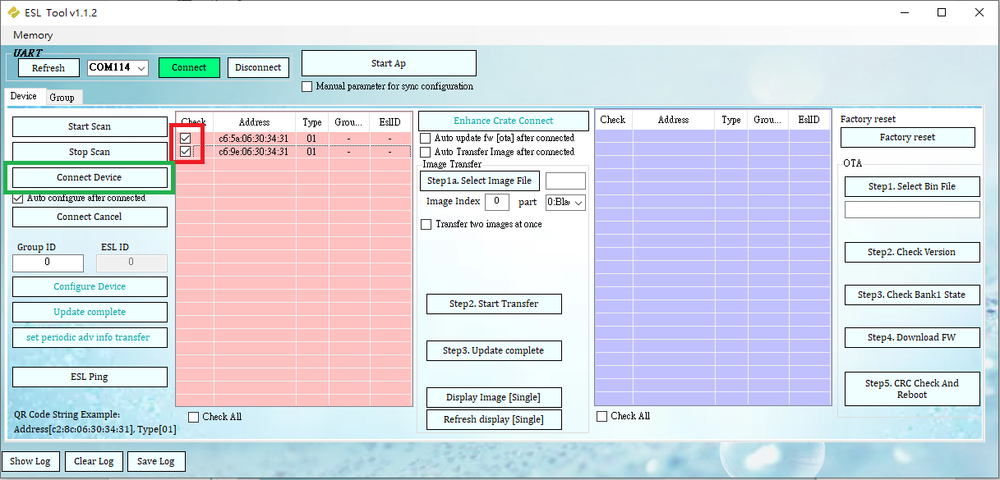

2. **Change image storage via enhanced create connection:** select a joined device and press
   **Enhance Crate Connect**; the button turns green once connected, and the selected image can
   then be transferred. ESL Tool sends "update complete" automatically to disconnect once the
   transfer finishes.

   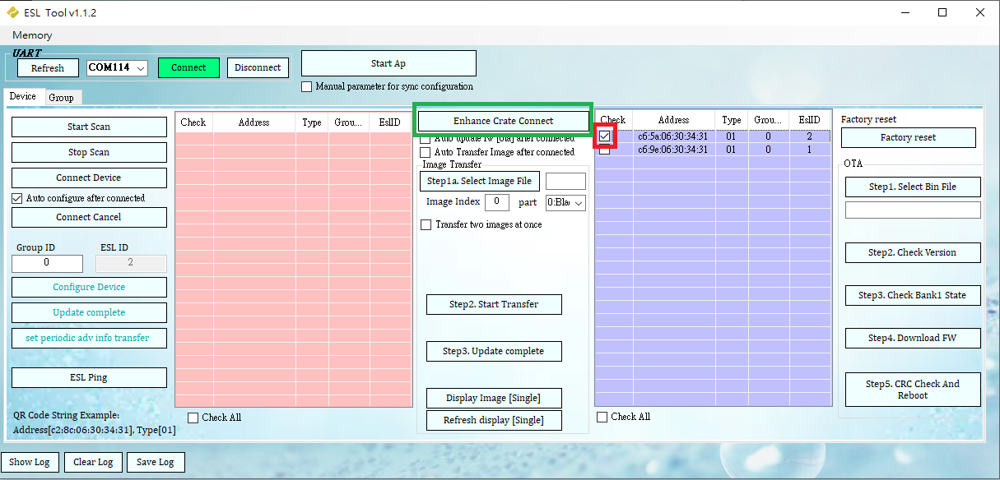
   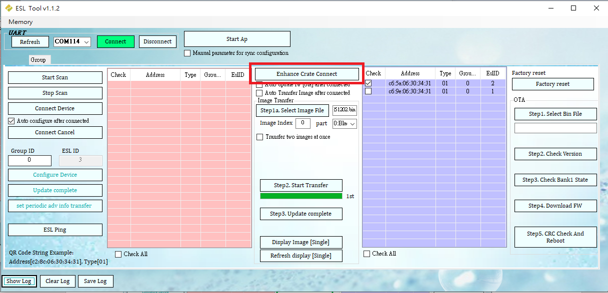

   Under the Group table, select one or multiple devices and use **Display Image** with an
   **Image Index** to change which stored image the tag shows:

   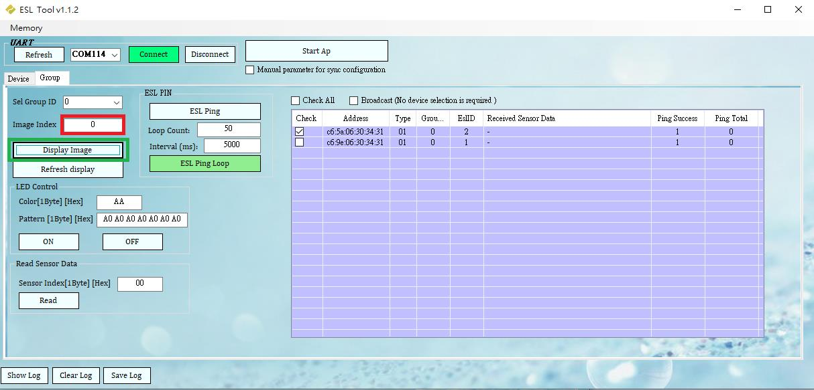

3. **LED control over PAwR:** under the Group table, select one or multiple tags and use **ON**/
   **OFF** to control their LEDs.

   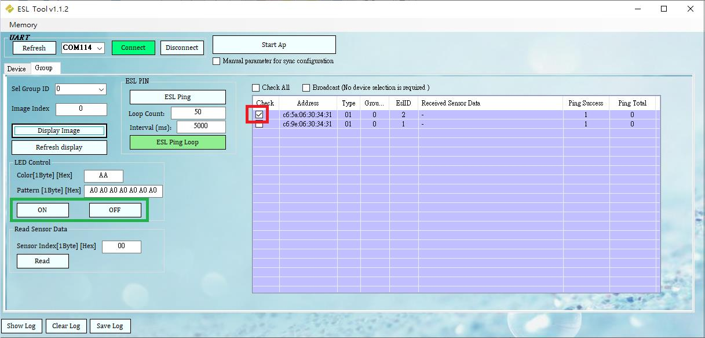

4. **Read sensor data over PAwR:** with a sensor index selected, **Read** returns each checked
   tag's value in the **Received Sensor Data** column.

   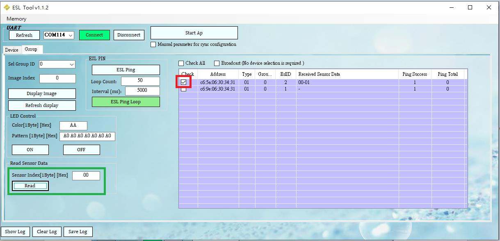

5. **Firmware OTA:** establishing the enhanced connection again (as in step 2) is required before
   the OTA panel's 5-step sequence — Select Bin File, Check Version, Check Bank1 State, Download
   FW, CRC Check And Reboot — can run.

   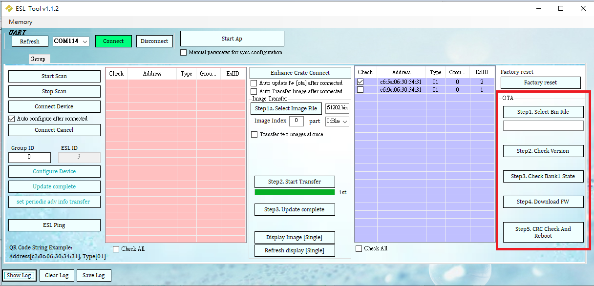

---

## 4. BLE Central + Peripheral Demo Application

### 4.1 multi-1c1p

Path: `examples/bluetooth-le/multi-link/multi-1c1p/`. Runs both a central role and a peripheral
role simultaneously on one device, each speaking TRSP — it can connect out to a TRSP peripheral
while also accepting a connection from some other TRSP central:

```
[periph-trsp]  <-- host id 0 -->  [multi-1c1p]  <-- host id 1 -->  [central-trsp]
                TRSPS(server) <-> TRSPS-C(client)      TRSPS-P(server) <-> TRSPS(client)
```

**Services and link roles:** one TRSP+GAPS+GATTS+DIS service combination is reused for both
links. `ble_profile_def.c` defines Link 0 as client-only and Link 1 as server-only;
`ble_profile_app.c`'s `ble_app_link_info[]` sets `.gap_role = BLE_GAP_ROLE_CENTRAL` for host id 0
and `.gap_role = BLE_GAP_ROLE_PERIPHERAL` for host id 1. Its own peripheral link advertises as
`"TRSP1C1P"`; its central link looks for a peer advertising as `"TRSP_DEMO"` (i.e. a
`periph-trsp`-style peripheral).

**UART command console** (`control-cmd/`, table-driven):

| Command | Description |
|---|---|
| `Help` | List all supported commands. |
| `Send=<host_id>,<len>,<data>` | Transmit data on the given link, e.g. `Send=0,5,12345`. |
| `EnAdv` | Enable advertising (targets the peripheral link, host id 1). |
| `DisAdv` | Disable advertising. |
| `EnScan` | Enable scanning (targets the central link, host id 0). |
| `DisScan` | Disable scanning. |
| `Disconnect=<host_id>` | Disconnect the given link. |

There is no explicit "connect" command: `EnScan` starts scanning, and the device auto-connects as
soon as it sees an advertiser whose local name matches `"TRSP_DEMO"`.

**Testing:** flash `multi-1c1p` alongside a `periph-trsp` board (for the central link) and, to
exercise the peripheral link, connect a phone or a `central-trsp` board.
1. **Scan & connect:** `EnScan` finds and auto-connects to the `periph-trsp` peer; the client runs
   the same MTU/CCCD/DIS handshake as `central-trsp`.
2. **Central-link data transfer:** use `Send=0,...` to transmit; incoming notifications from the
   peer print to the UART.
3. **Peripheral-link data transfer:** `EnAdv` to advertise as `"TRSP1C1P"`, connect from a phone's
   BLE scanner app, enable notify on the TRSP service, then use `Send=1,...` to send data to the
   phone and write from the phone to see it printed on the UART.

---

## 5. Other Demo Applications

Path: [`examples/bluetooth-le/others/`](../../examples/bluetooth-le/others/).

### 5.1 ibeacon

Path: `examples/bluetooth-le/others/ibeacon/`. A minimal non-connectable beacon transmitter
following Apple's iBeacon advertising format. There is no UART command interface and no Kconfig
options for the beacon's contents — everything is a hardcoded byte array in `adv_init()`
(`ibeacon/src/main.c`):

```c
uint8_t adv_data[] =
{
    0x02, GAP_AD_TYPE_FLAGS, 0x06,                  // LE General Discoverable Mode
    0x1A, GAP_AD_TYPE_MANUFACTURER_SPECIFIC_DATA,   // Manufacturer data length, Type
    0x4C, 0x00,                                     // 0x004C: Apple, Inc.
    0x02,                                           // iBeacon advertisement indicator
    0x15,                                           // Data length
    0x01, 0x02, 0x03, 0x04, 0x05, 0x06, 0x07, 0x08, // Proximity UUID part 1
    0x09, 0x10, 0x11, 0x12, 0x13, 0x14, 0x15, 0x16, // Proximity UUID part 2
    0x00, 0x11,                                     // Major ID
    0x00, 0x22,                                     // Minor ID
    0xD8,                                           // Measured TX Power (-40dBm: 256-40=0xD8)
};
```

Advertising is `ADV_TYPE_ADV_NONCONN_IND` (non-connectable) at a 100ms interval — nothing can
connect to this device; it broadcasts forever after boot. To customize the UUID/major/minor/TX
power, edit this array directly and rebuild.

**Testing:** flash the board and use any iBeacon-aware scanner app (e.g. a generic BLE scanner or
a dedicated beacon-locator app) to observe the advertised UUID/major/minor and estimated distance.

### 5.2 at-command

Path: `examples/bluetooth-le/others/at-command/`. Exposes most of the BLE command API as a UART
AT-command console, useful both as an interactive test tool and as a reference for how to call
the underlying `ble_cmd_*` APIs.

> A second, related demo, `examples/bluetooth-le/others/script-test/`, contains a similar but
> **not identical** AT-command engine (more test/diagnostic-oriented commands, some differing
> parameter counts on shared commands like `+CRCON`). It is a separate command surface and is not
> covered here.

**Transport:** UART, 115200 baud, TX/RX on GPIO17/GPIO16, line-based via the shared CLI shell
registered with prefix `"AT+"`. Multiple commands can be chained on one line separated by `;`.

**Syntax:**
- `AT+CMD` — execute / set with no parameters
- `AT+CMD?` — read the current value
- `AT+CMD=<params>` — set with parameters (comma-separated)
- `AT+CMD=?` — print usage/help text for that command

**Responses:** `OK` on success; `ERROR <REASON>` on failure (e.g. `ERROR BUSY`, `ERROR
INVALID_PARAM`, `ERROR INVALID_STATE`, `ERROR INVALID_HOST_ID`, `ERROR INVALID_HANDLE`, `ERROR
CMD_NOT_SUPPORTED`). Asynchronous BLE stack events (connect, disconnect, adv reports, RSSI, MTU
exchange, PHY update, etc.) are printed as free-form human-readable lines from the application's
event handler — there is no formal `+EVENT:` prefix scheme.

`AT+HELP` prints every supported command with its one-line description, read live from the
command table (`ble-atcmd/src/atcmd_command_list.c`) — it is always in sync with the actual
firmware and is the best first command to run against real hardware.

The command table is organized into 9 groups, matching the source's folder layout:

Every command's exact parameter ranges below are copied from that command's own built-in help
text (`test_cmd()` in its source file under `ble-atcmd/src/command/`) — run `AT+<CMD>=?` against
real hardware to see the same text live.

**Other**

| Command | Description | Parameters |
|---|---|---|
| `+RFRST` | RF/SoC reset. | — |
| `+HELP` | Print the full command list. | — |
| `+ROLE?` | Read the role (central/peripheral) per host id. | — |
| `+ALLPARAM?` | Dump all cached BLE parameters (address, adv/scan params, adv data, scan response, connection params, MTU). | — |
| `+SLEEP` | Allow the device to sleep when idle. | — |
| `+WAKEUP` | Keep the device awake. | — |
| `+READFALS` | Read filter accept list size. | — |
| `+ADDFAL=<num>,<addr>` | Add a device to the filter accept list. | `num`: address type; `addr`: `XX:XX:XX:XX:XX:XX` |
| `+CLEARFAL` | Clear the filter accept list. | — |
| `+REMOVEFAL=<num>,<addr>` | Remove a device from the filter accept list. | same as `+ADDFAL` |

**Advertising**

| Command | Description | Parameters |
|---|---|---|
| `+ENADV` | Enable advertising. Always targets host id 1 (peripheral role). | — |
| `+DISADV` | Disable advertising. | — |
| `+ADVINT?` / `+ADVINT=<min>,<max>` | Get/set advertising interval. | `min`,`max`: **32–16384** (× 0.625ms each); `min` < `max` |
| `+ADVCHMAP?` / `+ADVCHMAP=<num>` | Get/set advertising channel map. | `num`: **0–7** bitmap (bit0=ch37, bit1=ch38, bit2=ch39) |
| `+ADVTYPE?` / `+ADVTYPE=<num>[,<addr_type>,<addr>]` | Get/set advertising type; the directed form (`<num>`=1) also takes a target address. | `num`: **0–3** (0=connectable+scannable undirected, 1=connectable directed, 2=scannable undirected, 3=non-connectable undirected); `addr_type`: 0=public/1=random; `addr`: `XX:XX:XX:XX:XX:XX` |
| `+ADVDATA?` / `+ADVDATA=<hex>` | Get/set advertising data. | `hex`: colon-separated AD-structure bytes; first byte of each AD structure is its length, **0x00–0x1F** |
| `+SCANRSP?` / `+SCANRSP=<hex>` | Get/set scan response data. | same hex format as `+ADVDATA` |

**Connect**

| Command | Description | Parameters |
|---|---|---|
| `+DISCON=<host_id>` | Disconnect the given link. | `host_id`: **0–1** |
| `+CONINT?` / `+CONINT=<host_id>,<min>,<max>` | Get/set connection interval. | `host_id`: 0–1; `min`,`max`: **6–3200** (× 1.25ms); `min` < `max` |
| `+CONLAT?` / `+CONLAT=<host_id>,<latency>` | Get/set connection latency. | `host_id`: 0–1; `latency`: **0–499** |
| `+CONSUPTMO?` / `+CONSUPTMO=<host_id>,<timeout>` | Get/set supervision timeout. | `host_id`: 0–1; `timeout`: **10–3200** (× 10ms) |
| `+CONPARAM?` / `+CONPARAM=<host_id>,<min>,<max>,<latency>,<timeout>` | Get/set all connection parameters at once. | `host_id`: 0–1; `min`,`max`: 6–3200; `latency`: 0–499; `timeout`: 10–3200 |

All four interval/latency/timeout commands share one constraint from their help text:
`supervision_timeout × 4 > conn_interval_max × (1 + latency)`.

**Scanning**

| Command | Description | Parameters |
|---|---|---|
| `+ENSCAN` | Enable scanning. | — |
| `+DISSCAN` | Disable scanning. | — |
| `+SCANTYPE?` / `+SCANTYPE=<num>` | Get/set scan type. | `num`: 0=passive, 1=active |
| `+SCANINT?` / `+SCANINT=<num>` | Get/set scan interval. | `num`: **4–16384** (× 0.625ms) |
| `+SCANWIN?` / `+SCANWIN=<num>` | Get/set scan window. | `num`: **4–16384** (× 0.625ms) |

**Address**

| Command | Description | Parameters |
|---|---|---|
| `+DEVADDR?` / `+DEVADDR=<addr>` | Get/set the device's own address. | `addr`: `XX:XX:XX:XX:XX:XX` (random addresses need `addr[5] >= 0xC0`) |
| `+DEVADDRTYPE?` / `+DEVADDRTYPE=<num>` | Get/set the device's own address type. | `num`: 0=public, 1=random |
| `+DADDR?` / `+DADDR=<addr>` / `+DADDR=<num>,<addr>` | Get/set the default target address used by `+CRCON`. | `num`: address type; `addr`: `XX:XX:XX:XX:XX:XX` |

**Connect_Other**

| Command | Description | Parameters |
|---|---|---|
| `+SBOND` / `+SBOND=<num>` | Set the BLE bonding flag. | `num`: flag (no range published in the command's own help text) |
| `+PLDATALEN=<host_id>,<octets>` | Set the max TX payload octets for a link. | `host_id`: 0–1; `octets`: **27–251** |
| `+IBOND` | Initialize BLE bonding info/storage. | — |
| `+PHY?` / `+PHY=<host_id>,<tx_phy>,<rx_phy>,<coded_option>` | Get/set the PHY. | `host_id`: 0–1; `tx_phy`,`rx_phy`: 1=1M, 2=2M, 4=Coded; `coded_option` (only used when TX/RX=4): 0=no-preference, 1=S2, 2=S8 |
| `+PREPLDATALEN?` / `+PREPLDATALEN=<octets>` | Get/set the preferred TX payload length. | `octets`: **27–251** |
| `+PFMTUS=<host_id>,<mtu>` | Set preferred MTU size. | `host_id`: 0–1; `mtu`: **23–247** |
| `+RMTUS=<host_id>` | Read MTU size. | `host_id`: 0–1 |
| `+READPHY=<host_id>` | Read the current PHY. | `host_id`: 0–1 |
| `+RSCCCD=<host_id>` | Restore last-bond CCCD state after reconnect. | `host_id`: 0–1 |
| `+READRSSI=<host_id>` | Read RSSI. | `host_id`: 0–1 |
| `+SEC` / `+SEC=<host_id>` | Send a security request. | `host_id`: 0–1 |

**Master** (GATT client operations)

| Command | Description | Parameters |
|---|---|---|
| `+EXMTUS=<host_id>,<mtu>` | Exchange MTU with the server. | `host_id`: 0–1; `mtu`: **23–247** |
| `+READ=<host_id>,<handle>` | Read a characteristic value. | `host_id`: 0–1; `handle`: **0–65535** |
| `+WRITE=<host_id>,<handle>,<len>,<data>` | Write a value (with response). | `host_id`: 0–1; `handle`: 0–65535; `len`: **0–244** (must be ≤ MTU size − 3) |
| `+WRITENRSP=<host_id>,<handle>,<len>,<data>` | Write a value (without response). | same as `+WRITE` |
| `+READCCCD=<host_id>,<handle>` | Read a CCCD. | `host_id`: 0–1; `handle`: 0–65535 |
| `+WRITECCCD=<host_id>,<handle>,<value>` | Write a CCCD. | `host_id`: **0–0** per this command's own help text (every other command in this group allows 0–1 — likely a documentation typo in the source rather than an intentional restriction); `handle`: 0–65535; `value`: 0=disable both, 1=notify only, 2=indicate only, 3=notify+indicate |

**Create_Connect**

| Command | Description | Parameters |
|---|---|---|
| `+CRCON=<addr_type>,<addr>` | Create a connection, e.g. `AT+CRCON=1,11:12:13:BB:BB:C4`. | `addr_type`: address type (0=public/1=random, no explicit range published); `addr`: `XX:XX:XX:XX:XX:XX` |
| `+CCCON` | Cancel an in-progress create-connection. | — |
| `+CCONINT?` / `+CCONINT=<min>,<max>` | Get/set the create-connection interval. | `min`,`max`: **6–3200** (× 1.25ms); `min` < `max` |
| `+CCONLAT?` / `+CCONLAT=<latency>` | Get/set the create-connection latency. | `latency`: **0–499** |
| `+CCONSUPTMO?` / `+CCONSUPTMO=<timeout>` | Get/set the create-connection supervision timeout. | `timeout`: **10–3200** (× 10ms) |

**Slave** (GATT server operations)

| Command | Description | Parameters |
|---|---|---|
| `+DEVAP=<num>` | Set GAP appearance. | `num`: **0–65535** |
| `+DEVNAME=<string>` | Set GAP device name. | `string`: length **1–30** |
| `+PCONPAR=<min>,<max>,<latency>,<timeout>` | Set GAP preferred connection parameters. | `min`,`max`: 6–3200; `latency`: 0–499; `timeout`: 10–3200 |
| `+NFY=<host_id>,<handle>,<len>,<data>` | Send a notification. | `host_id`: 0–1; `handle`: 0–65535; `len`: **0–244** (must be ≤ MTU size − 3) |
| `+IND=<host_id>,<handle>,<len>,<data>` | Send an indication. | same as `+NFY` |
| `+READRSP=<host_id>,<handle>,<len>,<data>` | Send a read response for a pending characteristic read. | same as `+NFY` |

**Known limitation:** the newer Extended/Periodic Advertising and L2CAP command groups
(`ble_extended_advertising.h`, `ble_l2cap.h` — see the User Guide's API reference) are not exposed
as AT commands in this demo; they remain reachable only through the C API directly.
