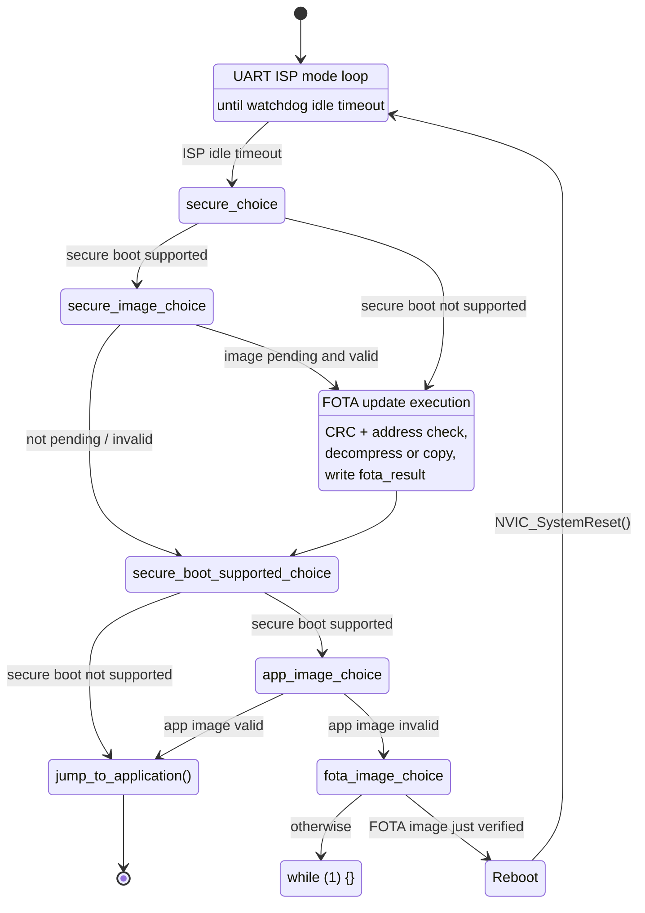

# RT58x Bootloader FOTA Guide

## Introduction

This document describes the RT58x/RT584 bootloader's FOTA (firmware
over-the-air) update flow: the memory layout it depends on, the shared
`fota_information_t` "Upgrade Information" struct a host uses to stage an
update, the bootloader's own boot/verify/update decision sequence, and the
UART ISP protocol it exposes for initial programming.

It is derived directly from the current source of
[`examples/bootloader-app/bootloader-app/`](../../examples/bootloader-app/bootloader-app/)
(`main.c`, `bootloader.c`, `isp.c`, `slip.c`, and their headers), plus the shared
`fota_information_t` definition in
[`components/common/fota/Include/fota_define.h`](../../components/common/fota/Include/fota_define.h).
It supersedes the flow-chart-only description previously derived from the PDF
guides, which did not match this implementation.

`bootloader-app` builds for six targets sharing one `main.c` (guarded by
`#ifdef CONFIG_<CHIP>_NONE_OS`): **RT582, RT583** (Cortex-M3) and **RT584H,
RT584HA4, RT584L, RF1301** (Cortex-M33). The two groups differ in memory layout
and in whether a legacy (pre-secure-boot) silicon revision exists.

## 1. Memory map

| | RT582 / RT583 | RF1301 / RT584H / RT584HA4 / RT584L |
|---|---|---|
| `BOOTLOADER_START_ADDRESS` | `0x00000000` | `0x10000000` |
| `BOOTLOADER_SIZE` | `0x8000` (32 KB) | `0x10000` (64 KB) |
| `FOTA_UPDATE_BANK_INFO_ADDRESS` (Upgrade Information Address) | `0x00007000` | `0x1000F000` |
| `APP_START_ADDRESS` | `0x00008000` | `0x10010000` |
| Secure-boot OTP/info page (`SECURE_BOOT_INFO_PAGE`) | `0x1000` | `0x1200` |

The staged-FOTA-image buffer address/size additionally depends on flash size,
since the buffer sits above the application partition:

| Chip | Flash | Compressed buffer | Size | Uncompressed buffer | Size |
|---|---|---|---|---|---|
| RT581 / RT582 | 1 MB | `0x00099000` | `0x57000` | `0x0007C000` | `0x74000` |
| RF1301 | 1 MB | `0x1009C000` | `0x54000` | `0x10080000` | `0x70000` |
| RT583 | 2 MB | `0x0012F000` | `0xB1000` | `0x000F4000` | `0xEC000` |
| RT584H / RT584L | 2 MB | `0x10132000` | `0xAE000` | `0x100F8000` | `0xE8000` |
| RT584HA4 | 4 MB | `0x10200000` | `0x1D0000` | `0x10200000` | `0x1D0000` |
| (default/other) | 512 KB | `0x0004F000` | `0x2B000` | `0x00041000` | `0x39000` |

## 2. `fota_information_t` (Upgrade Information)

The structure at `FOTA_UPDATE_BANK_INFO_ADDRESS` is defined once in
`fota_define.h` and shared by the host-side FOTA writer and the bootloader.
Offsets below are the actual compiled layout (4-byte fields aligned to 4
bytes; no `packed` attribute is used):

| Offset | Field | Type | Meaning |
|---|---|---|---|
| `0x00` | `status` | `uint32_t` | Bank programming status (`0` = programming, `1` = erase failed); not read by the bootloader |
| `0x04` | `fotabank_ready` | `uint32_t` | Set to `0xA55A6543` (`FOTA_IMAGE_READY`) by the host once the staged image is fully written |
| `0x08` | `fotabank_crc` | `uint32_t` | CRC32 of the staged image (`fotabank_startaddr`, `fotabank_datalen`) |
| `0x0C` | `fotabank_datalen` | `uint32_t` | Length of the staged image, in bytes |
| `0x10` | `fotabank_startaddr` | `uint32_t` | Flash address where the staged image was written |
| `0x14` | `target_startaddr` | `uint32_t` | Destination address for the final image; must be `>= APP_START_ADDRESS` |
| `0x18` | `fota_result` | `uint8_t` | Written by the bootloader after an update attempt. `0xFF` (erased flash) = not yet attempted, `0x00` = success, any other value = a `FOTA_RESULT_ERR_*` code (§4) |
| `0x19` | `fota_image_info` | `uint8_t` (bit field) | bit0 (`0x01`) = image is LZMA-compressed, bit1 (`0x02`) = image is signed |
| `0x1C` | `signature_len` | `uint32_t` | Only consulted when the image is compressed — see §3.2 |

### 2.1 Example values by mode

What a host is expected to write before setting `fotabank_ready`, for each
combination of the `fota_image_info` bits (`0x8000`/`APP_START_ADDRESS` below
stand for whatever this chip's `FOTA_UPDATE_BANK_INFO_ADDRESS`/
`APP_START_ADDRESS` actually are — §1):

| Mode | `fota_image_info` | `fotabank_crc` | `fotabank_datalen` | `fotabank_startaddr` | `target_startaddr` | `signature_len` |
|---|---|---|---|---|---|---|
| Normal (uncompressed, unsigned) | `0x00` | CRC32 of the staged image | staged image length | staged image address | `APP_START_ADDRESS` | N/A |
| Compressed | `0x01` | CRC32 of the staged (compressed) image | staged image length | staged image address | `APP_START_ADDRESS` | N/A |
| Signed (uncompressed) | `0x02` | CRC32 of the staged image | staged image length | staged image address | `APP_START_ADDRESS` | N/A |
| Compressed and signed | `0x03` | CRC32 of the staged image | staged image length | staged image address | `APP_START_ADDRESS` | compressed payload length alone (excludes the 0xFF pad and the 256-byte signature page, so it is always smaller than `fotabank_datalen`) |

`fotabank_ready` is always `0xA55A6543` in every mode — that's the value that
tells the bootloader an image is staged at all. `signature_len` is only ever
read by the bootloader in the "Compressed" and "Compressed and signed" modes
(see §3.2's `check_verify_size` derivation) — in the two uncompressed modes,
the equivalent size is instead read straight out of the plain image at
`fotabank_startaddr + 0x28`. In practice "Signed" and "Compressed and signed"
only apply to a build with secure boot enabled (§3.1) — that verification
path runs unconditionally whenever `fotabank_ready` is set on such a build,
so an unsigned image (`0x00`/`0x01`) staged there would simply fail ECDSA
verification rather than being treated as unsigned-and-fine.

## 3. Boot sequence (`main.c`)

This is a state machine, so it's drawn as a Mermaid state diagram rather than a
flowchart: each `<<choice>>` pseudostate is a branch point, and the
`Reboot -> ISPLoop` restart is just an ordinary back-transition — a real
`NVIC_SystemReset()` really does restart the MCU from its reset vector,
re-running the ISP loop and the whole sequence below it.

Note: in the actual code, `Update` is entered unconditionally and no-ops
internally when there's no valid pending image (it re-checks `fotabank_ready`
itself — see §3.3), and the app-signature recheck after `Update` always runs
when secure boot is supported regardless of what happened above. The diagram
keeps "secure boot supported?" and "is the image valid?" as separate,
visible decisions.

The `<<choice>>` boxes only carry a short edge label rather than the fuller
condition detail (exact field names, magic values, etc.) — that detail is in
§3.1–§3.4 below.

### 3.1 ISP loop, then boot decision

`bootloader_uart_init()` + `bootloader_run_loop()` run first and implement a
UART-based In-System-Programming mode (§5) driven by a watchdog
(`keep_alive_set(&g_keep_alive_init_cfg, 50)` in `bootloader.c`); once the
watchdog fires with no valid ISP traffic, the loop returns and the normal boot
logic below executes.

Only **RT582/RT583** builds gate secure boot on the silicon revision
(`IC_CHIP_REVISION_MASK < IC_CHIP_REVISION_MPB`): older revisions never attempt
secure boot at all. All builds then read the secure-info page and check for
`PK_MAGIC_PATTERN` (`0x72A34B50`); its absence also disables secure boot for
that boot. In both "no secure boot" cases `fota_check` is set true
unconditionally — an unsigned, unverified FOTA image will be applied.

### 3.2 FOTA image pre-verification (secure boot only)

When secure boot is enabled and `fotabank_ready` indicates a pending image, the
bootloader validates the **staged FOTA image itself** before flagging it
eligible for the update step:

- `check_verify_size` (how many bytes to hash/verify) comes from
  `signature_len` in the upgrade-information struct (offset `0x1C`) **if the
  image is compressed** — the size can't be read out of the image itself
  since it is still compressed at this point; otherwise it is read as a raw
  4-byte little-endian value at `fotabank_startaddr + 0x28` — the size field
  baked into the plain image by the signing tool.
- That size must be non-zero and below `fota_max_size` (derived from the
  detected flash size minus bootloader/MP-sector/page reservations), else
  `fota_result` records `VERIFY_SIZE_NOT_FOUND` / `IMAGE_SIZE`.
- A signature block is read from the next flash page boundary after the
  image. It must start with `SIG_MAGIC_PATTERN` (`0x58BF4E53`) and encode the
  same size, else `fota_result` records a mismatch error.
- The bootloader computes SHA-256 over the image and verifies an ECDSA-P256
  signature (`r`, `s` from the signature block) against the public key stored
  in the secure-info page. Only on success is the image marked eligible
  (`fota_check = true`); any failure writes the corresponding
  `FOTA_RESULT_ERR_*` code and the update step is skipped this boot.

### 3.3 FOTA update execution

This step runs whenever `fota_check` is true — whether because secure boot is
disabled (image applied without any signature check) or because §3.2 already
verified the image. It re-checks `fotabank_ready`, that `fota_result` is still
`0xFF` (so a completed/failed attempt is never repeated), the CRC32 of the
staged image, and that `target_startaddr` is not below `APP_START_ADDRESS`. If
`fota_image_info` bit0 is set, the image is LZMA-decompressed (64 KB
dictionary) directly into `target_startaddr`; otherwise it is erased and
copied byte-for-byte. The outcome is written back to `fota_result`.

### 3.4 Application verification and handoff

If secure boot is not supported, the bootloader jumps straight to
`APP_START_ADDRESS`. If it is supported, the bootloader re-runs the same
size/magic/ECDSA checks against the application image now sitting at
`APP_START_ADDRESS` (not the FOTA bank). Success (or secure boot being off)
leads to `jump_to_application()`. Failure triggers `NVIC_SystemReset()` — so a
freshly-applied-but-broken update gets one automatic retry pass — if a FOTA
image had just been verified this boot; otherwise the bootloader hangs in an
infinite loop rather than boot an unverified image.

## 4. `fota_result` codes

| Value | Macro | Meaning |
|---|---|---|
| `0x00` | `FOTA_RESULT_SUCCESS` | Update applied successfully |
| `0x01` | `FOTA_RESULT_ERR_VERIFY_SIZE_NOT_FOUND` | Could not determine the image's verify size |
| `0x02` | `FOTA_RESULT_ERR_IMAGE_SIZE` | Verify size is at/over the flash's maximum FOTA size |
| `0x03` | `FOTA_RESULT_ERR_SECURE_MAGIC_PATTERN_MISMATCH` | Signature block missing/wrong magic (`0x58BF4E53`) |
| `0x04` | `FOTA_RESULT_ERR_SECURE_VERIFY_SIZE_MISMATCH` | Signature block's recorded size disagrees with the computed verify size |
| `0x05` | `FOTA_RESULT_ERR_IMAGE_ECDSA_VERIFY_FAIL` | ECDSA-P256 signature check failed |
| `0x06` | `FOTA_RESULT_ERR_CHECK_IMAGE_CRC_FAIL` | `fotabank_crc` does not match the staged image |
| `0x07` | `FOTA_RESULT_ERR_TARGET_ADDR_IS_ILLEGAL` | `target_startaddr` is below `APP_START_ADDRESS` |
| `0x08` | `FOTA_RESULT_ERR_COMPRESS_DECODE_FAIL` | LZMA decode (or raw copy) failed |
| `0xFF` | *(erased flash default)* | No update has been attempted yet |

## 5. ISP (in-system programming) protocol

Before the boot logic in §3 runs, `bootloader_run_loop()` polls UART1/UART2
(2 Mbaud, interrupt-driven RX into a ring buffer) for a host programmer:

1. **Sync handshake** (`bootloader_isp_proc`, byte-at-a-time):
   - Host sends `0xAA` → bootloader replies four bytes of `0x55` (a "wake" probe).
   - Host sends `0x69` → bootloader kicks the watchdog and replies four bytes of `0x6A`.
   - Host sends `0xC0` → sync established, the watchdog is stopped (no further
     idle timeout), and the bootloader switches into the SLIP command loop.
2. **SLIP framing** (`slip.c`): packets are delimited by `0xC0`
   (`SLIP_DELIMITER`) and escape `0xC0`/`0xDB` bytes with `0xDB` + `0xDC`/`0xDD`
   (`SLIP_ESC` + `SLIP_ESC_DELIM`/`SLIP_ESC_ESC`), standard SLIP encoding.
3. **Command packet layout** (after SLIP decoding), all fields little-endian
   unless noted:

   | Bytes | Field | Notes |
   |---|---|---|
   | `[0]` | `0x52` | Fixed sync byte ('R') |
   | `[1]` | `seq` | Sequence number, echoed back in the response |
   | `[2..3]` | `length` | Big-endian; length of `command + option + payload` |
   | `[4]` | `checksum` | `~(byte1 + byte2 + byte3) & 0xFF` |
   | `[5]` | `command` | Opcode, see table below |
   | `[6]` | `option` | Command-specific |
   | `[7..]` | payload | `length - 2` bytes |
   | last 2 bytes | CRC16-CCITT | Big-endian, over the whole packet up to here |

   Flash-modifying commands (erase/write) are not executed inline: they are
   queued (`bootloader_flash_op_event_trigger`, a 64-entry pool of 256-byte
   buffers) and drained by `bootloader_check_flash_op_command()`, which is
   polled from inside the SLIP byte-receive loop so the flash operation
   overlaps with receiving the next packet.

   | Opcode | Name | Status |
   |---|---|---|
   | `0x02` | `ISP_WRITE_REG_CMD` | Implemented — direct 32-bit register write |
   | `0x04` | `ISP_READ_ID_CMD` | Implemented — returns `flash_get_deviceinfo()` |
   | `0x05` | `ISP_READ_STATUS_CMD` | Implemented — returns flash status register 1 or 2 |
   | `0x06` | `ISP_WRITE_STATUS_CMD` | Implemented (ack-only; shares handling with `0x0B`) |
   | `0x07` | `ISP_WRITE_BYTE_CMD` | Declared in the enum but **not handled** (falls to `default: break`) |
   | `0x08` | `ISP_ERASE_FLASH_CMD` | Implemented — queued as a flash op |
   | `0x09` | `ISP_WRITE_MEMORY_VERIFY_CMD` | Implemented — queued as a flash op (256-byte page write) |
   | `0x0A` | `ISP_WRITE_JUMP_FLASH_CMD` | Acks, but the actual jump/remap code is commented out — currently a no-op |
   | `0x0B` | `ISP_WRITE_SRAM_CMD` | Implemented (ack-only; shares handling with `0x06`) |
   | `0x0C` | `ISP_CHECK_CHIP_ID_CMD` | Implemented — returns a fixed 4-byte chip ID |
   | `0x0E` | `ISP_VERIFY_FLASH_CMD` | Declared in the enum but **not handled** |
   | `0x1A` | *(undocumented)* | Implemented — replies with 16 bytes of `0xFF` |

## 6. Source files

| File | Role |
|---|---|
| `main.c` | Entry point; secure-boot detection, FOTA verification/update, application handoff |
| `bootloader.c` / `bootloader.h` | UART driver glue, event queue, watchdog-gated ISP main loop |
| `isp.c` / `isp.h` | ISP command parsing/dispatch and response packet generation |
| `slip.c` / `slip.h` | SLIP encode/decode |
| `include/crc.h` | CRC16-CCITT table and helper (ISP packet integrity) |
| `include/project_config.h` | Board/peripheral feature switches for this example |
