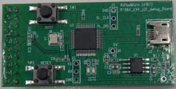

# Rafael-IoT-SDK Release Note

 

---

## 🆕 New Features

### RF MCU Firmware
- RT584H / RT584L (MAC | PCI, BLE, Multi-protocol) and RF1301 (MAC | PCI): FW updated from **v2.3.7** to **v2.4.0**
- RT582: rt569 FW updated to **v2.2.2** (Pure-MAC, Pure-BLE, Multi-protocol, MP FW)
- FW for SQC: scheduler changes reverted until the PDU issue is clarified
- System sleep notification between host and RF MCU (LPM)
- RF Sleep command for RF test

### Platform / Drivers
- OTA image signing support, with updated image-signing GUI
- Bootloader configuration for multiple devices
- New flash ioctl `HOSAL_FLASH_GET_END_ADDR`
- AES-CCM using RF radio (RF Radio version), with CCM performance comparison example
- Reduced power consumption by disabling unused peripherals
- User project support and JTAG speed adjustment for debug scripts

### BLE / BLE Mesh
- LESC debug mode API `ble_cmd_lesc_debug_mode_set`
- BLE Mesh library update (bearer ADV enable/disable state, adv timing, network transmit / relay count tuning)
- Transport layer retransmission parameters tuned for 377-byte data transmission
- Removed low power management mask/unmask calls from BLE host and Mesh

### Sub-G / Mesh-It-Up (MIU)
- MIU FSK 150K / 75K data rates and 868 MHz 250k channel spacing
- MIU ECDSA-P256 signed image support in OTA
- MIU tuned for 190-node Sub-G mesh (MLE and MAC)
- MIU TX power config and sniffer TX power / RX sensitivity
- MiuTool updated from V3.0 to V3.1 (mesh diagnostics topology view)

### Zigbee
- Zigbee OTA GUI tool with compressed / signed OTA image support
- Zigbee tool package split into `ota_upload_tool`, `smarthome_app` and `zigbee_gateway_pc_tool`

---

## 🛠️ Build System & Tools
- Self-detect prebuilt libraries (source build or prebuilt `.a` chosen at configure time)
- Strict include dependencies for SDK libraries, dead `#include` cleanup
- Build support for SDK paths containing spaces
- Rafael IoT extension v0.3.51 and extension user guide
- MP Tool (RT58x v1.11.3, RT584 v2.1.8), ISP tool update
- OpenOCD binaries (Windows / Linux / macOS) updated for the new RF1301 chip ID
- IOT Evaluation Tool, rf-labtest-tool and bootloader prebuilt binaries refreshed (new RT584L 10 dBm rf-labtest and RT583 bootloader)
- Fixed POST_BUILD comment (`\r\n`) breaking Ninja on Linux
- RT584HA4 image size limit changed to the flash controller limit (1984 KB)

---

## 🐞 Notable Fixes
- BLE bonding reconnect failure (LESC random value all zero)
- BLE host service parsed twice when bonding enabled
- L2CAP SDU reassembly error handling
- BLE Mesh scene store, configure model and lightness callback issues
- HCI command queue size margin
- Bootloader flash overwrite / over-erase and compressed-signed image size check
- Crypto API missing clock enable, FreeRTOS mutex error and curve25519 release
- AES-CCM length limit
- RT584 deep sleep (RF not entering deep sleep) and system tick before sleep
- RF MCU interrupt enable and low-power mode handling
- GPIO driver capture issue, RT58x PWM parameter error
- Zigbee gateway OTA timeout and OTA command
- MIU OTA download stall and OTA payload alignment
- MIU OTA bootinfo rebuilt before arming self-update (signature length read correctly)
- I2C slave data buffer now allocated with `pvPortMalloc`
- Zigbee event status values in `zigbee_platform.h`
- `partition.h` reserved RAM check supports weak symbol override

---

## 📖 Documentation
- FOTA guide, RF SubG user guide, Multi-Protocol application guide, Zigbee gateway command manual, Platform Getting Started, SDK Application Overview and SDK Quick Started converted from PDF to Markdown
- New Zigbee OTA guide
- New BLE example test pictures (data rate, ESL AP, HOGP)
- Rafael IoT SDK extension user guide and setup documentation

---

## 📡 Protocol Support  
- Bluetooth Low Energy (BLE)  
- Zigbee  
- Mesh Networking  
- Sub-G Wireless Communication  
---

## 🛠️ Developer Tools  
- Supports external debugging tools:  
  - **Rafael CMSIS-DAPLink**  
  - **SEGGER J-Link ICE**  

- Features:  
  - Firmware flashing  
  - Debugging  
  - Real-time trace  

📷 **Rafael CMSIS-DAP**  
  

---

