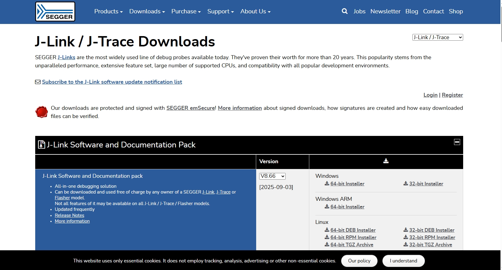
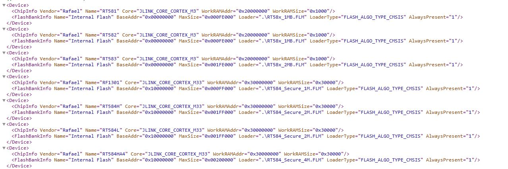

# J-Link Setup Guide

## Recommended Version

| Tool | Version | Notes |
|:-:|:-:|:-:|
| J-Link | v8.18 or later | Recommended, to flash MCU firmware |

## Download and Install J-Link

J-Link website: https://www.segger.com/downloads/jlink



### Installation steps

1. Run the installer.
2. Check **Install J-Link Software and Documentation**.
3. Set **Adjusting your PATH environment** to **Add J-Link to PATH**.
4. Keep all other options at their default value.
5. Click **Install**.

### Verify the installed version (Windows or Linux)

1. Open a terminal. On Windows, use Command Prompt. On Linux, use Terminal.
2. Run this command:

   ```
   JLinkExe
   ```

   The command prints this output:

   ```
   SEGGER J-Link Commander Vx.xx (Compiled Sep xx xx:xx:xx)
   ```

### Update JLinkDevices.xml

You have two ways to add the SDK's chip definitions to J-Link.

**Option A: Replace the file**

Copy the SDK's `JLinkDevices.xml` file over the existing J-Link file:

```
copy "<SDK_PATH>\tools\JLink\JLinkDevices.xml" "C:\Program Files (x86)\SEGGER\JLink\JLinkDevices.xml"
```

Warning: Check that the SDK's file already has the definitions for your other MCUs. If it does
not, this replacement removes J-Link support for those other devices.

**Option B: Merge the files by hand (recommended)**

This option keeps support for all your other MCUs.

1. Open the existing `JLinkDevices.xml` in a text editor.
2. Open `<SDK_PATH>\tools\JLink\JLinkDevices.xml` in a text editor.
3. Copy the `<Device>` entries for the RT58x and RT584 series from the SDK file.
4. Paste these entries inside the `<Database>` section of the existing file.
5. Save the file.

This keeps your other devices, and adds the RT58x and RT584 series definitions.



## Set the J-Link path in VS Code

1. Open your SDK folder.
2. Open the file `.vscode/settings.json`.
3. Add this setting:

```json
{
  "cortex-debug.JLinkGDBServerPath": "C:/Program Files/SEGGER/JLink/JLinkGDBServerCL.exe"
}
```
