# Windows WSL (Windows Subsystem for Linux) Setup

This guide sets up a faster build on Windows. It runs the toolchain inside WSL (Windows Subsystem
for Linux). VS Code itself stays on Windows. Do not install a separate copy of VS Code inside
WSL. VS Code's built-in **Remote - WSL** feature connects your Windows VS Code window to the
Ubuntu file system and shell. The Rafael extension then runs through this WSL connection.

First install VS Code on Windows. See step 1 of the [Setup guide](sdk_setup.md). Then do steps 3
and 4 of that guide here instead. Install the ARM toolchain and the Rafael extension inside WSL,
not on Windows.

## Windows version requirements

- Windows 10, version 2004 (Build 19041) or later
- Windows 11

## 1. Open Command Prompt

1. Press **Win + R**. This opens the Run dialog box.
2. Type `cmd` in the text field.
3. Press **Enter**, or click **OK**. The Command Prompt window opens.

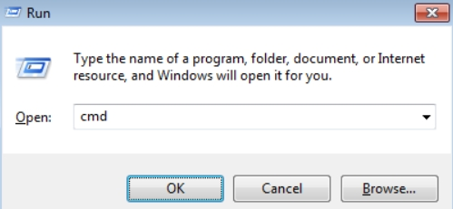

## 2. Check your WSL version

Run this command:

```
wsl --version
```

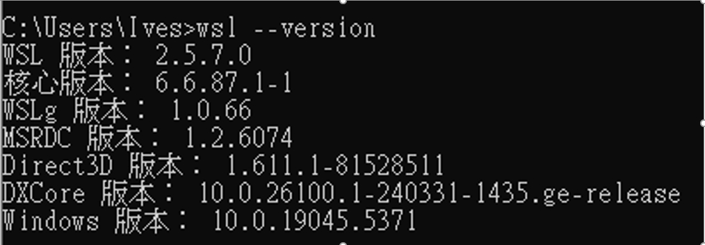

## 3. Install a Linux distribution

List the available distributions:

```
wsl --list --online
```

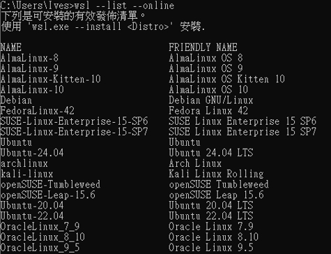

Install Ubuntu:

```
wsl --install -d Ubuntu-22.04
```


## 4. Install the WSL extension in VS Code

1. Click the Extensions icon.
2. Search for "WSL".
3. Install the WSL extension.

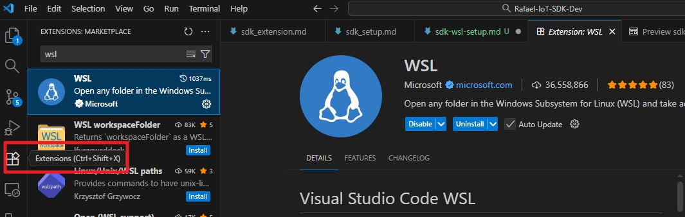
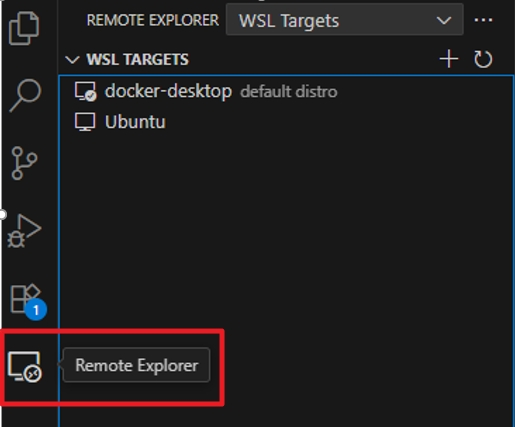

## 5. Open the SDK folder in WSL

1. Press **Ctrl+Shift+P**.
2. Select **WSL: Open Folder in WSL**.
3. Select the SDK folder.

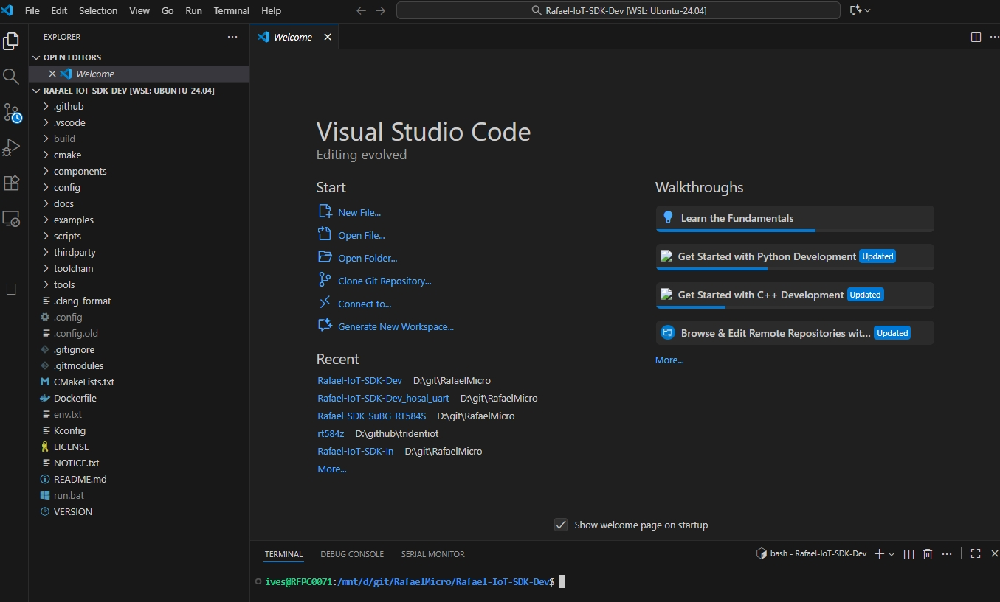

## 6. Install the Rafael extension

Run this command:

```sh
code --install-extension tools/rafael_extension/rafael-iot-<version>.vsix
```

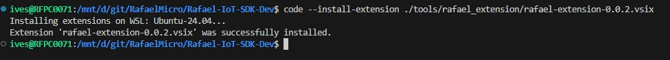

If you see an error message, run `sudo apt update`, then run the install command again.

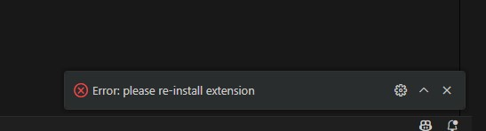

## 7. Install packages in Ubuntu

```sh
sudo apt update
sudo apt install -y python3 python3-pip
```

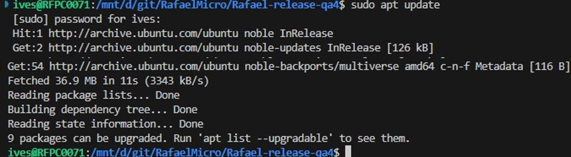

## 8. Install the ARM toolchain and add it to the PATH

WSL has its own PATH. This PATH is separate from the Windows PATH. If you install the toolchain
on the Windows side, it is not visible inside WSL.

Download the ARM GNU Toolchain, CMake, and Ninja. See
[toolchain/README.md](../../toolchain/README.md) for the download links. Install them inside
your WSL file system. Add each tool's `bin` directory to the PATH. For example, add it in
`~/.bashrc`.

To check the installation, run these commands:

```sh
arm-none-eabi-gcc --version
cmake --version
ninja --version
```

## 9. Optional: install Kconfig menuconfig support

This step is optional. It is only needed for the Kconfig editor's full `menuconfig` mode. A
simpler text mode works without it.

```sh
sudo apt install python3-tk python3-kconfiglib
```

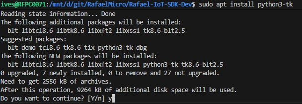
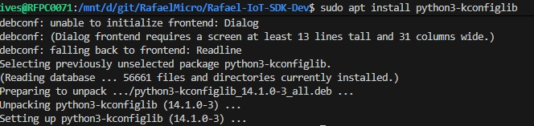

## Next step

See [Rafael Extension](sdk_extension.md) for how to build, flash, and debug.
