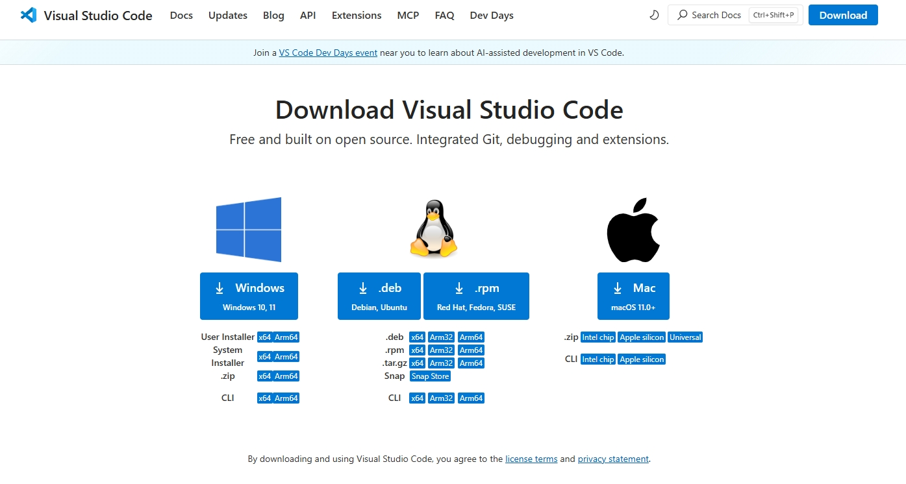
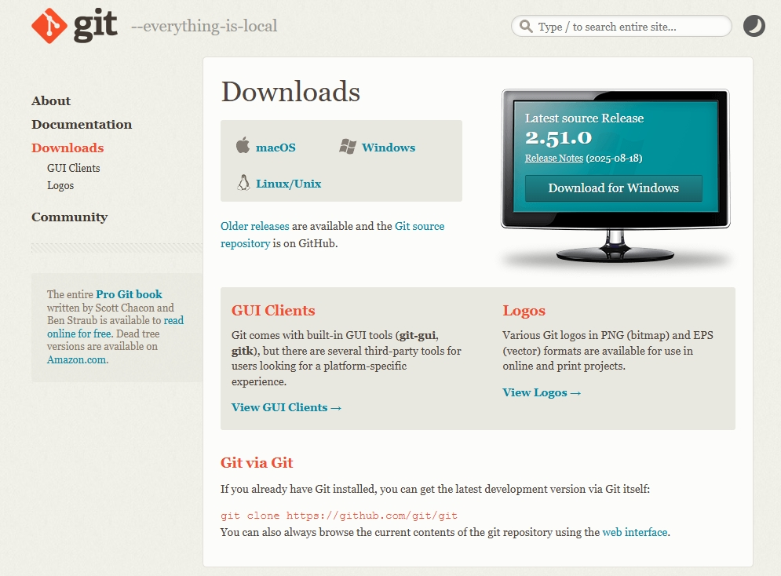
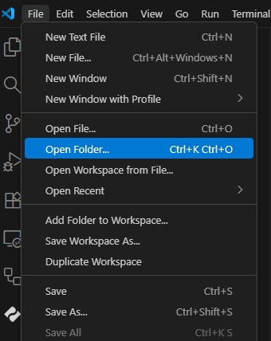
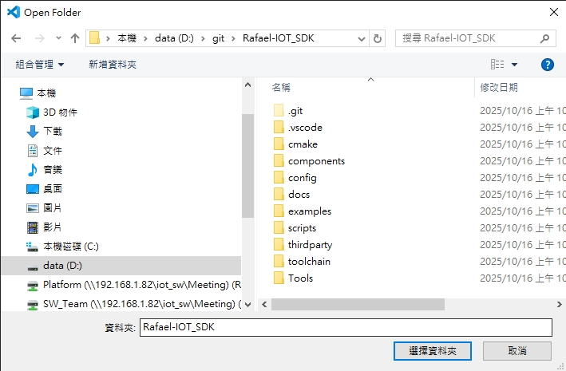

# Rafael IoT SDK
### Development Environment Setup Guide

Do the steps below one time. After that, use the Rafael VS Code extension to build, flash, and
debug. See [Rafael Extension](sdk_extension.md).

## What you install

| Tool | Version | Why |
|---|---|---|
| VS Code | 1.96 or later | The IDE the Rafael extension runs in |
| Git | 2.39 or later | To clone the SDK |
| ARM GNU Toolchain, CMake, Ninja | See [toolchain/README.md](../../toolchain/README.md) | Required. Put these tools on the PATH. You must download ARM GCC by hand. The Rafael extension can install CMake and Ninja for you. See step 3. |
| Python | 3.10 or later | Optional. Only needed for the Kconfig editor's full `menuconfig` mode. A simpler mode works without Python. |

## 1. Install VS Code

**Website:** https://code.visualstudio.com/

Download and run the installer for your operating system. Keep the default options. The default
options add VS Code to the PATH. You need VS Code on the PATH.



To check the installed version, run this command in a terminal:

```bash
code -v
```

## 2. Install Git and clone the SDK

**Website:** https://git-scm.com/downloads

Run the installer. Keep the default options.



Clone the SDK with this command:

```sh
git clone --recursive https://github.com/RafaelMicro/Rafael-IoT-SDK.git
```

If you already cloned without `--recursive`, run this instead:

```sh
git submodule update --init --recursive
```

## 3. Install the ARM toolchain and add it to the PATH

Install these tools in one permanent location on your machine, outside the SDK checkout. Put that
location on the PATH.

Older guidance told you to unzip the tools inside the SDK's own `toolchain/` folder. This meant
every fresh `git clone` needed a new copy of the tools. Install on the PATH instead. Then you set
up the tools once. Every SDK checkout you clone after that reuses the same install.

**ARM GCC** has no automatic installer. Download it by hand. See
[toolchain/README.md](../../toolchain/README.md) for the download link. Unzip it to a permanent
folder, not inside the SDK folder. Add its `bin` directory to the PATH.

**CMake and Ninja** have two install methods. You can download them by hand, the same way as ARM
GCC. Or you can install the Rafael extension first (step 4 below), then run **Rafael: Install /
Manage Toolchain**. This command installs both tools through your system's package manager:
winget, Homebrew, apt, dnf, pacman, or zypper. This is a permanent, machine-wide install. We
recommend the automatic method. It needs less setup. It needs no reinstall after a new clone.

Do this step in every environment where you build the SDK. Windows, native Linux, and WSL each
have a separate PATH. If you install the toolchain in Windows, it is not visible in WSL. Set up
each environment on its own.

To check the installation, run these commands:

```sh
arm-none-eabi-gcc --version
cmake --version
ninja --version
```

After you change the PATH, close VS Code. Open it again. The extension then picks up the new
tools.

Note: The Rafael extension's **Tools** panel can also find a toolchain inside the SDK's own
`toolchain/` folder. This is the older, per-clone method. Or the panel can use a toolchain path
you set in its settings. We recommend the PATH method. It survives future clones. If the
extension still cannot find a tool, right-click the tool in the **Tools** panel. Select **Change
path…**. See [Rafael Extension](sdk_extension.md).

## 4. Install the Rafael VS Code extension

Find the `.vsix` file in the SDK checkout, at `tools/rafael_extension/rafael-iot-<version>.vsix`.
Run this command from the SDK root, to install it:

```sh
code --install-extension tools/rafael_extension/rafael-iot-<version>.vsix
```

Open the cloned SDK folder in VS Code. Use **File → Open Folder**.

<div style="display: flex; align-items: center; gap: 20px;">
  <div style="text-align: center;">
    <p><strong>VS Code File→Open Folder</strong></p>
   
  </div>
  <div style="text-align: center;">
    <p><strong>Open the Rafael-IoT-SDK folder</strong></p>
      
  </div>
</div>

Setup is now complete. See [Rafael Extension](sdk_extension.md) for how to build, flash, and
debug.

## Optional steps

- If you use a J-Link probe instead of a CMSIS-DAP probe, see [J-Link setup](sdk-setup-jlink.md).
- If you want a faster build on Windows, or you want to develop from WSL, see
  [WSL setup](sdk-wsl-setup.md).
