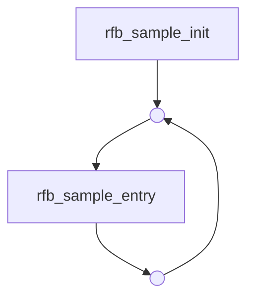
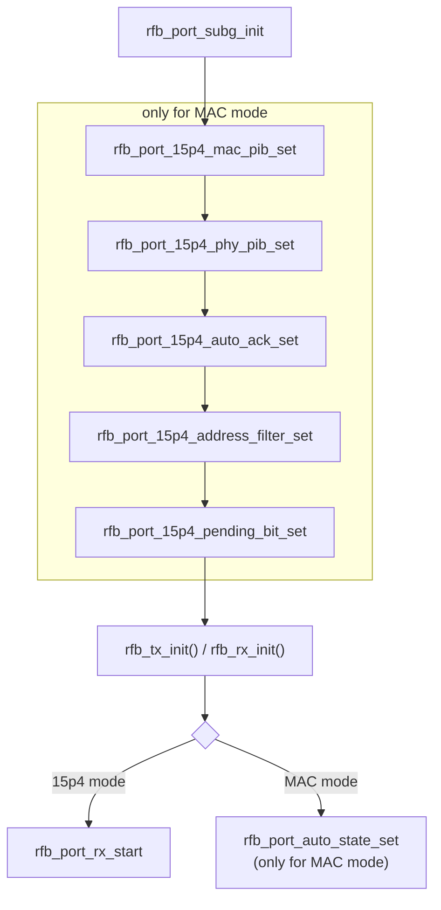

# RT58x RF Sub-G User Guide

## Table of Contents

- [1. Introduction](#1-introduction)
- [2. APIs](#2-apis)
  - [2.1 Sample Initialization](#21-sample-initialization)
  - [2.2 RF Control APIs](#22-rf-control-apis)
    - [2.2.1 Register Interrupt Event Initialization](#221-register-interrupt-event-initialization)
    - [2.2.2 MAC PIB Attributes Initialization](#222-mac-pib-attributes-initialization)
    - [2.2.3 PHY PIB Attributes Initialization](#223-phy-pib-attributes-initialization)
    - [2.2.4 Automatic Transmitting of Acknowledgment Initialization](#224-automatic-transmitting-of-acknowledgment-initialization)
    - [2.2.5 Address Filter Initialization](#225-address-filter-initialization)
    - [2.2.6 Frame Pending Flag Initialization](#226-frame-pending-flag-initialization)
    - [2.2.7 Automatic Transferring of State Initialization](#227-automatic-transferring-of-state-initialization)
    - [2.2.8 Frequency Initialization](#228-frequency-initialization)
    - [2.2.9 RX Configuration Initialization](#229-rx-configuration-initialization)
    - [2.2.10 TX Configuration Initialization](#2210-tx-configuration-initialization)
    - [2.2.11 Send Frame Function](#2211-send-frame-function)
  - [2.3 Data Generation for 15p4 Mode](#23-data-generation-for-15p4-mode)
  - [2.4 Frame Generation for MAC Mode](#24-frame-generation-for-mac-mode)
- [3. Setup Procedure](#3-setup-procedure)
  - [3.1 Main Flow](#31-main-flow)
  - [3.2 Initialization Flow in rfb_sample_init](#32-initialization-flow-in-rfb_sample_init)
- [4. Example Code](#4-example-code)
  - [4.1 Common Setting](#41-common-setting)
  - [4.2 Main Function](#42-main-function)
  - [4.3 rfb_sample_init](#43-rfb_sample_init)
  - [4.4 rfb_sample_entry](#44-rfb_sample_entry)
  - [4.5 Rfb_MacFrameGen](#45-rfb_macframegen)
- [Revision History](#revision-history)
- [Appendix: Mapping to the Current SDK](#appendix-mapping-to-the-current-sdk)

---

## 1. Introduction

This document describes the process to perform transmitting and receiving using Rafael RF with
or without MAC layer. Users can use provided APIs to set RF parameters and perform transmitting
or receiving through a series of primitives as defined in following sections.

In the SubG_TRX project, two modes are provided: **15p4 mode** (pure 802.15.4 RF) and
**MAC mode** (802.15.4 MAC layer + RF).

---

## 2. APIs

This section provides an overview of the APIs.

### 2.1 Sample Initialization

Sample initialization function.

```c
void rfb_sample_init(uint8_t RfbPciTestCase);
```

**Parameter**

| Name | Type | Description |
|---|---|---|
| `RfbPciTestCase` | Integer | 1: TX case (`RFB_PCI_BURST_TX_TEST`)<br>2: Sleeping TX case (`RFB_PCI_SLEEP_TX_TEST`)<br>3: RX case (`RFB_PCI_RX_TEST`) |

### 2.2 RF Control APIs

For SubG devices, the RF control APIs are as follows. For a simple demo, some of these APIs are
described in detail below. To see more, you can also find the description of all these APIs in the
definition of `rfb_subg_ctrl_t` in the header file `rfb.h`.

```c
rfb_subg_ctrl_t const rfb_ctrl =
{
    rfb_port_subg_init,
    rfb_port_modem_set,
    rfb_port_frequency_set,
    rfb_port_subg_is_channel_free,
    rfb_port_subg_rx_config_set,
    rfb_port_subg_tx_config_set,
    rfb_port_data_send,
    rfb_port_sleep_set,
    rfb_port_idle_set,
    rfb_port_rx_start,
    rfb_port_tx_continuous_wave_set,
    rfb_port_rssi_read,
    rfb_port_version_get,
    rfb_port_15p4_address_filter_set,
    rfb_port_15p4_mac_pib_set,
    rfb_port_15p4_phy_pib_set,
    rfb_port_15p4_auto_ack_set,
    rfb_port_15p4_pending_bit_set,
    rfb_port_auto_state_set,
    rfb_port_15p4_src_addr_match_ctrl,
    rfb_port_15p4_short_addr_ctrl,
    rfb_port_15p4_extend_addr_ctrl,
    rfb_port_key_set,
    rfb_port_csl_receiver_ctrl,
    rfb_port_csl_accuracy_get,
    rfb_port_csl_uncertainty_get,
    rfb_port_csl_sample_time_update,
    rfb_port_rtc_time_read,
    rfb_port_ack_packet_read,
    rfb_port_rx_rtc_time_get,
    rfb_port_current_channel_get,
    rfb_port_frame_counter_get,
};
```

> **Note:** For 15p4 mode, sections 2.2.2 to 2.2.7 can be skipped.

#### 2.2.1 Register Interrupt Event Initialization

The following API initiates the register interrupt event.

```c
RFB_EVENT_STATUS rfb_port_subg_init(rfb_interrupt_event_t *_rfb_interrupt_event,
                                    rfb_keying_type_t      keying_mode,
                                    uint8_t                band_type);
```

The definition of `rfb_interrupt_event_t`:

```c
typedef struct rfb_interrupt_event_s
{
    void (*rx_done)(uint16_t packet_length, uint8_t *rx_data_address,
                    uint8_t crc_status, uint8_t rssi, uint8_t snr);
    void (*tx_done)(uint8_t tx_status);
    void (*rx_timeout)(void);
} rfb_interrupt_event_t;
```

**Parameter**

| Name | Description |
|---|---|
| `rx_done` | Interrupt event when RX completes |
| `tx_done` | Interrupt event when TX completes |
| `rx_timeout` | Interrupt event when the device doesn't receive a packet in the expected time |

The definition of `rfb_keying_type_t`:

```c
typedef enum
{
    RFB_KEYING_FSK   = 1,   /* For SubG data rate = 50~300 kbps         */
    RFB_KEYING_OQPSK = 2,   /* For SubG data rate = 6.25, 12.5, 25 kbps */
} rfb_keying_type_t;
```

The definition of band type for `keying_mode = RFB_KEYING_FSK`:

```c
typedef enum
{
    BAND_SUBG_915M = 0,
    BAND_2P4G      = 1,
    BAND_SUBG_868M = 2,
    BAND_SUBG_433M = 3,
    BAND_SUBG_315M = 4
} band_type_t;
```

The definition of band type for `keying_mode = RFB_KEYING_OQPSK`:

```c
typedef enum
{
    BAND_OQPSK_SUBG_915M = 0,
    BAND_OQPSK_SUBG_868M = 1,
    BAND_OQPSK_SUBG_433M = 2,
    BAND_OQPSK_SUBG_315M = 3
} oqpsk_band_type_t;
```

#### 2.2.2 MAC PIB Attributes Initialization

The following API is for MAC PIB attributes setting.

```c
RFB_EVENT_STATUS rfb_port_15p4_mac_pib_set(uint32_t a_unit_backoff_period,
                                           uint32_t mac_ack_wait_duration,
                                           uint8_t  mac_max_BE,
                                           uint8_t  mac_max_CSMA_backoffs,
                                           uint32_t mac_max_frame_total_wait_time,
                                           uint8_t  mac_max_frame_retries,
                                           uint8_t  mac_min_BE);
```

**Parameter**

| Name | Type | Description |
|---|---|---|
| `a_unit_backoff_period` | Integer | The time forming the basic time period used by the CSMA-CA algorithm, specified in us. |
| `mac_ack_wait_duration` | Integer | The maximum time to wait for an acknowledgment frame to arrive following a transmitted data frame, specified in us. |
| `mac_max_BE` | Integer | The maximum value of the back off exponent, BE, in the CSMA-CA algorithm. |
| `mac_max_CSMA_backoffs` | Integer | The maximum number of back off the CSMA-CA algorithm will attempt before declaring a channel access failure. |
| `mac_max_frame_total_wait_time` | Integer | The maximum time to wait either for a frame intended as a response to a data request frame, specified in us. |
| `mac_max_frame_retries` | Integer | The maximum number of retries allowed after a transmission failure. |
| `mac_min_BE` | Integer | The minimum value of the back off exponent (BE) in the CSMA-CA algorithm. |

#### 2.2.3 PHY PIB Attributes Initialization

The following API is for PHY PIB attributes setting.

```c
RFB_EVENT_STATUS rfb_port_15p4_phy_pib_set(uint16_t a_turnaround_time,
                                           uint8_t  phy_cca_mode,
                                           uint8_t  phy_cca_threshold,
                                           uint16_t phy_cca_duration);
```

**Parameter**

| Name | Type | Description |
|---|---|---|
| `a_turnaround_time` | Integer | RX-to-TX or TX-to-RX turnaround time, specified in us. |
| `phy_cca_mode` | Integer | 0: Energy above threshold<br>1: Carrier sense only<br>2: Carrier sense with energy above threshold, where the logical operator is AND<br>3: Carrier sense with energy above threshold, where the logical operator is OR |
| `phy_cca_threshold` | Integer | The received power threshold for CCA |
| `phy_cca_duration` | Integer | The duration for CCA, specified in us. |

#### 2.2.4 Automatic Transmitting of Acknowledgment Initialization

The following API enables/disables automatic transmitting of the acknowledgment frame.

```c
RFB_EVENT_STATUS rfb_port_15p4_auto_ack_set(uint8_t auto_ack_enable);
```

**Parameter**

| Name | Type | Description |
|---|---|---|
| `auto_ack_enable` | Integer | True: enable automatic transmitting of ack frame<br>False: disable automatic transmitting of ack frame |

#### 2.2.5 Address Filter Initialization

The following API is for address filter setting.

```c
RFB_EVENT_STATUS rfb_port_15p4_address_filter_set(uint8_t  mac_promiscuous_mode,
                                                  uint16_t short_source_address,
                                                  uint32_t long_source_address_0,
                                                  uint32_t long_source_address_1,
                                                  uint16_t pan_id,
                                                  uint8_t  is_coordinator);
```

**Parameter**

| Name | Type | Description |
|---|---|---|
| `mac_promiscuous_mode` | Integer | True: activate promiscuous mode<br>False: deactivate promiscuous mode |
| `short_source_address` | Integer | 16-bit short address |
| `long_source_address_0` | Integer | First 32 bits of 64-bit extended address |
| `long_source_address_1` | Integer | Last 32 bits of 64-bit extended address |
| `pan_id` | Integer | 16-bit PAN ID |
| `is_coordinator` | Integer | Whether the device is coordinator or not [0: false, 1: true] |

#### 2.2.6 Frame Pending Flag Initialization

The following API is for frame pending bit setting.

```c
RFB_EVENT_STATUS rfb_port_15p4_pending_bit_set(uint8_t pending_bit_enable);
```

**Parameter**

| Name | Type | Description |
|---|---|---|
| `pending_bit_enable` | Integer | Frame pending bit flag [0: false, 1: true] |

#### 2.2.7 Automatic Transferring of State Initialization

The following API enables/disables automatic transferring of state when RFB is idle.

```c
RFB_EVENT_STATUS rfb_port_auto_state_set(bool rxOnWhenIdle);
```

**Parameter**

| Name | Type | Description |
|---|---|---|
| `rxOnWhenIdle` | bool | Whether to transfer to RX state automatically when RFB is idle [0: false, 1: true] |

#### 2.2.8 Frequency Initialization

The following API is for frequency setting.

```c
RFB_EVENT_STATUS rfb_port_frequency_set(uint32_t rf_frequency);
```

**Parameter**

| Name | Type | Description |
|---|---|---|
| `rf_frequency` | Integer | Radio frequency, specified in kHz. |

#### 2.2.9 RX Configuration Initialization

The following API is for RX configuration setting.

```c
RFB_EVENT_STATUS rfb_port_subg_rx_config_set(uint8_t         data_rate,
                                             uint16_t        preamble_len,
                                             fsk_mod_t       mod_idx,
                                             crc_type_t      crc_type,
                                             whiten_enable_t whiten_enable,
                                             uint32_t        rx_timeout,
                                             bool            rx_continuous,
                                             uint8_t         filter_type);
```

**Parameter**

| Name | Type | Description |
|---|---|---|
| `data_rate` | Integer | Data rate (unit: K = kbps)<br>For FSK — 3: `FSK_200K`, 4: `FSK_100K`, 5: `FSK_50K`, 6: `FSK_300K`, 7: `FSK_150K`<br>For OQPSK — 3: `OQPSK_25K`, 4: `OQPSK_12P5K`, 5: `OQPSK_6P25K` |
| `preamble_len` | Integer | Preamble length, specified in bytes. |
| `mod_idx` | Integer | Modulation index [0: modulation index = 0.5, 1: modulation index = 1] |
| `crc_type` | Integer | CRC type [0: 16-bit CRC, 1: 32-bit CRC] |
| `whiten_enable` | Integer | Whitening flag [0: disable whitening, 1: enable whitening] |
| `rx_timeout` | Integer | Time for RX timeout, specified in microseconds. |
| `rx_continuous` | Integer | 1: continuous mode<br>0: RX off after one time RX or timeout |
| `filter_type` | Integer | FSK filter type [0: FSK, 1: GFSK] |

#### 2.2.10 TX Configuration Initialization

The following API is for TX configuration setting.

```c
RFB_EVENT_STATUS rfb_port_subg_tx_config_set(tx_power_level_t tx_power,
                                             uint8_t          data_rate,
                                             uint16_t         preamble_len,
                                             fsk_mod_t        mod_idx,
                                             crc_type_t       crc_type,
                                             whiten_enable_t  whiten_enable,
                                             uint8_t          filter_type);
```

**Parameter**

| Name | Type | Description |
|---|---|---|
| `tx_power` | Integer | TX power mode [0: 20 dBm, 1: 14 dBm, 2: 0 dBm] |
| `data_rate` | Integer | Data rate (unit: K = kbps)<br>For FSK — 3: `FSK_200K`, 4: `FSK_100K`, 5: `FSK_50K`, 6: `FSK_300K`, 7: `FSK_150K`<br>For OQPSK — 3: `OQPSK_25K`, 4: `OQPSK_12P5K`, 5: `OQPSK_6P25K` |
| `preamble_len` | Integer | Preamble length, specified in bytes. |
| `mod_idx` | Integer | Modulation index [0: modulation index = 0.5, 1: modulation index = 1] |
| `crc_type` | Integer | CRC type [0: 16-bit CRC, 1: 32-bit CRC] |
| `whiten_enable` | Integer | Whitening flag [0: disable whitening, 1: enable whitening] |
| `filter_type` | Integer | FSK filter type [0: FSK, 1: GFSK] |

#### 2.2.11 Send Frame Function

The following API is for data frame transmitting.

```c
RFB_WRITE_TXQ_STATUS rfb_port_data_send(uint8_t  *tx_data_address,
                                        uint16_t  packet_length,
                                        uint8_t   InitialCwAckRequest,
                                        uint8_t   Dsn);
```

**Parameter**

| Name | Type | Description |
|---|---|---|
| `tx_data_address` | Pointer | Data address |
| `packet_length` | Integer | Packet length |
| `InitialCwAckRequest` | Integer | TX control parameter (set to 0 for 15p4 mode; generated in `mac_data_gen` for MAC mode) |
| `Dsn` | Integer | Data sequence number (set to 0 for 15p4 mode) |

### 2.3 Data Generation for 15p4 Mode

The following is an example data generation function.

```c
void data_gen(uint8_t *pbuf, uint16_t len);
```

**Parameter**

| Name | Type | Description |
|---|---|---|
| `pbuf` | Pointer | Address for data storing |
| `len` | Integer | Data length |

### 2.4 Frame Generation for MAC Mode

The following is an example frame generation function.

```c
void Rfb_MacFrameGen(MacBuffer_t *pbuf,
                     uint8_t     *InitialCwAckRequest,
                     uint8_t      Dsn,
                     uint16_t     MacDataLength);
```

**Parameter**

| Name | Type | Description |
|---|---|---|
| `pbuf` | Pointer | Address for data storing |
| `InitialCwAckRequest` | Pointer | TX control parameter address |
| `Dsn` | Integer | Data sequence number |
| `MacDataLength` | Integer | MAC layer payload length |

> **Note:** In this function, the user needs to set the parameters in the frame control field of the
> MAC header. An example code can be found in section 4.

---

## 3. Setup Procedure

### 3.1 Main Flow



### 3.2 Initialization Flow in rfb_sample_init

The steps inside the dashed group are executed **only in MAC mode**.



---

## 4. Example Code

The example code in this section can be found in the project at the following path:
`Project\Application\SubG_Demo\SubG_TRX`.

> In this SDK the corresponding sample lives under
> [`examples/sub-g/subg-trx/`](../../examples/sub-g/subg-trx) — see the
> [appendix](#appendix-mapping-to-the-current-sdk) for the API differences.

### 4.1 Common Setting

The following is some of the setting code that users usually need to modify. These parts of the
example code are also highlighted in blue in the original document, sections 4.2 to 4.5.

#### 4.1.1 Case Setting

```c
/* Set RFB test case
   1. RFB_PCI_BURST_TX_TEST: Tester sends a certain number of packets
   2. RFB_PCI_SLEEP_TX_TEST: Tester sends a certain number of packets and
                             sleeps between each tx
   3. RFB_PCI_RX_TEST:       Tester receives and verifies packets
*/
rfb_pci_test_case = RFB_PCI_RX_TEST;
```

#### 4.1.2 Mode Setting

The user should set `SUBG_MAC` as true for MAC mode, and false for 15p4 mode.

```c
#define SUBG_MAC (false)
```

#### 4.1.3 Address Filter Setting

The setting in this section should be the same as the destination part of section 4.1.4.

```c
/* Address Filter Set */
uint16_t short_addr  = 0x1234;
uint32_t long_addr_0 = 0x11223333;
uint32_t long_addr_1 = 0x55667788;
uint16_t pan_id      = 0x1AAA;
```

#### 4.1.4 Addressing Field Setting

This section is only effective for the `RFB_PCI_BURST_TX_TEST` case.

```c
MacHdr.destPanid            = 0x1AAA;
MacHdr.destAddr.mode        = SHORT_ADDR; //LONG_ADDR;
MacHdr.destAddr.shortAddr   = 0x1234;
MacHdr.destAddr.longAddr[0] = 0x11223333;
MacHdr.destAddr.longAddr[1] = 0x55667788;
.
.
.
MacHdr.srcPanid             = 0x1aaa;
MacHdr.srcAddr.mode         = SHORT_ADDR; //LONG_ADDR;
MacHdr.srcAddr.shortAddr    = 0x1111;
MacHdr.srcAddr.longAddr[0]  = 0x00000001;
MacHdr.srcAddr.longAddr[1]  = 0xacde4800;
```

#### 4.1.5 Transmitting Configuration

```c
g_rfb_ctrl->tx_config_set(TX_POWER_20dBm, FSK_100K, 8, MOD_1,
                          CRC_16, WHITEN_DISABLE, GFSK);
.
.
.
g_rfb_ctrl->frequency_set(g_100k_freq_support[0]);
```

#### 4.1.6 Receiving Configuration

```c
g_rfb_ctrl->rx_config_set(FSK_100K, 8, MOD_1, CRC_16,
                          WHITEN_DISABLE, 0, rx_continuous, GFSK);
.
.
.
g_rfb_ctrl->frequency_set(g_100k_freq_support[0]);
```

### 4.2 Main Function

```c
int32_t main(void)
{
    RFB_PCI_TEST_CASE rfb_pci_test_case;

    /* RF system priority set */
    set_priotity();

    /* Init debug pin */
    init_default_pin_mux();

    dma_init();

    /* init debug uart port for printf */
#if (PRINTF_ENABLE == 1)
    util_uart_0_init();
#endif

#if (MODULE_ENABLE(SUPPORT_DEBUG_CONSOLE_CLI))
    extern int cli_console_init(void);
    extern int cli_console_proc(void);
    cli_console_init();

#if (SUBG_TEST_PLAN_BER)
    while (!g_start_flag)
    {
        cli_console_proc();
    }
#endif
#endif

    /* Set RFB test case
       1. RFB_PCI_BURST_TX_TEST: Tester sends a certain number of packets
       2. RFB_PCI_SLEEP_TX_TEST: Tester sends a certain number of packets and
                                 sleeps between each tx
       3. RFB_PCI_RX_TEST:       Tester receives and verifies packets
    */
    rfb_pci_test_case = RFB_PCI_RX_TEST;
    printf("Test Case:%X\n", rfb_pci_test_case);

    /* Init RFB */
    rfb_sample_init(rfb_pci_test_case);

    while (1)
    {
        rfb_sample_entry(rfb_pci_test_case);
#if (MODULE_ENABLE(SUPPORT_DEBUG_CONSOLE_CLI))
        cli_console_proc();
#endif
    }
}
```

### 4.3 rfb_sample_init

```c
void rfb_sample_init(uint8_t RfbPciTestCase)
{
    uint32_t FwVer;
#if (SUBG_MAC)
    /* MAC PIB Parameters */
    uint32_t a_unit_backoff_period         = A_UNIT_BACKOFF_PERIOD;
    uint32_t mac_ack_wait_duration         = MAC_ACK_WAIT_DURATION;
    uint8_t  mac_max_BE                    = MAC_MAX_BE;
    uint8_t  mac_max_CSMA_backoffs         = MAC_MAX_CSMACA_BACKOFFS;
    uint32_t mac_max_frame_total_wait_time = MAC_MAX_FRAME_TOTAL_WAIT_TIME;
    uint8_t  mac_max_frame_retries         = MAC_MAX_FRAME_RETRIES;
    uint8_t  mac_min_BE                    = MAC_MIN_BE;

    /* PHY PIB Parameters */
    uint16_t a_turnaround_time = A_TURNAROUND_TIMR;
    uint8_t  phy_cca_mode      = ENERGY_DETECTION_OR_CHARRIER_SENSING;
    uint8_t  phy_cca_threshold = 80;
    uint16_t phy_cca_duration  = A_TURNAROUND_TIMR;

    /* AUTO ACK Enable Flag */
    uint8_t auto_ack_enable = true;

    /* Frame Pending Bit */
    uint8_t frame_pending_bit = true;

    /* Address Filter Set */
    uint16_t short_addr           = 0x1234;
    uint32_t long_addr_0          = 0x11223333;
    uint32_t long_addr_1          = 0x55667788;
    uint16_t pan_id               = 0x1AAA;
    uint8_t  is_coordinator       = true;
    uint8_t  mac_promiscuous_mode = false;
#endif

    /* Register rfb interrupt event */
    struct_rfb_interrupt_event.tx_done    = rfb_tx_done;
    struct_rfb_interrupt_event.rx_done    = rfb_rx_done;
    struct_rfb_interrupt_event.rx_timeout = rfb_rx_timeout;

    /* Init rfb */
    g_rfb_ctrl = rfb_subg_init();
#if (SUBG_TEST_PLAN_BER)
    if (g_data_rate >= 50000)
    {
        g_rfb_ctrl->init(&struct_rfb_interrupt_event, RFB_KEYING_FSK,
                         g_band_type);
    }
    else
    {
        g_rfb_ctrl->init(&struct_rfb_interrupt_event, RFB_KEYING_OQPSK,
                         g_band_type);
    }
#else
    g_rfb_ctrl->init(&struct_rfb_interrupt_event, RFB_KEYING_FSK,
                     BAND_SUBG_915M);
#endif

#if (SUBG_MAC)
    g_rfb_ctrl->mac_pib_set(a_unit_backoff_period, mac_ack_wait_duration,
                            mac_max_BE, mac_max_CSMA_backoffs,
                            mac_max_frame_total_wait_time,
                            mac_max_frame_retries, mac_min_BE);

    g_rfb_ctrl->phy_pib_set(a_turnaround_time, phy_cca_mode,
                            phy_cca_threshold, phy_cca_duration);

    g_rfb_ctrl->auto_ack_set(auto_ack_enable);

    g_rfb_ctrl->address_filter_set(mac_promiscuous_mode, short_addr,
                                   long_addr_0, long_addr_1, pan_id,
                                   is_coordinator);

    g_rfb_ctrl->frame_pending_set(frame_pending_bit);
#endif

    /* Init test counters */
    g_crc_success_count = 0;
    g_crc_fail_count    = 0;
    g_rx_total_count    = 0;
    g_tx_total_count    = 0;

#if (SUBG_TEST_PLAN_BER)
    g_tx_count_target = (g_pkt_number * 1000) + 1;
#else
    g_tx_count_target = 1000;
#endif

    data_gen(&g_prbs9_buf[0], FSK_RX_LENGTH);

    /* Set test parameters */
    switch (RfbPciTestCase)
    {
    case RFB_PCI_BURST_TX_TEST:
    case RFB_PCI_SLEEP_TX_TEST:
        rfb_tx_init();
        break;
    case RFB_PCI_RX_TEST:
        rfb_rx_init(0, true);
        /* Enable RF Rx */
#if (SUBG_MAC)
        g_rfb_ctrl->auto_state_set(true);
#else
        g_rfb_ctrl->rx_start();
#endif
        break;
    }
    FwVer = g_rfb_ctrl->fw_version_get();
    printf("RFB Firmware version: %d\n", FwVer);
}
```

#### 4.3.1 rfb_tx_init

```c
void rfb_tx_init(void)
{
    /* Set RF State to Idle */
    g_rfb_ctrl->idle_set();

    /* Set TX config */
#if (SUBG_TEST_PLAN_BER)
    switch (g_data_rate)
    {
    case 6250:
        g_rfb_ctrl->tx_config_set(TX_POWER_20dBm, OQPSK_6P25K, 8, MOD_UNDEF,
                                  CRC_16, WHITEN_DISABLE, OQPSK);
        break;
    case 12500:
        g_rfb_ctrl->tx_config_set(TX_POWER_20dBm, OQPSK_12P5K, 8, MOD_UNDEF,
                                  CRC_16, WHITEN_DISABLE, OQPSK);
        break;
    case 25000:
        g_rfb_ctrl->tx_config_set(TX_POWER_20dBm, OQPSK_25K, 8, MOD_UNDEF,
                                  CRC_16, WHITEN_DISABLE, OQPSK);
        break;
    case 50000:
        g_rfb_ctrl->tx_config_set(TX_POWER_20dBm, FSK_50K, 8, MOD_1, CRC_16,
                                  WHITEN_DISABLE, GFSK);
        break;
    case 100000:
        g_rfb_ctrl->tx_config_set(TX_POWER_20dBm, FSK_100K, 8, MOD_1, CRC_16,
                                  WHITEN_DISABLE, GFSK);
        break;
    case 150000:
        g_rfb_ctrl->tx_config_set(TX_POWER_20dBm, FSK_150K, 8, MOD_1, CRC_16,
                                  WHITEN_DISABLE, GFSK);
        break;
    case 200000:
        g_rfb_ctrl->tx_config_set(TX_POWER_20dBm, FSK_200K, 8, MOD_1, CRC_16,
                                  WHITEN_DISABLE, GFSK);
        break;
    case 300000:
        g_rfb_ctrl->tx_config_set(TX_POWER_20dBm, FSK_300K, 8, MOD_1, CRC_16,
                                  WHITEN_DISABLE, GFSK);
        break;
    default:
        g_rfb_ctrl->tx_config_set(TX_POWER_20dBm, FSK_100K, 8, MOD_1, CRC_16,
                                  WHITEN_DISABLE, GFSK);
        break;
    }
#else
    g_rfb_ctrl->tx_config_set(TX_POWER_20dBm, FSK_100K, 8, MOD_1, CRC_16,
                              WHITEN_DISABLE, GFSK);
#endif

    /*
     * Set channel frequency:
     * For band is subg, unit is kHz
     * For band is 2.4g, unit is mHz
     */
#if (SUBG_TEST_PLAN_BER)
    g_rfb_ctrl->frequency_set(g_frequency);
#else
    g_rfb_ctrl->frequency_set(g_100k_freq_support[0]);
#endif

    g_tx_len = PHY_MIN_LENGTH;
}
```

#### 4.3.2 rfb_rx_init

```c
void rfb_rx_init(uint32_t rx_timeout_timer, bool rx_continuous)
{
    /* Set RF State to Idle */
    g_rfb_ctrl->idle_set();

    /* Set RX config */
    if (rx_continuous == true)
    {
#if (SUBG_TEST_PLAN_BER)
        switch (g_data_rate)
        {
        case 6250:
            g_rfb_ctrl->rx_config_set(OQPSK_6P25K, 8, MOD_UNDEF, CRC_16,
                                      WHITEN_DISABLE, 0, rx_continuous,
                                      OQPSK);
            break;
        case 12500:
            g_rfb_ctrl->rx_config_set(OQPSK_12P5K, 8, MOD_UNDEF, CRC_16,
                                      WHITEN_DISABLE, 0, rx_continuous,
                                      OQPSK);
            break;
        case 25000:
            g_rfb_ctrl->rx_config_set(OQPSK_25K, 8, MOD_UNDEF, CRC_16,
                                      WHITEN_DISABLE, 0, rx_continuous,
                                      OQPSK);
            break;
        case 50000:
            g_rfb_ctrl->rx_config_set(FSK_50K, 8, MOD_1, CRC_16,
                                      WHITEN_DISABLE, 0, rx_continuous,
                                      GFSK);
            break;
        case 100000:
            g_rfb_ctrl->rx_config_set(FSK_100K, 8, MOD_1, CRC_16,
                                      WHITEN_DISABLE, 0, rx_continuous,
                                      GFSK);
            break;
        case 150000:
            g_rfb_ctrl->rx_config_set(FSK_150K, 8, MOD_1, CRC_16,
                                      WHITEN_DISABLE, 0, rx_continuous,
                                      GFSK);
            break;
        case 200000:
            g_rfb_ctrl->rx_config_set(FSK_200K, 8, MOD_1, CRC_16,
                                      WHITEN_DISABLE, 0, rx_continuous,
                                      GFSK);
            break;
        case 300000:
            g_rfb_ctrl->rx_config_set(FSK_300K, 8, MOD_1, CRC_16,
                                      WHITEN_DISABLE, 0, rx_continuous,
                                      GFSK);
            break;
        default:
            g_rfb_ctrl->tx_config_set(TX_POWER_20dBm, FSK_100K, 8, MOD_1,
                                      CRC_16, WHITEN_DISABLE, GFSK);
            break;
        }
#else
        g_rfb_ctrl->rx_config_set(FSK_100K, 8, MOD_1, CRC_16, WHITEN_DISABLE,
                                  0, rx_continuous, GFSK);
#endif
    }
    else
    {
        g_rfb_ctrl->rx_config_set(FSK_100K, 8, MOD_1, CRC_16, WHITEN_DISABLE,
                                  rx_timeout_timer, rx_continuous, GFSK);
    }

    /* Set channel frequency */
#if (SUBG_TEST_PLAN_BER)
    g_rfb_ctrl->frequency_set(g_frequency);
#else
    g_rfb_ctrl->frequency_set(g_100k_freq_support[0]);
#endif
}
```

### 4.4 rfb_sample_entry

```c
void rfb_sample_entry(uint8_t rfb_pci_test_case)
{
#if (SUBG_MAC)
    uint8_t tx_control = 0;
    uint8_t Dsn = 0;
    static MacBuffer_t MacBuf;
#else
    uint16_t max_length = ((g_rfb.modem_type == RFB_MODEM_FSK) ? 2047 : 127);
#endif

    switch (rfb_pci_test_case)
    {
    case RFB_PCI_BURST_TX_TEST:
        /* Abort test if TX count is reached in burst tx test */
        if (burst_tx_abort())
        {
            break;
        }

        g_tx_done = false;

#if (SUBG_MAC)
        /* Generate IEEE802.15.4 MAC Header and append data */
        mac_data_gen(&MacBuf, &tx_control, &Dsn);
        g_rfb_ctrl->data_send(MacBuf.dptr, MacBuf.len, tx_control, Dsn);
        g_tx_len = MacBuf.len;
#else
        /* Determine TX packet length */
#if (SUBG_TEST_PLAN_BER)
        g_tx_len = 0x40;
        if (g_tx_total_count == 0)
        {
            timer_config_mode_t cfg0;

            cfg0.int_en   = ENABLE;
            cfg0.mode     = TIMER_PERIODIC_MODE;
            cfg0.prescale = TIMER_PRESCALE_1;

            Timer_Open(3, cfg0, _timer_isr_handler_tx);

            uint32_t delay_tick = 39000000;
            delay_tick = ((g_data_rate >= 100000) ? 400
                                                  : (delay_tick / g_data_rate));
            Timer_Start(3, delay_tick);
        }
        while (tx_trigger == 0);
        tx_trigger = 0;
#else
        g_tx_len++;
        if (g_tx_len > (max_length - CRC16_LENGTH))
        {
            g_tx_len = PHY_MIN_LENGTH;
        }
#endif
        /* Send data */
        g_rfb_ctrl->data_send(&g_prbs9_buf[0], g_tx_len, 0, 0);
#endif
        /* Wait TX finish */
        while (tx_done_check() == false);

        /* Add delay to increase TX interval */
#if (!SUBG_TEST_PLAN_BER)
        Delay_us(30000);
#endif
        break;

    case RFB_PCI_SLEEP_TX_TEST:
        /* Abort test if TX count is reached in burst tx test */
        if (burst_tx_abort())
        {
            break;
        }

        g_tx_done = false;

#if (SUBG_MAC)
        g_rfb_ctrl->auto_state_set(true);

        /* Generate IEEE802.15.4 MAC Header and append data */
        mac_data_gen(&MacBuf, &tx_control, &Dsn);
        g_rfb_ctrl->data_send(MacBuf.dptr, MacBuf.len, tx_control, Dsn);
        g_tx_len = MacBuf.len;
#else
        g_rfb_ctrl->idle_set();

        /* Determine TX packet length */
        g_tx_len++;
        if (g_tx_len > (max_length - CRC16_LENGTH))
        {
            g_tx_len = PHY_MIN_LENGTH;
        }

        /* Send data */
        g_rfb_ctrl->data_send(&g_prbs9_buf[0], g_tx_len, 0, 0);
#endif
        /* Wait TX finish */
        while (tx_done_check() == false);

        /* Set RF State to SLEEP */
#if (SUBG_MAC)
        g_rfb_ctrl->auto_state_set(false);
#else
        g_rfb_ctrl->sleep_set();
#endif

        /* Start timer to wake me up later and sleep */
        timer_config_mode_t cfg;

        cfg.int_en   = ENABLE;
        cfg.mode     = TIMER_PERIODIC_MODE;
        cfg.prescale = TIMER_PRESCALE_1;

        Timer_Open(3, cfg, _timer_isr_handler);
        Timer_Start(3, 800000); //for 40kHz timer, 40k = 1s;

        Lpm_Set_Low_Power_Level(LOW_POWER_LEVEL_SLEEP0);
        Lpm_Enable_Low_Power_Wakeup(LOW_POWER_WAKEUP_32K_TIMER);
        Lpm_Enter_Low_Power_Mode();

        break;

    case RFB_PCI_RX_TEST:
#if (!SUBG_TEST_PLAN_BER)
        g_rx_total_count_last = g_rx_total_count;

        /* Check whether RX data is coming during certain interval */
        Delay_us(1000000);
        if (g_rx_total_count_last == g_rx_total_count)
        {
            printf("[E] No RX data in this period\n");
        }
#endif
        break;
    }
}
```

### 4.5 Rfb_MacFrameGen

```c
void Rfb_MacFrameGen(MacBuffer_t *pbuf, uint8_t *tx_control, uint8_t Dsn,
                     uint16_t MacDataLength)
{
    uint16_t idx;
    uint16_t payloadLength = MacDataLength;
    uint8_t  initialCW;
    uint8_t  ackRequest;
    uint16_t max_data_size = ((g_rfb.modem_type == RFB_MODEM_FSK) ?
                              FSK_MAX_DATA_SIZE : OQPSK_MAX_DATA_SIZE);

    MacHdr_t MacHdr;
    memset(&pbuf->buf[0], 0x0, max_data_size);
    pbuf->dptr = &pbuf->buf[0];
    pbuf->len  = 0;

    MacHdr.macFrmCtrl.secEnab   = false;
    MacHdr.macSecCtrl.secLevel  = SEC_LEVEL_NONE;
    MacHdr.macSecCtrl.keyIdMode = KEY_ID_MODE_IMPLICITY;

    MacHdr.destPanid            = 0x1AAA;
    MacHdr.destAddr.mode        = SHORT_ADDR; //LONG_ADDR;
    MacHdr.destAddr.shortAddr   = 0x1234;
    MacHdr.destAddr.longAddr[0] = 0x11223333;
    MacHdr.destAddr.longAddr[1] = 0x55667788;

    MacHdr.macFrmCtrl.panidCompr = true;

    MacHdr.srcPanid             = 0x1aaa;
    MacHdr.srcAddr.mode         = SHORT_ADDR; //LONG_ADDR;
    MacHdr.srcAddr.shortAddr    = 0x1111;
    MacHdr.srcAddr.longAddr[0]  = 0x00000001;
    MacHdr.srcAddr.longAddr[1]  = 0xacde4800;

    MacHdr.macFrmCtrl.framePending = true;
    MacHdr.macFrmCtrl.frameType    = MAC_COMMAND;
    MacHdr.macFrmCtrl.ackReq       = true;

    MacHdr.dsn  = Dsn;
    initialCW   = DIRECT_TRANSMISSION;
    ackRequest  = MacHdr.macFrmCtrl.ackReq;
    *tx_control = (((initialCW << 1) & 0x02) | ((ackRequest) & 0x01));

    switch (MacHdr.macFrmCtrl.frameType)
    {
    case MAC_COMMAND:
    case MAC_BEACON:
    case MAC_DATA:
        mac_genHeader(pbuf, &MacHdr);
        break;
    case MAC_ACK:
        mac_genAck(pbuf, MacHdr.macFrmCtrl.framePending, MacHdr.dsn);
        break;
    default:
        break;
    }

    /* add payload */
    for (idx = pbuf->len; idx < (payloadLength + pbuf->len); idx++)
    {
        pbuf->buf[idx] = idx;
    }
    if ((pbuf->len + payloadLength) > max_data_size)
    {
        pbuf->len = max_data_size;
    }
    else
    {
        pbuf->len += payloadLength;
    }
}
```

---

## Revision History

| Revision | Description | Owner | Date |
|---|---|---|---|
| 1.0 | Initial version | Jiawei | 2022/09/16 |
| 1.1 | Update with SDK_v1.3.0 | Jiawei | 2023/01/05 |
| 1.2 | Update with SDK_v1.6.0 | Jiawei | 2023/07/21 |

---

## Appendix: Mapping to the Current SDK

This guide corresponds to `examples/sub-g/`, but the SDK has since been refactored: the
`rfb_subg_ctrl_t` / `g_rfb_ctrl->xxx()` / `rfb_port_*` symbols used throughout this document
**no longer exist anywhere in this repo** (a grep over every `.c`/`.h` returns nothing). The
function names (`rfb_sample_init`, `rfb_sample_entry`, `data_gen`, `mac_data_gen`) and the overall
flow are unchanged — only the layer underneath was replaced by three separate APIs.

### Corresponding examples

| Example | Path | Description |
|---|---|---|
| `subg-sample` | [examples/sub-g/subg-sample](../../examples/sub-g/subg-sample) | Minimal SubG send/receive sample |
| `subg-trx` | [examples/sub-g/subg-trx](../../examples/sub-g/subg-trx) | **The SubG_TRX project this document describes**; main body in `subg-trx/RFB_SubG/rfb_sample.c` |
| `subg-wake-on-radio` | [examples/sub-g/subg-wake-on-radio](../../examples/sub-g/subg-wake-on-radio) | Wake-on-radio low-power RX wakeup |
| `mesh-it-up/` | [examples/sub-g/mesh-it-up](../../examples/sub-g/mesh-it-up) | OpenThread over SubG (miu-ftd / miu-mtd / miu-sniffer) |

### The three current API layers

| Layer | Header | Responsibility |
|---|---|---|
| `subg_ctrl_*` | `subg_ctrl.h` | PHY/modem: frequency, modulation, preamble, SFD, CRC/whitening, filter, idle/sleep |
| `lmac15p4_*` | `lmac15p4.h` | 802.15.4 MAC: PIB, address filter, auto ACK, pending bit, auto state, TX submit, callbacks |
| `hosal_rf_ioctl` | `hosal_rf.h` | Low-level RF ioctl (e.g. `HOSAL_RF_IOCTL_TX_PWR_SET`) |

### Old-to-new API table

| This document (legacy `rfb_port_*`) | Current SDK |
|---|---|
| `rfb_subg_init()` + `g_rfb_ctrl->init(cb, keying, band)` | `lmac15p4_init(LMAC15P4_SUBG_FSK \| _OQPSK \| _BLE, band)` + `lmac15p4_cb_set(0, &mac_cb)` |
| `rfb_interrupt_event_t` (rx_done / tx_done / rx_timeout) | `lmac15p4_callback_t` (same three callbacks) |
| `rfb_port_15p4_mac_pib_set()` | `lmac15p4_mac_pib_set()` (same parameters) |
| `rfb_port_15p4_phy_pib_set()` | `lmac15p4_phy_pib_set()` (same parameters) |
| `rfb_port_15p4_auto_ack_set()` | `lmac15p4_auto_ack_set()` |
| `rfb_port_15p4_pending_bit_set()` | `lmac15p4_ack_pending_bit_set(0, ...)` |
| `rfb_port_15p4_address_filter_set()` | `lmac15p4_address_filter_set(0, ...)` (extra leading instance parameter) |
| `rfb_port_auto_state_set()` | `lmac15p4_auto_state_set()` |
| `rfb_port_data_send()` | `lmac15p4_tx_data_send(0, dptr, len, tx_control, Dsn)` |
| `rfb_port_frequency_set()` | `subg_ctrl_frequency_set()` |
| `rfb_port_idle_set()` / `rfb_port_sleep_set()` | `subg_ctrl_idle_set()` / `subg_ctrl_sleep_set(true)` |
| `rfb_port_subg_tx_config_set()` / `rx_config_set()` (one call) | Split into several: `subg_ctrl_modem_config_set()`, `subg_ctrl_mac_set()`, `subg_ctrl_preamble_set()`, `subg_ctrl_sfd_set()`, `subg_ctrl_filter_set()` |
| `tx_power` (the `TX_POWER_20dBm` argument) | `hosal_rf_ioctl(HOSAL_RF_IOCTL_TX_PWR_SET, &sPhyPowerStage)` |
| Constants `FSK_100K` / `MOD_1` / `CRC_16` / `WHITEN_DISABLE` / `GFSK` | `SUBG_CTRL_MODU_FSK`, `SUBG_CTRL_FSK_MOD_1`, `SUBG_CTRL_CRC_TYPE_16`, `SUBG_CTRL_WHITEN_ENABLE`, `SUBG_CTRL_FILTER_TYPE_FSK` |

What did not change: `#define SUBG_MAC (false)` (15p4 mode) is still at the top of
`subg-trx/RFB_SubG/rfb_sample.c`; the three test cases `RFB_PCI_BURST_TX_TEST` /
`RFB_PCI_SLEEP_TX_TEST` / `RFB_PCI_RX_TEST` and the MAC-header generation flow in
`mac_frame_gen.c` are the same as described above.

---

© 2022 by Rafael Microelectronics, Inc. All Rights Reserved. — Confidential.

The information contained herein is the exclusive property of Rafael Microelectronics, Inc. and
shall not be distributed, reproduced or disclosed in whole or in part without prior written
permission of Rafael Microelectronics, Inc.
