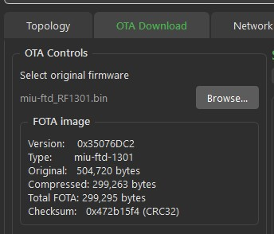
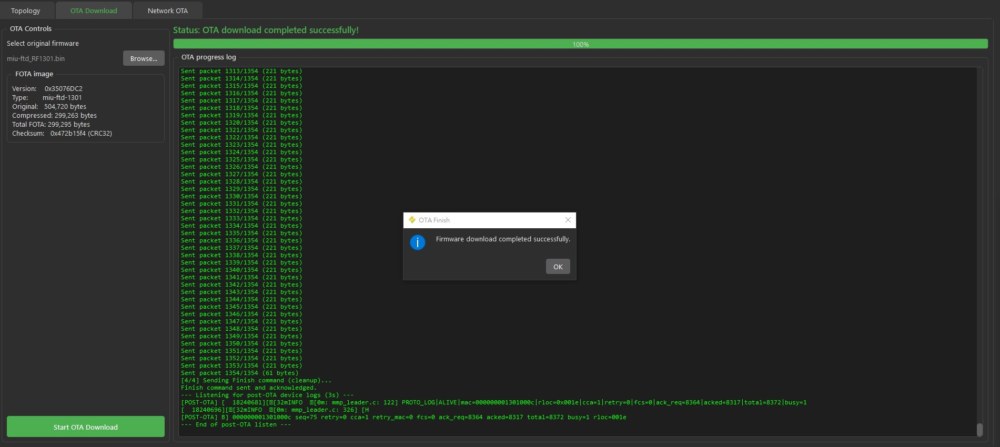
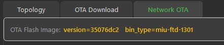
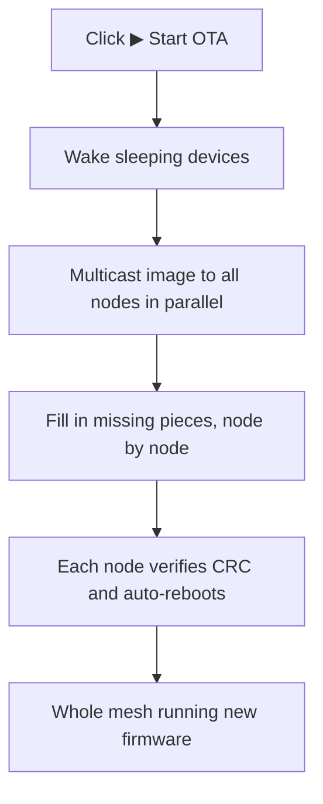
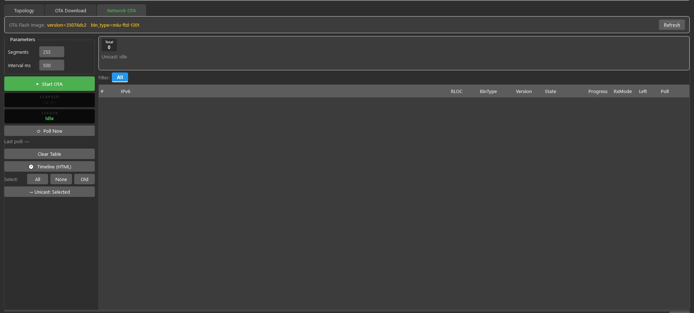
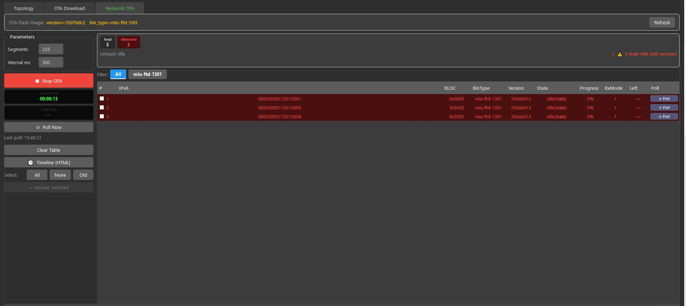
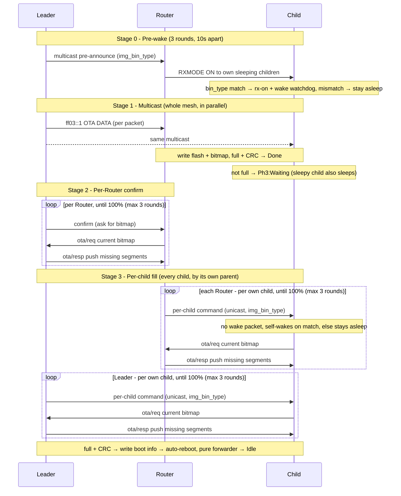

# Thread Over-The-Air (OTA) Update Guide

This guide walks you through updating the firmware of a whole Rafael MIU Thread
mesh from a PC. The update has two steps, and the tool automates almost every
part:

- **UART Download:** Copy the new firmware image from the PC into the
  Leader node's OTA flash over UART.
- **Network OTA:** The Leader distributes the image to every node in
  the mesh over the Thread network. Each node applies the new firmware and
  **reboots automatically** — no manual reboot step is needed.


---

## 1. Software Configuration

### 1.1 Enable OTA

Set the following macro in your `CMakeLists.txt` before building:

```cmake
set(CONFIG_APP_TASK_OTA_ENABLE 1)
```

This turns on the OTA service task, background flash management, and the
automatic network recovery flow.

### 1.2 Device type (`bin_type`)

Every device carries a 12-byte `bin_type` string — an **IC segment** plus a
**role segment** (e.g. `miu-ftd-1301`). This is the single value that decides
whether a device joins an OTA run: the image embeds its own `img_bin_type`, and
a device only applies an image whose `img_bin_type` matches its own `bin_type`.
So *"which devices to update"* is the same as *"which binary to send"*.

`bin_type` is fixed at **compile time** in [`app_task.c`](../../../examples/sub-g/mesh-it-up/miu-ftd/src/app_task.c),
where the IC segment is chosen by the `CONFIG_RFxxxx` you build for and the role
segment comes from the project (miu-ftd vs miu-mtd):

```c
#if defined(CONFIG_RF1301)
#define BIN_TYPE_ARR 'm','i','u','-','f','t','d','-','1','3','0','1'   // miu-ftd-1301
#elif defined(CONFIG_RT581) || defined(CONFIG_RT582)
#define BIN_TYPE_ARR 'm','i','u','-','f','t','d','-','r','5','8','1'   // miu-ftd-r581
#endif
const sys_information_t systeminfo = SYSTEMINFO_INIT(BIN_TYPE_ARR);
```

Edit `BIN_TYPE_ARR` if you need a different type string. To update several device
types, build one binary per type and run the OTA once for each — the flow is
identical every time.

> Timing/retry constants (multicast interval, wake watchdog, retry counts, …)
> are tunable too, in
> [`app_ota.h`](../../../examples/sub-g/mesh-it-up/miu-common/include/app_ota.h);
> they ship with sensible defaults.

---

## 2. UART Firmware Download (PC → Leader)

In this phase the tool transfers the firmware image into the Leader node's OTA
flash over UART. The tool handles all protocol switching automatically — you do
not type any CLI commands during the transfer.

### 2.1 SOP

**Step 1 — Connect**

1. Connect the Leader node to the PC via UART.
2. Open the **MiuTool** and go to the **OTA Download** tab.
3. Select the **COM Port** and **Baud Rate**:
   - `115200` — standard, compatible with all setups.
   - `2000000` — high speed (recommended, ~25 s per transfer).
4. Click **Connect**.

<div align="center">


<em>Figure 1: Serial port configuration</em>
</div>

**Step 2 — Select firmware**

1. Click **Browse...** and select the compiled binary (`miu-ftd.bin`,
   `miu-mtd.bin`, etc.).
2. The tool automatically reads the firmware version and bin_type, compresses
   the image, and adds the FOTA header.

<div align="center">


<em>Figure 2: Selecting the firmware binary</em>
</div>

**Step 3 — Start download**

1. Click **Start OTA Download**. The tool silences device logs, erases the OTA
   flash, and streams the image automatically.
2. Wait for the progress bar to reach 100%.

<div align="center">


<em>Figure 3: Download in progress</em>
</div>

**Step 4 — Verify**

You can confirm the stored image in two ways:

**Option A — CLI.** Type `ota` on the Leader:

```
> ota
ota state          : Done
ota image version  : 0x34594a38
ota image bin type : miu-ftd-1301
ota image size     : 0x00043426
ota image crc      : 0xf2820a13
current bin version: 0x335b5b32
```

**Option B — Network OTA tab.** The **OTA Flash Image** bar at the top of the
Network OTA tab shows the same `version` and `bin_type`. Click **Refresh** to
re-read it.

<div align="center">


<em>Figure 4: OTA Flash Image bar showing the stored version and bin_type</em>
</div>

---

## 3. Network OTA (Leader → Mesh)

Once the image is in the Leader's OTA flash, this phase pushes it to the whole
mesh.

### 3.1 How it works (automatic)

You only click **Start OTA** once and watch the device table. Behind the scenes
the firmware runs a multi-stage flow on its own:

> It first **wakes** any sleeping devices, **multicasts** the image to all nodes
> in parallel, then walks the network **node by node to fill in any missing
> pieces**. Only devices whose bin_type matches the image participate. When a
> node has the complete image, it verifies the CRC and **reboots itself** — you
> never send a reboot command.



Because the whole mesh receives in parallel and then repairs, a full update can
take from a few minutes up to roughly 1–1.5 hours on a large, lossy network.
Just leave the tool running and watch the **Done** count climb.

> **For engineers:** the mesh-side wire protocol, per-node state machine, and
> stage-by-stage sequence are documented in [Appendix C](#appendix-c--network-ota-protocol-thread-mesh-side).
> You do **not** need any of it for normal use.

### 3.2 SOP

Open the **Network OTA** tab and connect to the Leader node.

<div align="center">


<em>Figure 5: Network OTA tab — controls (left), live device table (right)</em>
</div>

**Step 1 — Confirm the image on the Leader**

The **OTA Flash Image** bar at the top shows the `version` and `bin_type`
currently stored in the Leader (from the UART Download). Click **Refresh** to
re-read it.

**Step 2 — Start OTA**

1. Set the parameters (defaults work for most setups):
   - **Segments** — chunks per burst (default `255`).
   - **Interval ms** — delay between packets (default `1000`).
2. Click **▶ Start OTA**.

The button turns into **■ Stop OTA** and the device table starts filling in
automatically — no separate scan step is needed. Each responding node appears as
a row:

| Column | Description |
| :--- | :--- |
| **IPv6 / RLOC** | Node address in the mesh |
| **BinType** | Firmware type running on the node |
| **Version** | Current firmware version |
| **State** | OTA progress (`Idle`, receiving, `Done`, `Reboot`, …) |
| **Progress** | Completion percentage |
| **RxMode** | Radio forced on (`1`) or normal sleep (`0`) |

The summary shows **Devices** and **Done** counts. Wait until **Done = N/N**.
Nodes that reach `Done`/`Reboot` are applying the new firmware and will come back
on the new version.

<div align="center">


<em>Figure 6: Live device table during a network OTA</em>
</div>

> Use **⟳ Poll Now** to force an immediate table refresh, and **🕒 Timeline
> (HTML)** to export a per-device progress timeline for a report.

**Step 3 — Fill in stragglers (if any)**

If a few nodes are still not `Done` after the network settles:

1. Click **■ Stop OTA** to end the multicast session first. Unicast is locked
   while a multicast OTA is running.
2. Select the unfinished rows — click **Select → Old** to grab everything not on
   the target version, or tick rows manually.
3. Click **→ Unicast: Selected**.

Both the **Stop OTA** and **→ Unicast: Selected** buttons are visible in the
controls panel (see Figure 5) — no extra screen is needed for this step.

The tool updates those nodes one at a time over unicast until they finish. The
button turns into **■ Stop Unicast** while running.

That's the whole flow — there is **no manual reboot** and **no manual wake**
step. Use **Clear Table** to reset the view before a new session.

> To confirm afterwards that every node came back on the new firmware, use the
> **Topology** tab: scan, then type the old version into **Search** to see which
> devices — if any — did not take the update, and where they sit in the mesh.
> See [`topology-guide.md`](topology-guide.md).

---

## 4. CLI Command Reference

The tool issues these commands for you; they are listed for reference and manual
diagnosis.

| Command | Description |
| :--- | :--- |
| `ota` | Print the stored OTA image info and current state. |
| `ota erase` | Manually erase the OTA flash partition. |
| `ota download` | Enter UART download mode (triggered automatically by the tool). |
| `ota start <segments> <interval_ms>` | Start the network OTA (wake → multicast → gap-fill → auto-reboot). |
| `ota send <ipv6>` | Unicast the image to a single node. |
| `ota stop` | Abort the current OTA session. |
| `ota status <ipv6> <ftd/mtd/all> <timeout_ms>` | Query the OTA state of matching nodes. |
| `ota self` | Print this node's own OTA status. |
| `ota debug <level>` | Set OTA debug log verbosity. |

---

## Appendix A — UART Binary Protocol (UART Download)

You do not need this section for normal use — the tool handles the binary
protocol automatically. It is included for integration and debugging.

All packets use the following frame. Multi-byte fields are **little-endian**
unless noted.

| Field | Size | Description |
| :--- | :--- | :--- |
| Preamble | 4 bytes | `FF FC FC FF` (fixed) |
| Length | 1 byte | Byte count from Cmd ID to end of Payload (excludes Preamble and Checksum) |
| Cmd ID | 4 bytes | Command identifier |
| Address | 2 bytes | `00 00` (host → device) |
| Mode | 1 byte | `00` |
| Payload | N bytes | Command-specific data |
| Checksum | 1 byte | One's complement of the sum of all bytes from Length to end of Payload |

**Flash Erase Request**
```
FF FC FC FF  07  00 00 00 F0  00 00  00  08
```

**Flash Erase ACK**
```
FF FC FC FF  0B  00 80 00 F0  00 00  00  00 00 00 00  84
```

**OTA Data Packet** — sent once per chunk (max 221 bytes of data):

| Field | Size | Value |
| :--- | :--- | :--- |
| Preamble | 4 B | `FF FC FC FF` |
| Length | 1 B | 7 + payload length |
| Cmd ID | 4 B | `01 00 00 F0` |
| Address | 2 B | `00 00` |
| Mode | 1 B | `00` |
| file_type | 2 B | `01 00` (fixed) |
| manufacturer_code | 2 B | `34 12` (fixed) |
| file_version | 4 B | Firmware version from FOTA header |
| file_size | 4 B | Total FOTA image size in bytes |
| total_packets | 4 B | Total packet count (N) |
| current_index | 4 B | This packet's index (0-based) |
| data_length | 2 B | Bytes of data in this packet |
| data | ≤221 B | FOTA image chunk |
| Checksum | 1 B | One's complement checksum |

**OTA Data ACK**
```
FF FC FC FF  0B  00 80 00 F0  00 00  00  [current_index: 4B LE]  [checksum]
```

**Finish Command**
```
FF FC FC FF  07  02 00 00 F0  00 00  00  06
```

**Finish ACK**
```
FF FC FC FF  0B  00 80 00 F0  00 00  00  00 00 00 00  84
```

**NACK (Device Error)**
```
FF FC FC FF  0B  00 90 00 F0  00 00  00  [status: 4B]  [checksum]
```

## Appendix B — FOTA Image Format

Before transmission the tool builds a FOTA image from the raw firmware binary:

| Field | Size | Description |
| :--- | :--- | :--- |
| version | 4 bytes | Firmware version (extracted from `VerGet` marker in binary) |
| bin_type | 12 bytes | Firmware type string, e.g. `miu-ftd-1301` |
| crc32 | 4 bytes | CRC32 of the compressed payload (big-endian) |
| start_address | 4 bytes | `00 00 00 00` (reserved) |
| end_address | 4 bytes | Compressed payload size in bytes (big-endian) |
| reserved | 4 bytes | `00 00 00 00` |
| payload | N bytes | LZMA-compressed firmware (FORMAT_ALONE, dict=64KB, lc=3, lp=0, pb=2) |

## Appendix C — Network OTA Protocol (Thread mesh side)

You do **not** need this section for normal use — the tool and firmware run the
entire mesh-side exchange automatically. It is provided for engineers who want
to understand, sniff, or debug the network OTA at the protocol level.

### C.1 Roles and participation

These are Thread topology roles and are independent of the binary type:

| Role | Description |
| :--- | :--- |
| **Leader** | Source of the OTA image; the multicast sender in the multicast stage; confirms every Router; serves its own children. |
| **Router** (FTD) | Always awake; receives the multicast / is topped-up by the Leader; serves its own children. |
| **Child** (MTD / SED) | Sleepy leaf node; woken to receive the image, acts only as a receiver. |

A single OTA run carries exactly **one** binary. Whether a device participates
and applies the image is decided entirely by a `bin_type` match:

- Each device has its own `bin_type` (a 12-byte IC + role string such as
  `miu-ftd-1301` or `miu-mtd-1301`), fixed at compile time and stored in
  `systeminfo`.
- The image embeds `img_bin_type` (at flash offset `0x20`, i.e. inside seq 0).
- On receiving the image a device compares `img_bin_type` against its own
  `bin_type`: only a match is written, applied, and rebooted; a mismatch does
  not participate.

To update several device types, run the OTA once per binary — **the flow is
identical each time**. `miu-ftd-1301` / `miu-mtd-1301` are only examples.

### C.2 Packet formats

Each packet is identified by its **CoAP URL**; the payload is the packed struct
below, field order = wire order. `bin_type` / `img_bin_type` are 12-byte
IC + role strings.

**`ota/data` — DATA (image data packet)**
```
| version(4) | size(4) | crc(4) | seq(2) | segments(2) | interval(2) | is_unicast(1) | data[256] |
```
| Field | Description |
| :--- | :--- |
| `seq` | This packet's sequence number (0-based) |
| `segments` | Payload size per packet (bytes) |
| `interval` | Multicast send interval (ms) |
| `is_unicast` | 1 = unicast fill / manual send; 0 = multicast |

> DATA carries **no** `bin_type` field: the image's `img_bin_type` is embedded in
> the image content (offset `0x20`, inside `seq 0`) and is written to flash along
> with the data. The pre-filter `img_bin_type` used by the wake / confirm stages
> is instead carried explicitly by `ota/rxmode` and `ota/execute`.

**`ota/req` — BITMAP (missing-segment list)**
```
| version(4) | total_num(2) | byte_offset(2) | byte_len(2) | data[byte_len] |
```
- The receiver sends its whole bitmap to the sender (bit = 1 have / bit = 0 missing).
- `version`: identifies this OTA run; a mismatch is discarded.
- `total_num`: total segment count the bitmap describes; `data`: raw bitmap bytes.
- `byte_offset` / `byte_len`: for very large images the bitmap is split (≤256 B per message); normally sent in one message (offset = 0).

**`ota/resp` — RESPONSE (fill data)**
```
| version(4) | size(4) | crc(4) | seq(2) | segments(2) | data[256] |
```
- The sender pushes the missing segments in one batch based on the peer's bitmap, without waiting for a per-packet ack.

**`ota/status` — STATUS**

GET (query):
```
| flag=0x40(1) | device_type(1) | report_time(2, ms) |
```
- `device_type`: `0x50` = FTD / `0x51` = MTD / `0x52` = ALL.

REPORT (reply):
```
| flag=0x41(1) | version(4) | rxmode(1) | state(1) | progress_bar(1) | bin_type[12] | dst_ipv6(16) | src_mleid(16) | state_remain_ms(4) | state_enter_tick(4) | rloc16(2) |
```
| Field | Description |
| :--- | :--- |
| `rxmode` | 1 = rx-on (awake) / 0 = sleepy |
| `state` | Current OTA state (see C.3) |
| `progress_bar` | Receive progress percentage; `== 100` means the bitmap is full |
| `bin_type` | The device's own `bin_type` (identifies the device) |
| `dst_ipv6` | Routing destination address |
| `src_mleid` | Sender's Mesh-Local EID: a stable device key |
| `state_remain_ms` | Time left before the current state's timer fires (0 = no timer) |
| `state_enter_tick` | Tick when the current state was entered (raw `xTaskGetTickCount()`); the tool multiplies by `portTICK_PERIOD_MS` and subtracts adjacent samples to get the previous state's dwell time. Resets on reboot, so a negative delta means a reboot happened. |
| `rloc16` | RLOC16: upper 6 bits = router id, lower 10 bits = child id — reconstructs the parent/child topology. |

**`ota/execute` — EXECUTE (command)**
```
| flag(1) | time(2, ms) | bin_type[12] | img_bin_type[12] |
```
| `flag` | Command |
| :--- | :--- |
| `0x61` | REBOOT |
| `0x62` | STOP |
| `0x63` | PHASE3 (wake pre-announce / confirm-complete self-trigger) |
| `0x64` | PHASE2 |
| `0x65` | PHASE3_CHILD |
- `time`: normally milliseconds; in the per-child stage this field carries `total_num` (total segment count) instead.
- `bin_type`: here carries image metadata (version/size/crc) for a cold-start fill.
- `img_bin_type`: this run's binary type; a receiver that does not match replies Idle.

**`ota/rxmode` — RXMODE (wake / sleep)**
```
| OnWhenIdle(1) | version(4) | img_bin_type(12) | total_segments(2) | interval(2) |
```
- `OnWhenIdle`: 1 = switch to rx-on (awake) / 0 = back to sleepy.
- `img_bin_type` / `total_segments` / `interval`: let a child match its own `bin_type` and estimate how long it must stay awake.

**CoAP transport types**

| URL | Packet | Condition | Type | Notes |
| :--- | :--- | :--- | :--- | :--- |
| `ota/data` | DATA | multicast | NON | Multicast broadcast |
| `ota/data` | DATA | unicast | CON | Manual `ota send` single-device update; receiver acks |
| `ota/req` | BITMAP | unicast | NON | Receiver sends its whole missing list |
| `ota/resp` | RESPONSE | unicast | NON | Push fill (NON to avoid exhausting buffers) |
| `ota/status` | STATUS | any | NON | Query / report |
| `ota/execute` | EXECUTE | any | NON | Wake pre-announce / confirm |
| `ota/rxmode` | RXMODE | unicast | NON | Pre-wake / per-child wake |

### C.3 Per-state behavior

**Leader / Router (FTD)**

| State | Behavior |
| :--- | :--- |
| `OTA_IDLE` | Initial / OTA finished. |
| `OTA_PHASE1_RECEIVING` | Receiving the multicast; writes flash + updates bitmap per packet. |
| `OTA_PHASE1_FILLING` | Used by the manual `ota send` single-device fill flow. |
| `OTA_PHASE2_CONFIRMING` | **Leader only:** per-Router, sends the confirm command, checks the bitmap is 100%, fills gaps; re-scans all Routers once after the main loop (grace re-scan). |
| `OTA_PHASE2_FILLING` | **Router only:** after the confirm command, sends its bitmap to the Leader and is batch-pushed the missing segments. |
| `OTA_PHASE3_CONFIRMING` | Per-child, sends the per-child command and waits for a bitmap; resends after ~10 s, skips after 3 no-replies. |
| `OTA_PHASE3_REPAIRING` | After a child's bitmap, batch-pushes the missing segments, then re-checks the bitmap and fills the difference until the child reports 100%. |
| `OTA_PHASE3_WAITING` | Bitmap not full, no timer — a **terminal idle state**: no poll, no auto-recovery, keeps the bitmap. Left only by an external trigger (see C.4). |
| `OTA_UNICAST_RECEIVING` | Receiving manual `ota send` unicast data. |
| `OTA_DONE` | Data complete (CRC pass); waiting for the per-child wrap-up or the boot signal. |
| `OTA_REBOOT` | Boot info written; waiting to reboot into the new firmware. |

**Child (MTD / SED)**

| State | Behavior |
| :--- | :--- |
| `OTA_IDLE` | Initial / OTA finished; stays in SED sleep. |
| `OTA_PHASE0_PREWAKE` | Briefly entered after RXMODE ON with a matching `bin_type`; switches to rx-on to wait for the first DATA packet; on wake-watchdog timeout keeps the bitmap and returns to `OTA_PHASE3_WAITING` and sleep. |
| `OTA_PHASE1_RECEIVING` | Receives the multicast alongside Routers; on window expiry (or early 100%) returns to sleepy; if the bitmap is not full moves to `OTA_PHASE3_WAITING`. |
| `OTA_PHASE3_FILLING` | After being woken by the per-child command: sends its bitmap to the Router, is batch-pushed the fill, writes flash + bitmap until 100%. |
| `OTA_PHASE3_WAITING` | Same as FTD: terminal idle, back to sleep, no poll, keeps the bitmap. |
| `OTA_UNICAST_RECEIVING` | Receiving manual `ota send` unicast data. |
| `OTA_DONE` | Data complete (CRC pass), boot info written; waits for the per-child command, or self-reboots on fallback timeout. |
| `OTA_REBOOT` | Reboots into the new firmware. |

### C.4 Stage flow

A child (sleepy) is only woken at two moments, both requiring a `bin_type`
match; it returns to sleepy once it finishes receiving or times out:

1. **Pre-wake:** receives RXMODE ON → switches to rx-on and receives the
   multicast alongside the Routers.
2. **Per-child fill:** those not reached by pre-wake, or still missing segments
   after the multicast, are woken one at a time to be topped up.


