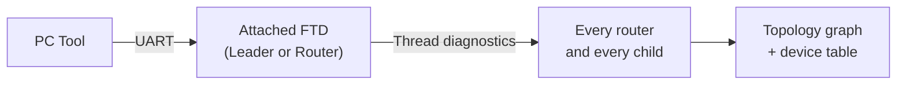
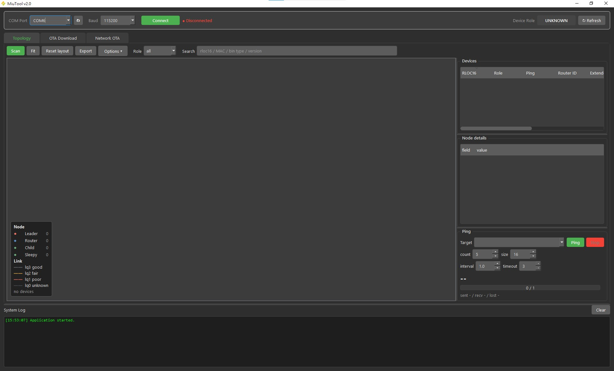
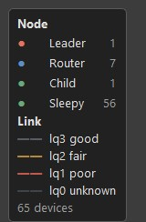
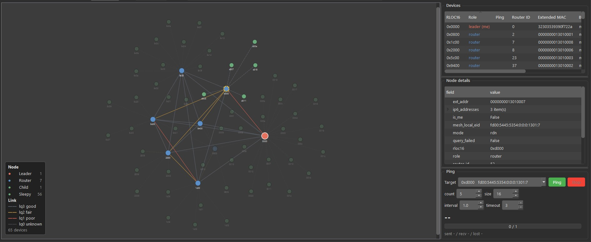
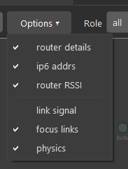
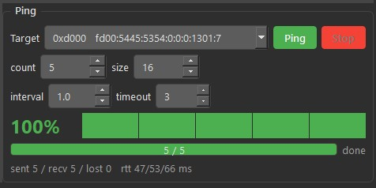

# Mesh Topology and Ping Guide

The **Topology** tab of the MiuTool draws the live shape of a running MIU mesh:
every device, who its parent is, which routers can hear each other, and how good
each link is. It is the fastest way to answer *"did all my nodes join?"*, *"which
node is the weak link?"*, and *"can the Leader still reach that far corner?"*
before or after an [OTA run](OTA-guide.md).

Nothing is written to the network. A scan only reads: it is safe to run at any
time on a production mesh.



---

## 1. Prerequisites

**The attached device must be a Leader or a Router.** The scan uses the Thread
mesh-diagnostic commands, and only a full router can run them. A sleepy child
(MTD) cannot — connect the tool to an FTD.

**The firmware must include mesh diagnostics.** Both macros below are already
enabled in the shipped example, so a stock `miu-ftd` build works with no changes:

```c
/* examples/sub-g/mesh-it-up/miu-ftd/include/app_miu_config.h */
#define OPENTHREAD_CONFIG_TMF_NETDIAG_CLIENT_ENABLE   1
#define OPENTHREAD_CONFIG_MESH_DIAG_ENABLE            1
```

If they are turned off in a custom build, **Scan** finds nothing and the System
Log says so:

```
[!!] this firmware has no 'meshdiag' command — rebuild the FTD with OPENTHREAD_CONFIG_MESH_DIAG_ENABLE=1
```

---

## 2. Running a Scan

<div align="center">


<em>Figure 1: The Topology tab before a scan — toolbar on top, graph on the left,
and the Devices table, Node details and Ping panel down the right</em>
</div>

1. Select the **COM Port** and **Baud Rate** at the top of the window and click
   **Connect**. The dashboard should show **Device Role: LEADER** (or ROUTER)
   and **Network State: Attached**.
2. Open the **Topology** tab — it is the first tab.
3. Click **Scan**.

The status text at the right end of the toolbar reports progress while the scan
runs, then settles on a summary such as `142 nodes (7 routers)  38.4s`. The
graph, the **Devices** table and the ping target list all fill in together —
Figure 3 shows the same tab once a 65-device mesh has been scanned.

A scan runs in three passes, visible in the System Log as `[phase0]`,
`[phase1]`, `[phase2]`:

| Pass | What it collects |
| :--- | :--- |
| **phase 0** | The attached device itself: state, RLOC16, bin type, firmware version, its own neighbours. |
| **phase 1** | The whole topology: every router, every router-to-router link, and every parent-child link with its link quality. |
| **phase 2** | One query per router for bin type and firmware version, plus each router's child table (this is where each child's MAC comes from). |

Phase 2 is the slow part on a large mesh. If you only need the shape of the
network, turn **router details** off in the **Options** menu — the scan then
finishes in a fraction of the time.

---

## 3. Reading the Graph

### 3.1 Legend

The legend sits in the bottom-left corner of the graph. It carries the role
colours **with a live head count per role**, the link-quality key, and the total
device count, so an exported picture explains itself.

<div align="center">


<em>Figure 2: The legend, showing how many devices of each role the scan found</em>
</div>

**Nodes.** Colour is the Thread role; size follows it too — the Leader is the
largest circle, then routers, then children.

| Colour | Role |
| :--- | :--- |
| Red | Leader |
| Blue | Router |
| Green | Child (a sleepy child is the same colour — whether it sleeps is shown in the **Mode** column, not on the dot) |

**Links.** A **solid** line is a router-to-router link; a **dashed** line is a
parent-child link. The colour is the OpenThread link quality, the receiver's own
grading of the link margin (0–3):

| Colour | Link quality | Meaning |
| :--- | :--- | :--- |
| Grey | lq3 | good — the normal case, deliberately drab so it recedes |
| Amber | lq2 | fair |
| Red | lq1 | poor — these are the links worth looking at |
| Dark grey | lq0 | unknown / not measured |

A healthy mesh is nearly all grey. Colour appears only where there is something
to investigate.

> Both ends of a router-to-router link grade it independently, and the two
> gradings are often different. Hover the link to see both, plus RSSI when it
> was collected.

### 3.2 Moving around

| Action | Result |
| :--- | :--- |
| Mouse wheel | Zoom in / out |
| Drag empty space | Pan |
| Drag a node | Move it; with **physics** on its neighbours follow and the graph settles again |
| Hover a node | Tooltip with RLOC16, role, MAC, bin type, firmware version, mode |
| Hover a link | Tooltip with the link quality from each end, and RSSI if collected |
| Click a node | Full details in **Node details**, and the graph dims everything except that node and what it links to |
| Click empty space | Undim everything |

**Fit** zooms out until the whole network is on screen without moving anything.
**Reset layout** places every node again from scratch, throwing away any node you
dragged. A scan does both by itself.

<div align="center">


<em>Figure 3: A 65-device mesh with router 0xd000 selected — its links stay lit
while the rest dims, and Node details fills in on the right</em>
</div>

---

## 4. Toolbar

### 4.1 Options

Six switches, all optional. The first three make the scan collect more and
therefore take longer; the last three are display only and cost nothing.

| Switch | Default | Effect |
| :--- | :--- | :--- |
| **router details** | on | One diagnostic query per router: bin type and firmware version. Turn off for a fast, shape-only scan. |
| **ip6 addrs** | on | Collect every device's IPv6 addresses. Ping then targets the mesh-local EID; without it, ping falls back to the RLOC address. |
| **router RSSI** | on | One extra query per router for its neighbour table, which adds RSSI to router-to-router links. Child links already carry RSSI. |
| **link signal** | **off** | Print the link quality and RSSI on every link. A number on each of a few hundred links is the biggest single source of clutter, which is why it is off — the tooltip already has it. |
| **focus links** | on | Clicking a device dims everything except that device and its links. |
| **physics** | on | Keep the graph springy. Turn it off to place nodes by hand and have them stay exactly where you drop them. |

<div align="center">


<em>Figure 4: The Options menu</em>
</div>

### 4.2 Role and Search

**Role** narrows the view to one role (`leader`, `router`, `child`,
`sleepy-child`). **Search** matches RLOC16, extended MAC, bin type or firmware
version; press Enter to jump the view to the first match. The count of matches
appears next to the box.

Matching devices stay bright and the rest dim, in both the graph and the
**Devices** table. This is also how you scope a ping sweep — see §5.

A common use: after an OTA, type the old firmware version into **Search** to see
exactly which devices did not take the update, and where they sit in the mesh.

---

## 5. Ping

The **Ping** panel measures whether a device is actually reachable, and how long
the round trip takes across the mesh.

**One device.** Pick it from the **Target** list (or click it in the graph, which
selects it in the list), set the parameters, and click **Ping**.

| Parameter | Default | Description |
| :--- | :--- | :--- |
| **count** | 5 | Number of packets |
| **size** | 16 | Payload bytes |
| **interval** | 1.0 | Seconds between packets |
| **timeout** | 3 | Seconds to wait for each reply |

The large percentage is the success rate. The strip beside it shows one cell per
packet as it happens, and the line underneath gives sent / received / lost and
the min / average / max round-trip time.

<div align="center">


<em>Figure 5: Pinging one router — 5 of 5 replies, round trip 47 / 53 / 66 ms</em>
</div>

**Every device.** Choose **all devices** as the target and click **Ping**. The
tool sweeps every device the Role/Search filter currently shows, one packet per
device per round, and **count** becomes the number of rounds. Results land in the
**Ping** column of the **Devices** table as `received/sent`, so you can sort by
it and find the unreachable nodes at a glance.

The attached device is never included in a sweep — pinging yourself proves
nothing.

A sweep of a large mesh takes a while: it is one packet per device per round, so
a 65-device network at the default 5 rounds is 325 packets. Narrow it with
**Role** or **Search** first, or drop **count** to 1, when you only want to know
who answers at all.

> A sleepy child answers on its own poll cycle, so its round-trip time is
> dominated by the poll period, not by the mesh. Long but consistent times on
> MTDs are normal; **lost** packets are what matters.

---

## 6. Export

**Export** asks for one file name and writes three files beside it:

| File | Contents |
| :--- | :--- |
| `<name>.csv` | One row per device: RLOC16, role, ping result, router id, extended MAC, bin type, firmware version, mode, Thread version, mesh-local EID |
| `<name>_links.csv` | One row per link: kind, both ends, link quality from each end, RSSI from each end |
| `<name>.png` | The graph exactly as drawn, with the legend painted into the corner |

The CSVs are UTF-8 with BOM, so Excel opens them directly. This is the usual way
to attach a network's state to a test report.

---

## 7. Troubleshooting

| Symptom | Cause and fix |
| :--- | :--- |
| `[!!] not connected` | Connect to a COM port first. |
| `no meshdiag in firmware` | The attached device was built without `OPENTHREAD_CONFIG_MESH_DIAG_ENABLE`. Rebuild and reflash it. |
| `scan returned no devices -- check the log` | The device answered but listed nothing. Check the System Log: usually the attached device is not a Leader/Router, or it is not attached to a network yet. |
| Routers appear but children do not | **router details** is off — the child tables come from phase 2. |
| A device is in the graph but ping fails | The device is in the topology (its parent reports it) but not answering IPv6. For a sleepy child, raise **timeout** first. |
| Ping targets look like RLOC addresses | **ip6 addrs** was off during the scan. Turn it on and scan again to ping the mesh-local EID. |
| The graph is a tangle | Click **Reset layout**, then **Fit**. Turn **physics** off if you want to arrange it by hand. |

---

## 8. Related Documents

* [`OTA-guide.md`](OTA-guide.md) — updating the firmware of the whole mesh
* [`miu-ftd-guide.md`](example/miu-ftd-guide.md) — building and running the FTD example
* [`miu-mtd-guide.md`](example/miu-mtd-guide.md) — building and running the MTD example
