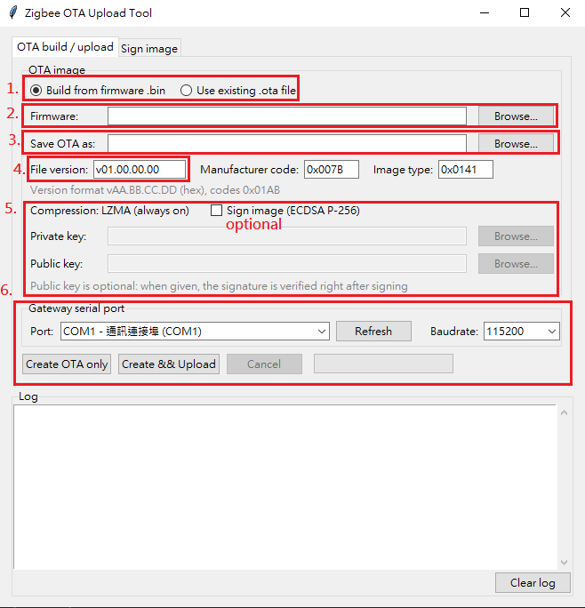

# Zigbee OTA Upgrade Guide

## Introduction

This document describes how to upgrade the firmware of an RT58x Zigbee device over the air (OTA)
through the Rafael Zigbee gateway module. It covers:

* The OTA file format used by RT58x Zigbee devices
* How to create an OTA file (LZMA compression and optional ECDSA signing) with the OTA Upload Tool
* How to upload the OTA file to the gateway module
* What happens on the device during and after the download

The overall flow is:

```
 firmware .bin
      |
      |  OTA Upload Tool (tools/Zigbee_Tool/ota_upload_tool.7z)
      |  - LZMA compression (always)
      |  - ECDSA P-256 signing (optional)
      |  - Rafael image header + Zigbee OTA header + AES-MMO hash
      v
   .ota file  --- UART (Gateway OTA commands 0xF000-xxxx) --->  Gateway module (OTA server)
                                                                     |
                                                                     | Zigbee OTA Upgrade cluster
                                                                     v
                                                               Zigbee device (OTA client)
                                                               - stores the image in the FOTA bank
                                                               - reboots, bootloader verifies,
                                                                 decompresses and installs it
```

## OTA File Format

The OTA file follows the Zigbee OTA File Format (Zigbee document 095264, section 6.3). All
multi-byte fields are little endian.

```
 offset 0    +-------------------------------------------+
             | Zigbee OTA header                (56 B)   |
 offset 56   +-------------------------------------------+
             | Upgrade image sub-element                 |
             |   tag 0x0000 (2 B) | length (4 B)         |
 offset 62   |   +---------------------------------------+
             |   | Rafael image header         (16 B)    |
 offset 78   |   +---------------------------------------+
             |   | Payload (compressed / signed image)   |
             +---+---------------------------------------+
             | Hash sub-element                          |
             |   tag 0x0003 (2 B) | length 16 (4 B)      |
             |   AES-MMO hash (16 B)                     |
             +-------------------------------------------+
```

### Zigbee OTA header (56 bytes)

| Field | Size | Value |
|---|---|---|
| OTA upgrade file identifier | 4 | `0x0BEEF11E` |
| OTA header version | 2 | `0x0100` |
| OTA header length | 2 | `0x0038` (56) |
| OTA header field control | 2 | `0x0010` |
| Manufacturer code | 2 | Must match the device's Manufacturer ID attribute (SDK examples: `0x007B`) |
| Image type | 2 | Must match the device's image type (SDK default: `0x0141`) |
| File version | 4 | Version of the new firmware, entered as `vAA.BB.CC.DD` |
| Zigbee stack version | 2 | `0x0002` (Zigbee PRO) |
| OTA header string | 32 | `"The latest and greatest upgrade."` |
| Total image size | 4 | Size of the whole OTA file in bytes |

### Upgrade image sub-element

Tag `0x0000`, followed by a 4-byte length, then the Rafael image header and the payload. The
device stores everything from file offset 62 (the Rafael image header) onwards.

### Rafael image header (16 bytes)

The Rafael image header tells the device how the payload was built, so the bootloader knows
whether it must verify a signature and decompress the image.

| Offset | Field | Size | Description |
|---|---|---|---|
| 0 | Magic | 4 | `0x544F4652` (`"RFOT"`) |
| 4 | Version | 1 | `1` |
| 5 | Header size | 1 | `16` |
| 6 | Image info | 1 | Bit 0 (`0x01`): compressed. Bit 1 (`0x02`): signed |
| 7 | Reserved | 1 | `0` |
| 8 | Signature length | 4 | Signed images: length of the compressed data covered by the outer signature. Unsigned: `0` |
| 12 | Image length | 4 | Length of the payload that follows the header |

### Payload

| Image info | Payload |
|---|---|
| `0x01` (compressed) | `LZMA(firmware)` |
| `0x03` (compressed + signed) | `sign(LZMA(sign(firmware)))` |

* **Compression** is always applied. The format is LZMA "alone" (`.lzma`): 5-byte properties,
  8-byte uncompressed size, then the LZMA1 stream (dictionary 64 KB, lc=3, lp=0, pb=2).
* **Signing** uses ECDSA P-256 with SHA-256. The firmware is signed, then compressed, then the
  compressed data is signed again, so the device can check the image before and after
  decompression. Each signature is appended as a 256-byte trailer, aligned to 256 bytes (magic
  `0x58BF4E53`, data length, then the signature r and s values). Before the first signature, the
  firmware length is written at offset `0x28` of the firmware image.
* The firmware (after signing, if enabled) must not exceed 1984 KB, and the payload must fit in the
  device's FOTA bank.

### Hash sub-element

Tag `0x0003`, length 16, followed by the AES-MMO hash (Zigbee spec B.6) of everything from the
first byte of the OTA header to the end of the upgrade image sub-element.

## Creating the OTA File

Use the OTA Upload Tool to create the OTA file. It compresses the firmware, optionally signs it,
and builds all the headers above.

### Getting the tool

Extract [`tools/Zigbee_Tool/ota_upload_tool.7z`](../../tools/Zigbee_Tool/ota_upload_tool.7z) and
launch the tool. It opens the **Zigbee OTA Upload Tool** window, which has two tabs:

* **OTA build / upload**: creates an OTA file from a firmware `.bin` and/or uploads an OTA file to
  the gateway module.
* **Sign image**: signs a firmware `.bin` only, without compression or OTA headers.

The tool's source code is in
[`examples/zigbee/gateway-module/ota_upload_tool_src/`](../../examples/zigbee/gateway-module/ota_upload_tool_src/).
To run it from source, install Python 3 with `pyserial` (and `cryptography` if you need signing),
then run `start_gui.bat` or `python ota_gui.py`.

### Building an OTA file in the GUI

The numbers in the screenshot match the steps below.



1. On the **OTA build / upload** tab, select **Build from firmware .bin**.
2. **Firmware**: select the device firmware `.bin` produced by the SDK build
   (`<project>_<CHIP>.bin` in the build directory).
3. **Save OTA as**: the output `.ota` file (filled in automatically).
4. Set the OTA header fields:
   * **File version**: `vAA.BB.CC.DD` (hexadecimal, for example `v01.02.01.01`). Use a version
     different from (normally higher than) the device's current firmware version.
   * **Manufacturer code**: four hex digits, for example `0x007B`. Must match the device.
   * **Image type**: four hex digits, for example `0x0141`. Must match the device.
5. Compression (LZMA) is always on. To sign the image, check **Sign image (ECDSA P-256)** and select:
   * **Private key**: ECDSA P-256 (prime256v1) private key, unencrypted PEM.
   * **Public key** (optional): the matching public key, PEM. When given, the tool verifies each
     signature right after signing.
6. Click **Create OTA only** to write the `.ota` file. To write it and upload it to the gateway
   module in one step, first select the **Gateway serial port** and **Baudrate**, then click
   **Create && Upload** (see the next section).

The log shows the size before and after compression, the signature length and the AES-MMO hash
of the generated file.

A key pair can be generated with OpenSSL, for example:

```bash
openssl ecparam -name prime256v1 -genkey -noout -out private.pem
openssl ec -in private.pem -pubout -out public.pem
```

Keep the private key secret. The device's bootloader must hold the matching public key to accept
signed images.

## Uploading the OTA File to the Gateway Module

The gateway module acts as the Zigbee OTA server. The OTA file is first uploaded to it over UART
with the gateway OTA commands (`0xF000-xxxx`), then the gateway serves it to the Zigbee devices.

For the command protocol, the upload flow and the rules the host must follow (block order,
retransmission, CRC32 check, busy status while a device is downloading), refer to
[RT58x Zigbee Gateway Command Manual, section 5 "Over the Air(OTA) Upgrade Management"](RT58x_Zigbee_Gateway_Command_Manual.md#5-over-the-airota-upgrade-management).
In short, the upload sequence is:

1. OTA Upload Start Request (`0xF000-0000`), with the CRC32 of the whole OTA file
2. OTA Image Block Request (`0xF000-0001`) for every block, until OTA Upload End Response (`0xF000-8002`)
3. Insert OTA Candidate Request (`0xF000-0005`)
4. OTA File Insert Request (`0xF000-0003`)

You can implement this sequence in your own host software, or use the OTA Upload Tool:

1. Connect the gateway module's command UART to the PC.
2. On the **OTA build / upload** tab, either build from a firmware `.bin` as described above, or
   select **Use existing .ota file** and pick an `.ota` file. For an existing file, the file
   version, manufacturer code and image type are read from its header.
3. Under **Gateway serial port**, select the port and baudrate (default 115200).
4. Click **Create && Upload** (or **Upload** for an existing `.ota` file).
5. Wait for "OTA image uploaded and set as candidate." Erasing the FOTA bank at the start and
   verifying the image at the end can each take several seconds.

The tool only accepts `.ota` files that contain the Rafael image header and are compressed. OTA
files made by older tools must be rebuilt from the firmware `.bin`.

After the image is inserted, the gateway notifies the devices (Image Notify), and every device
whose manufacturer code and image type match downloads it.

## Device-Side Behavior

The OTA client handling is implemented in `raf_device_cb()` in
[`components/network/zigbee/zboss_port/src/zb_freertos.c`](../../components/network/zigbee/zboss_port/src/zb_freertos.c).

### Requirements on the device application

* The device must declare the OTA Upgrade cluster in the client role (see
  `ota_upgrade_cli_attr_list` in the example `zcl_construction.c` files).
* The image's **manufacturer code** must equal the device's Manufacturer ID attribute
  (`manufacturer` in the examples, default `123` = `0x007B`).
* The image's **image type** must equal `raf_image_type` (default `321` = `0x0141`). It is a weak
  symbol: define `uint16_t raf_image_type` in your application to use another value, and build the
  OTA file with the same image type.
* The current firmware version is the CurrentFileVersion attribute (`file_version` in the
  examples). Update it in each new firmware release.

If the manufacturer code or the image type does not match, the device rejects the image at the
start of the download.

### Download and upgrade

1. **Start**: the device checks the manufacturer code and image type and erases its FOTA bank.
2. **Receive**: blocks must arrive in order. The device skips the 62-byte Zigbee OTA header,
   parses the Rafael image header (magic, version, image info, signature length and image length
   are validated), and writes the payload into the FOTA bank. The hash sub-element after the
   payload is not stored.
3. **Check**: the download succeeds only if a valid Rafael image header was received and the whole
   payload was stored.
4. **Finish**: the device writes the FOTA information for the bootloader (image info, signature
   length, image length, CRC32 of the FOTA bank and the new file version), then reboots after
   about 3 seconds.
5. **Bootloader**: verifies the signature(s) for signed images, decompresses the image and
   installs it to the application area.

If any check fails, the device reports an error to the OTA server and does not mark the image as
ready, so the current firmware keeps running.

### Troubleshooting

The device prints these messages on its debug UART:

| Log message | Cause |
|---|---|
| `OTA: Rafael image header not found` | The OTA file was not made by the OTA Upload Tool (or an older version of it). Rebuild it from the `.bin`. |
| `OTA: unsupported Rafael header version ...` | The OTA file was made by a newer tool than the device firmware supports. |
| `OTA: unknown image info 0x..` | The image info field has bits other than compressed/signed set. |
| `OTA: invalid image length ...` | The payload is empty, larger than the FOTA bank, or larger than the OTA file. |
| `OTA: invalid signature length ...` | The signature length of a signed image is inconsistent with the image length. |
| `OTA: image incomplete, ...` | The download ended before the whole payload was received. |
| `OTA: no valid image in the FOTA bank, skip update` | No valid image was stored; the device does not reboot into the bootloader update. |
